# Kiến trúc

Tài liệu này là bản đồ tổng thể của WriTory: thành phần nào nằm đâu, nối với nhau ra sao, dữ liệu đi đường nào. Nó không chép chi tiết của tài liệu khác. Schema đồ thị nằm ở `docs/graph-schema.md`, guardrail và test ở `docs/security.md`, lệnh chạy và biến môi trường ở `docs/runbook.md`, bộ đo ở `docs/eval.md`. Lý do của từng lựa chọn xem các mục `D-n` trong `docs/decisions.md`. Mọi con số (trần, ngưỡng, tên model, giá) nằm trong `config/`, tài liệu chỉ nêu tên khoá.

Quy ước: đường dẫn code tính từ `backend/src/writory/`, trừ khi ghi rõ. Nguồn được dẫn bằng file và tên hàm, không dẫn số dòng, vì số dòng hay đổi. Chỗ nào là suy luận, không đọc thẳng từ code, thì có ghi "(suy luận)".

## 1. Ngữ cảnh hệ thống

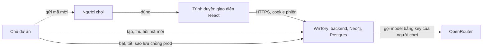

- **BYOK (D-2).** Người chơi dán key OpenRouter của mình (`PUT /player/key`, `api/keys.py`). Key được mã hoá Fernet trước khi lưu (`safety/crypto.py` `KeyCipher`, `db/keys.py`), và chỉ được giải mã ở hai chỗ: khi gọi model (`api/deps.py` `PlayerLLM.open`), và khi `GET /player/key` tính bốn ký tự cuối để hiện (`api/keys.py` `key_status`). Key `OPENROUTER_API_KEY` của chủ dự án chỉ dùng cho bộ đo và lệnh xuất kịch bản video của admin (mục 3), không bao giờ cho app; phần lớn đọc nó qua `quality/bench_d.py` `load_keys` (bộ xuất, `bench_run`, bài A, C, D, E), riêng `safety/bench_g5.py`, `bench_g9.py` qua `config.py` `Settings`.
- **Mã mời (D-89).** Chủ dự án tạo và thu hồi mã bằng lệnh `python -m writory.db.invites` (`db/invites.py`). Người chơi nhập mã ở màn đăng nhập để có phiên (mục 10).
- **Bật, tắt (D-103).** Chủ dự án tự bật chồng prod khi có người chơi và tắt khi xong, bằng script `deploy/prod-up.ps1` và `deploy/prod-down.ps1`. Cách chạy: `docs/runbook.md`, mục Deploy.

## 2. Thành phần runtime

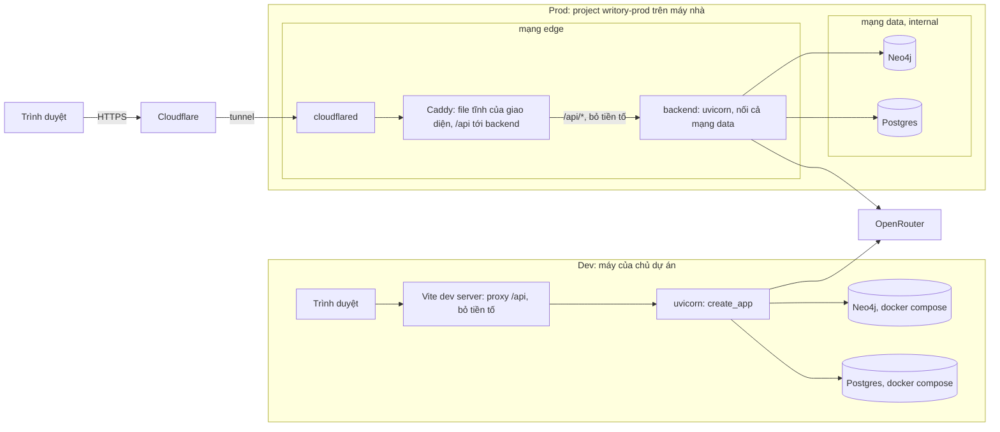

**Dev.** `docker-compose.yml` chỉ chạy Neo4j và Postgres. Backend (`uvicorn writory.api:create_app --factory`) và frontend (Vite) chạy ngoài Docker. Vite chuyển `/api` tới backend và bỏ tiền tố (`frontend/vite.config.ts`), vì FastAPI không có tiền tố đường dẫn. Backend không bật CORS: giao diện và API phải cùng origin. Có thể chạy giao diện với máy chủ giả, không cần backend (`npm run dev:mock`, `frontend/src/mock/`, D-69). Lệnh: `docs/runbook.md`.

**Prod (D-103).** `docker-compose.prod.yml`: không service nào mở cổng ra máy, đường vào duy nhất là tunnel. Mạng `data` là `internal`, nên Neo4j và Postgres không ra Internet; `cloudflared` và Caddy không tới được hai kho này. Backend nằm ở cả hai mạng: mạng `edge` để nhận yêu cầu từ Caddy và gọi OpenRouter, mạng `data` để tới hai kho. Caddy (`deploy/Caddyfile`) phục vụ bản build của giao diện và chuyển `/api/*` tới backend, không đệm SSE. Backend chỉ tin header địa chỉ máy khi yêu cầu đến từ IP của proxy (`TRUSTED_PROXIES`, `api/deps.py` `client_address`).

**`create_app`** (`api/app.py`) đọc biến môi trường và `config/` lúc gọi factory. Router của người chơi chỉ được gắn khi `AUTH_MODE=invite`, hoặc khi `ENABLE_DEV_ROUTES` bật ở chế độ `dev` (D-41, D-89). `/health` luôn có. Với `APP_ENV=prod`: `config.prod_problems` chặn cấu hình nguy hiểm ngay lúc khởi động; lifespan chạy migration Postgres, `ensure_schema` của Neo4j, rồi áp lại chương kẹt `pending` (`prepare_storage`, `reconcile_at_startup`, D-105); trang OpenAPI bị tắt.

## 3. Module backend

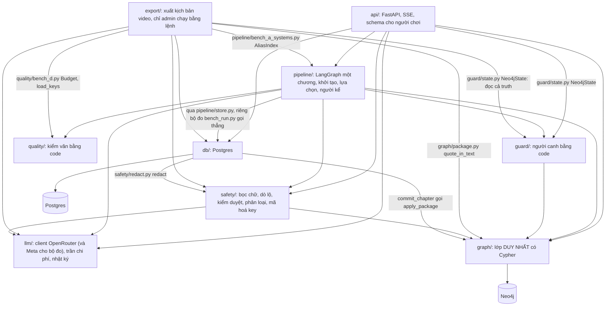

- **Luật G10: mọi Cypher chỉ nằm trong `graph/`.** Mọi hàm công khai của `graph/` đọc hay ghi dữ liệu truyện đều kiểm `story_id` bằng `require_story_id` (`graph/story.py`), trực tiếp hoặc qua hàm chung (ví dụ `_read` trong `graph/queries.py`, hay `apply_package`), và mọi câu Cypher lọc theo `story_id`. Các module khác đọc đồ thị qua hàm của `graph/`. Ví dụ, `guard/state.py` `Neo4jState` gọi các hàm cùng tên trong `graph/queries.py`. Test nhanh `tests/unit/test_cypher_boundary.py` quét mọi file `.py` của `src/writory` ngoài `graph/`, tìm mệnh đề Cypher và lời gọi chạy truy vấn của driver (D-106). Hiện không có ngoại lệ.
- **Phụ thuộc vào kiểu dữ liệu.** `pipeline/story_plan.py` (`StoryPlan`) chỉ là kiểu dữ liệu, nên `guard/`, `safety/leak.py` và `db/` đều nhập nó. `graph/context.py` nhập `safety/wrap.py` (`UserAuthored`) để bọc chữ người chơi viết khi đọc lại từ đồ thị (G4). Hai mũi tên này không vẽ trên sơ đồ.
- **Gốc gói.** `config.py` (nạp và kiểm `config/*.yaml` bằng pydantic) và `errors.py` (mã lỗi, câu cho người chơi) được mọi module dùng (D-13). Hai file này không vẽ trên sơ đồ.
- **Bộ đo nhập thêm.** Mũi tên chỉ do bộ đo tạo ra thì không vẽ, ví dụ `quality/bench_d.py` và `quality/bench_bakeoff.py` nhập `llm/` và `pipeline/`. Riêng `export/` dùng lại hạ tầng của bộ đo (trần, đọc key, chỉ mục tên), nên các mũi tên đó có vẽ.
- **`export/` (D-125) không có đường nào từ `api/` hay giao diện.** Bộ xuất kịch bản video đọc toàn bộ `truth` (kể cả bí mật) nên chỉ chạy bằng lệnh của admin cầm DB; nó chỉ đọc, và không module nào ngoài chính nó nhập nó (test: `tests/unit/test_video_export_security.py`). Luồng:

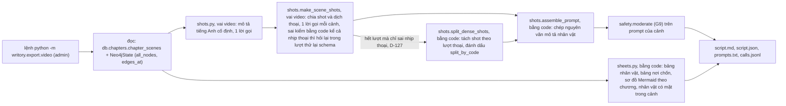
  Mọi lời gọi model đi qua `ExportClient`: giữ chỗ chi phí tối đa trong `--budget` trước khi gọi (G8), không ghi chữ truyện vào nhật ký. Lệnh chạy: `docs/runbook.md`.
- **Bộ đo** nằm trong chính module được đo (D-24), ví dụ `guard/bench_b.py`, `pipeline/bench_a*.py`. Xem mục 12.

## 4. Khởi tạo truyện

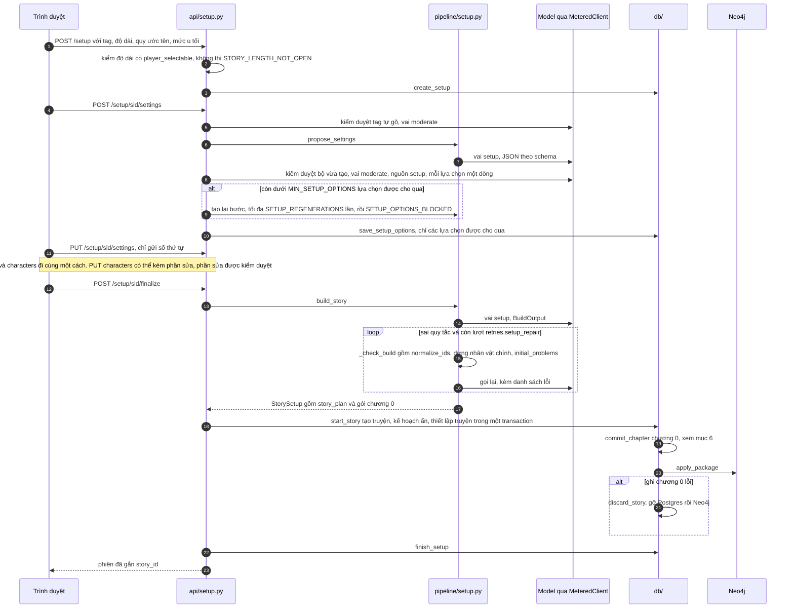

- Máy chủ giữ các lựa chọn của mỗi bước trong `setup_sessions`; trình duyệt chỉ gửi số thứ tự (`api/setup.py`). POST một bước đã có lựa chọn thì trả lại, không gọi model. Chi phí của khởi tạo tính theo phiên (`llm.metered(setup_id=...)`).
- Lựa chọn do model tạo qua kiểm duyệt đầu ra trước khi lưu hay trả về (`api/setup.moderated_options`, G9, D-137): một lời gọi cho cả bộ ở mức u tối của phiên; lựa chọn bị chặn bị bỏ, nên một bước có thể chỉ còn hai lựa chọn. Kiểm duyệt lỗi thì không lưu gì. Chốt không trả chữ model nào mới.
- `pipeline/setup.py` không ghi gì. Nhân vật chính do code dựng từ chữ người chơi, mang `user_authored: true`. Gói chương 0 chỉ có một hé lộ, là nhân vật chính (D-38, D-74). Code chuẩn hoá id (D-54) rồi mới kiểm quy tắc. Mạch phải gỡ khai bí mật trả lời nó (`answered_by`); khoảng gỡ bắt đầu trước khoảng lộ của bí mật đó thì code dời trên cả `story_plan` lẫn nút `Thread`, không tốn lượt sửa (`story_plan.align_thread_windows`, D-135); id fact thường (không phải bí mật) trong `answered_by` thì code bỏ, cũng không tốn lượt sửa. Chi tiết luật của gói chương 0: `docs/graph-schema.md`, mục "Chương 0".
- Bước dựng cũng sinh ngoại hình cố định cho nhân vật (`appearance`, kể cả nhân vật chính qua `protagonist_appearance`) và cảnh sắc cho nơi chốn (`visual`), nền cho xuất kịch bản video (D-118, D-120). Chúng là thuộc tính tuỳ chọn trên nút, lớp `truth`; `story_plan` không đổi. Ngữ cảnh viết đọc `appearance` của người có mặt và nhân vật lân cận khi `limits.context.character_appearance_max_chars` > 0; `visual` chưa vào đề nào của đường viết; đề bảng mô tả của bộ xuất video đọc nó (`export/shots.py` `sheet_messages`).
- `story_brief` là thiết lập truyện người chơi đã đọc. Nó được lưu theo truyện; mọi đề chương sau bọc nó như dữ liệu, và bộ dò lộ coi nó là chữ người chơi đã thấy (D-52).
- Thử lại: mỗi lời gọi `_ask` có lớp thử lại schema và lớp thử lại mạng (`with_json_retries`), kể cả từng lượt sửa (D-54). `api/setup.py` không bọc thêm lớp nào, nên lỗi mạng chỉ gọi lại đúng lời gọi hỏng (D-105).

## 5. Đường đi một chương

Đồ thị LangGraph thật, dựng trong `_build` (`pipeline/chapter.py`) và biên dịch một lần:

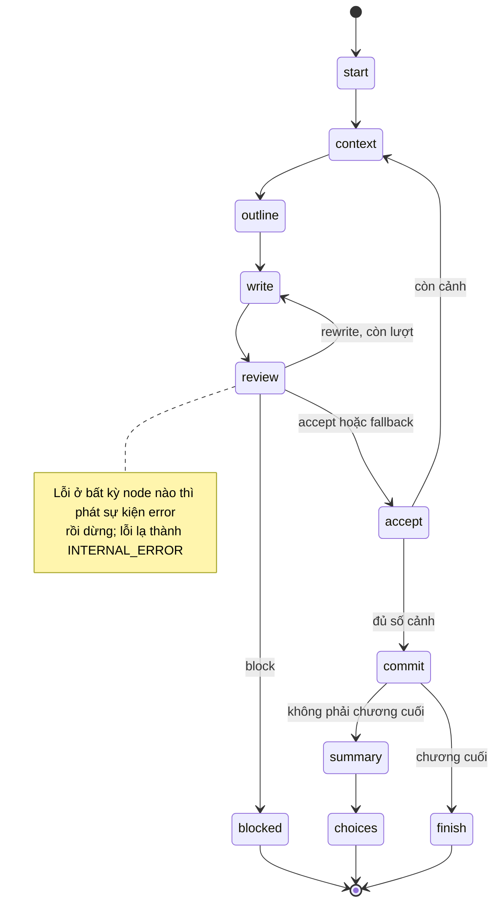

| Node | Hàm | Việc chính | Vai model |
|---|---|---|---|
| `start` | `_start` | `_preflight` (mọi model và ngưỡng phải đặt, `ensure_budget`); chương `pending` thì `CHAPTER_PENDING`; quá chương cuối thì `STORY_COMPLETE`; dựng danh mục thực thể, tác động của lựa chọn dẫn tới chương (`_choice_prelude`, D-55), tóm tắt chương trước, kho đoạn trang nếu bật (D-85) | |
| `context` | `_context` | `writer_context` ở chương trước (lớp `truth`); mục tiêu chương `chapter_goals` (D-49) trên nền đã commit cộng các cảnh trước; mốc đã diễn ra (dấu ở nút `Chapter`, cộng mốc các cảnh trước của chương) thì ghi "đã xảy ra" thay vì giục lại (D-116); cao trào có dấu trước khoảng chỉ là ứng viên, cao trào đã xong thì mục tiêu vài chương sau đòi viết hậu quả (D-142) | |
| `outline` | `_outline` | dàn ý cảnh; cảnh cuối mà chưa dàn ý nào định gỡ mạch đến hạn thì thử lại (D-82); id lạ bị lọc (G11) | `outline` |
| `write` | `_write` | văn cảnh, hoặc viết lại kèm lỗi của bản trước | model viết theo `writer_tier` |
| `review` | `_review` | chuỗi kiểm ở bảng dưới, rồi ra `verdict` | `extract`, `moderate`; `overreach` chỉ khi hành động tự viết dẫn tới chương vượt luật (D-138) |
| `accept` | `_accept` | phát `scene_ready` (chữ cảnh tới người chơi), giữ gói của cảnh | |
| `blocked` | `_blocked` | phát `scene_blocked`, dừng chương, không ghi gì | |
| `commit` | `_commit` | `merge_scene_packages` rồi `store.commit` (mục 6) | |
| `summary` | `_summary` | tóm tắt chương cho đề chương sau, luôn gọi nhân vật chính bằng tên chuẩn trong đồ thị (D-112); lỗi chỉ ghi log, không làm hỏng chương | `summary` |
| `choices` | `_choices` | `make_choices` từ `player_view` (G1) | `choices`, `moderate` |
| `finish` | `_finish` | chương cuối của kế hoạch: phát `story_finished`, không tóm tắt, không lựa chọn (D-50) | |

**Thứ tự kiểm trong `_review`.** Mọi bước chạy trên đúng chữ sẽ hiện, đã chuẩn hoá NFC và dấu gạch (D-31).

| # | Bước | Code | Mức lỗi |
|---|---|---|---|
| 1 | Kiểm văn: độ dài, lặp, sáo ngữ, chữ khác hệ, lời thoại, ngôi kể; lọt suy luận hay chữ của prompt | `quality/checks.py` `check_scene`, `check_meta_leak` | viết lại; riêng `META_LEAK` là chặn (D-30). Bản bị cắt vì quá dài thêm lỗi `truncated`, mức viết lại |
| 2 | Trích thay đổi: model `extract`, rồi code bỏ từng cạnh sai luật (id lạ, câu trích không nguyên văn G3, gỡ mạch không có câu trích hay chưa tới khoảng gỡ, `known_as` trùng tên nút khác…); cùng lời gọi, bộ trích đánh dấu mốc kế hoạch đã diễn ra, code chỉ nhận mốc có trong mục "chưa xảy ra", chưa đánh dấu, kèm câu trích nguyên văn (D-116) | `pipeline/extract.py` `extract_changes`, `to_package` | cạnh sai bị bỏ, không thành lỗi của cảnh |
| 3 | Tự hé lộ nút có tên mà trang nêu nguyên văn | `safety/reveal.py` `auto_reveals` | thêm cạnh, không thành lỗi (D-62) |
| 4 | Người canh trên nền đã commit, cộng các cảnh trước, cộng cảnh này | `guard/rules.py` `check_scene_package` | `early_reveal` là chặn; các loại khác là viết lại. Cạnh bị báo bị cắt bằng `_prune` (D-92) |
| 4b | Chữ sổ tay sẽ hiện: chữ lớp truth của nút chữ (Fact, Event, Lie, kể cả Fact mới) mà gói đưa vào `player_view` không được có tên bị cấm hay nhóm `leak_terms` (`scope="player_path"`) mà câu trích của nút không nói. Sau người canh, để người canh vẫn thấy mọi hé lộ | `pipeline/extract.py` `drop_unquoted_leaks`, `safety/leak.py` `unquoted_leaks` | cạnh đưa nút vào bị bỏ, Fact mới bị bỏ cả nút; không chặn cảnh (D-93, D-134) |
| 5 | Dò lộ trên chữ cảnh, `scope="scene"` | `safety/leak.py` `check_leaks` | chặn |
| 6 | Kiểm duyệt nội dung G9, ở mức u tối của truyện | `safety/moderate.py` `moderate`, `decide` | chặn |
| 7 | Chỉ khi hành động tự viết dẫn tới chương bị bộ phân loại chấm vượt luật (`ChapterRequest.feasibility`): trang, tính tới hết cảnh này cùng các cảnh trước của chương, có để điều vượt luật xảy ra không (G6, D-138) | `safety/overreach.py` `check_overreach`, `needs_rewrite` | vượt luật thế giới: chỉ `failed` qua, `cost` và `granted` là chặn; vượt sức nhân vật: `failed`, `cost` qua, `granted` là chặn |

Phán quyết: không lỗi thì `accept`. Có lỗi và còn lượt (`limits.retries.rewrite_per_scene`) thì `rewrite`. Hết lượt mà còn lỗi chặn: có bản trước không lỗi chặn thì `fallback` và hiện bản đó (D-50), không có thì `block`. Hết lượt mà chỉ còn lỗi mức viết lại thì `accept`. `scene_blocked` mang `SCENE_OVERREACH_BLOCKED` khi lỗi chặn duy nhất là bước 7, còn lại `SCENE_LEAK_BLOCKED` (`blocked_code`). Chương có hành động vượt luật còn có câu mục tiêu theo loại vượt luật (thế giới: thất bại; nhân vật: thất bại hoặc trả giá) trong đề dàn ý và đề viết (`pipeline/pacing.py`). Luật của từng phép kiểm: `docs/security.md` (G2, G3, G9) và `docs/graph-schema.md` (bộ trích, tự hé lộ).

**Chạy và huỷ.** `ChapterRun` chạy đồ thị trong một task riêng. Hàng đợi sự kiện có kích thước nhỏ, để đồ thị không chạy xa hơn người đọc. `aclose()` chờ đồ thị dừng hẳn rồi mới trả về, để API nhả khoá (D-63).

## 6. Đường ghi chương

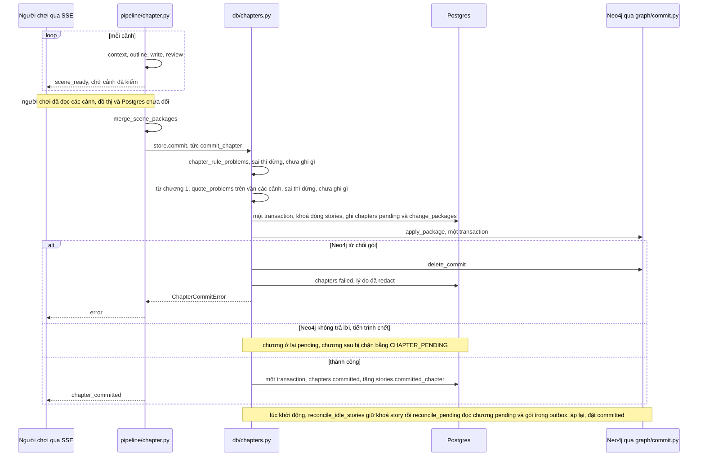

- **Postgres là nguồn gốc (D-6).** `commit_chapter` (`db/chapters.py`) ghi chương `pending` kèm gói vào bảng `change_packages` (outbox), rồi gọi `apply_package` (`graph/commit.py`), rồi mới đặt `committed`. `stories.committed_chapter` chỉ đổi ở `_mark_committed`. Mọi lần đọc lấy số chương từ `db.current_chapter`, nên chỉ thấy chương đã commit. Luật của gói: `docs/graph-schema.md`, mục "Ghi theo `commit_id`".
- **`apply_package`** chạy cả gói trong một `execute_write`. Nút và cạnh được `MERGE` theo `(story_id, id)` và mang `commit_id`, nên áp lại cùng gói là an toàn. Lỗi ở bất kỳ bước nào làm Neo4j rollback cả gói.
- **`delete_commit`** gỡ mọi thứ một commit tạo ra và mở lại các cạnh nó đã đóng. Nó từ chối nếu có commit khác dựa vào commit này. Hàm này được gọi khi Neo4j từ chối gói.
- **`reconcile_pending`** áp lại các chương còn `pending`. Lúc app khởi động ở prod, `db.reconcile_idle_stories` gọi nó cho từng truyện, sau khi giữ được khoá `story` của truyện đó (D-46). Mọi đường ghi chương giữ khoá này, kể cả chương 0 (`start_story`), nên truyện đang có việc ở tiến trình khác bị bỏ qua (`busy`), còn khoá của tiến trình đã chết thì Postgres đã nhả. Lỗi khi áp lại chỉ vào log, app vẫn lên (D-105). Ở dev và khi cần chạy tay: `docs/runbook.md`, mục "Ghi chương bị kẹt `pending`".
- **Chữ cảnh hiện trước khi chương được ghi.** `_accept` phát `scene_ready` ngay sau khi cảnh qua kiểm, trước `_commit`. Đây là thiết kế của D-1: cảnh sau được viết trong lúc người chơi đọc cảnh trước, và đồ thị chỉ ghi một lần sau cảnh cuối. Hệ quả đọc được trong code: nếu bước ghi lỗi, người chơi đã đọc các cảnh mà đồ thị và Postgres không đổi. Khi đó lần viết sau tạo lại chương với `commit_id` mới (suy luận).
- Khởi tạo đi cùng đường này với chương 0 (`db/plans.py` `start_story`), dưới khoá `story` của truyện mới (D-105). Lỗi ở chương 0 thì `discard_story` gỡ cả truyện.

## 7. Hai lớp và ranh giới G1

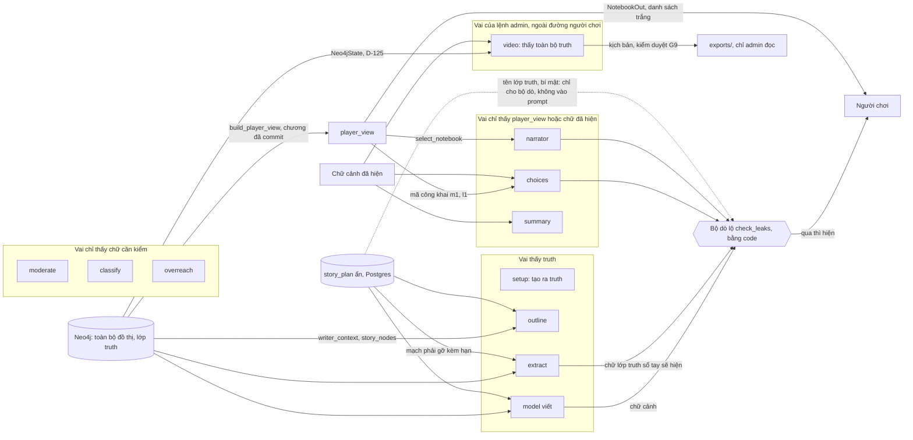

- **Một định nghĩa `player_view`:** hàm thuần `build_player_view` (`graph/player_view.py`). Có hai nơi gom bản ghi cho hàm này: `player_view` đọc từ Neo4j, và `guard/state.py` `player_view_of` đọc trên nền đã commit cộng gói chưa ghi. Hai đường được test so với nhau. Định nghĩa: `docs/graph-schema.md`, mục `player_view`.
- **Đường người chơi luôn đọc ở chương đã commit:** `db.committed_player_view`, `api/deps.py` `get_player_view`. Phản hồi API dùng schema danh sách trắng, `extra="forbid"` (`api/schemas.py` `NotebookOut`). Id lớp `truth` không ra ngoài; người chơi và model phục vụ người chơi chỉ thấy mã công khai (`public_entries`, `public_lies`, D-40).
- `choices` và `narrator` có nhận tên lớp `truth` và `story_plan`, nhưng chỉ để chạy bộ dò lộ bằng code sau khi model trả lời. Hai thứ này không vào prompt.
- Test cho G1 kiểm context mà model nhận được (`FakeLLM.calls`). Cách test từng đường: `docs/security.md`, cột Test của G1.

| Vai | Đầu vào | Thấy `truth` | Schema đầu ra | Nơi gọi |
|---|---|---|---|---|
| `setup` | chữ người chơi chọn hay sửa (bọc G4) | tạo ra nó | `SettingsOutput`, `PlotsOutput`, `CharactersOutput`, `BuildOutput` | `pipeline/setup.py` `_ask` |
| `outline` | `render_writer_context`, mục tiêu chương, tên đang cấm (D-91), đoạn trang nếu bật (D-85), các cảnh trước | có | `SceneOutline` | `pipeline/scene.py` `outline_messages`, gọi từ `_outline` |
| model viết | như dàn ý, cộng dàn ý, cộng bản trước và lỗi khi viết lại; system là hướng dẫn văn phong | có | chữ thường, không schema | `pipeline/scene.py` `writer_messages`, gọi từ `_write` |
| `extract` | danh mục mọi nút, cạnh đang mở, mạch phải gỡ kèm hạn, văn cảnh (bọc) | có | `ExtractOutput`, rồi `to_package` | `pipeline/extract.py` `extract_changes` |
| `summary` | chỉ chữ chương đã hiện (bọc) | không | `SummaryOutput` | `pipeline/summary.py` `summarize_chapter` |
| `choices` | sổ tay dựng từ `player_view` (mã công khai), cảnh cuối đã hiện, cờ đứng yên chỉ đúng hay sai (D-98: ở yên một nơi; D-112: nhiều chương liền không đổi trạng thái nào) | không | `ChoicesOutput`; tham chiếu ngoài sổ tay bị bỏ riêng, không bỏ cả bộ (D-114) | `pipeline/choices.py` `make_choices`, từ `_choices` và `POST /stories/{id}/choices` |
| `narrator` | sổ tay từ `player_view`, đủ hay một phần (`select_notebook`), câu hỏi (bọc) | không | `NarratorOutput`; câu sắp hiện qua dò lộ, lưới úp mở rồi kiểm duyệt, bị chặn thì `NARRATOR_ANSWER_BLOCKED` và trả lại lượt (D-137) | `pipeline/narrator.py` `ask_narrator_reply` |
| `classify` | chữ ô tự viết và thiết lập truyện người chơi đã đọc (`stories.brief`), đều bọc | không | `Classification`: nhãn enum (G5) và `feasibility` enum (G6, D-138) | `safety/classify.py` `classify_action` |
| `overreach` | hành động tự viết dẫn tới chương, văn các cảnh trước của chương và bản đang soát (bọc); loại vượt luật là chữ của code | không | `OverreachCheck`, kết luận enum (G6, D-138) | `safety/overreach.py` `check_overreach`, từ `_review` |
| `moderate` | chỉ chữ cần kiểm: đầu vào, cảnh, bộ lựa chọn, lựa chọn khởi tạo, câu trả lời người kể (bọc; D-137) | không | `ModerationOutput`, `ChoicesModerationOutput` | `safety/moderate.py` `moderate`, `ensure_input_allowed` |
| `video` | nhân vật (ngoại hình, tính cách, quá khứ), nơi chốn, quan hệ, nơi của nhân vật chính, chữ cảnh đã ghi (chữ truyện và chữ người chơi bọc G4) | có, toàn bộ, kể cả bí mật; chỉ lệnh admin, không có đường tới người chơi (D-118, D-125) | `SheetOutput`, `SceneOutput` | `export/shots.py` `make_sheet`, `make_scene_shots`, gọi từ `export/video.py` |

Model của từng vai và danh sách mức model viết: `config/models.yaml` (`roles`, `writer_tiers`).

## 8. Truy hồi

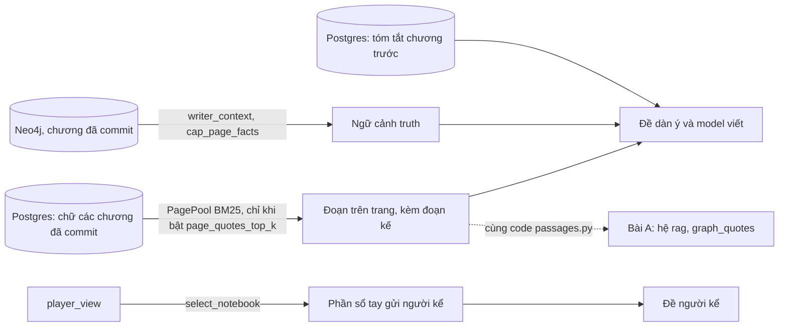

- **`writer_context`** (`graph/context.py`) đọc lớp `truth` ở cuối chương trước: người có mặt, quan hệ, Fact họ biết, lời nói dối chưa bị phát hiện, bí mật kèm trạng thái, đồ vật (D-90), lân cận theo cạnh, mạch đang mở. `render_writer_context` ghi cạnh tên thật tên mà người đọc biết (`reader_names`, D-91). Danh sách đầy đủ: `docs/graph-schema.md`, mục "Ngữ cảnh cho model viết". `cap_page_facts` giới hạn số Fact sinh từ trang (D-93).
- **Đoạn trên trang** (`pipeline/passages.py`, D-85). Đây là BM25 thuần Python, tất định, không đọc đồ thị. Kho đoạn chỉ được dựng ở `_start` khi `limits.context.page_quotes_top_k` khác 0; mặc định là tắt (`config/limits.yaml`). Mỗi đoạn trúng kéo theo đoạn liền sau cùng chương (`page_quotes_neighbors`, D-96). Đoạn chỉ vào đề dàn ý và đề viết, trong khối dữ liệu (G4).
- **Truy hồi sổ tay của người kể** (`pipeline/notebook.py` `select_notebook`, D-59). Hàm chỉ nhận `PlayerView`, nên lọc theo `player_view` trước, truy hồi sau. Sổ tay dưới trần `limits.narrator_notebook` thì gửi nguyên. Vượt trần thì luôn kèm các mục gần đây nhất (`recent_entries`), rồi chọn theo tên, từ khoá hiếm và hàng xóm theo `about`. Mã công khai luôn lấy từ sổ tay đầy đủ, nên ổn định dù chỉ gửi một phần.
- **Quan hệ với bài A** (`pipeline/bench_a_systems.py`, `SYSTEMS`). Hệ `rag` và phần chữ trang của `graph_quotes` dùng chung `PagePool` với sản phẩm. Hệ `graph` của bài A có cách dựng ngữ cảnh riêng (`build_graph_context`, đọc qua `GraphState`), không phải `writer_context`. Vì vậy kết quả bài A đo khả năng của đồ thị làm bộ nhớ, không đo trực tiếp đề của model viết (suy luận). Đề, hệ và cách chấm: `docs/eval.md`, Bài A.

## 9. LLM client và chi phí

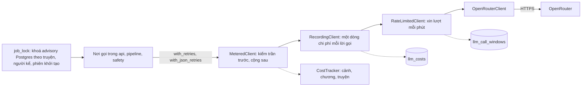

- **Chồng client** được dựng ở `api/deps.py` `PlayerLLM.open`: `OpenRouterClient` bọc trong `RateLimitedClient`, rồi `RecordingClient`. `metered()` bọc thêm `MeteredClient`; `ChapterRun` tự bọc `MeteredClient` quanh client của `open()`. **Thử lại lỗi tạm có chờ lùi (D-123):** `llm/retry.py` chờ `retries.transient_backoff_seconds` giữa các lần thử lại của `LLM_UNAVAILABLE`/`LLM_TIMEOUT` (không áp cho 429 hay JSON sai schema); chờ qua `retry._sleep`, test thay hàm này. **Hạn tổng mỗi lời gọi (D-113):** `OpenRouterClient(deadline_s=...)` lấy `limits.llm_call.deadline_seconds`; `chat`, `stream` (mỗi lần chờ một dòng) và `generation_cost` quá hạn thì ra `LLM_TIMEOUT`, lỗi tạm cho lớp thử lại, tính tiền ước tính như lời gọi bị huỷ. `httpx.Timeout` chỉ là hạn từng lần đọc/ghi nên không bắt được máy chủ nhỏ giọt byte.
- **Chồng client của bộ đo (D-140).** Bộ đo không dựng `OpenRouterClient` riêng: `llm/provider.py` `bench_llm(config, env_file, ...)` chọn theo tiền tố id model trong config. Chỉ có model OpenRouter thì ra `OpenRouterClient`, chỉ có model `meta/...` thì ra `MetaClient` (`llm/meta.py`), chỉ có model `anthropic-api/...` thì ra `AnthropicClient` (`llm/anthropic_client.py`, D-145, qua SDK `anthropic`), trộn thì `RoutingClient`. Bộ đo tự bọc tiếp `BudgetedClient` hay `MeteredClient` như trước. Sản phẩm không đi qua đây và từ chối model của bộ đo (`config.product_model_problems`). Mặc định ngoài Meta là OpenRouter, nên bộ đo cũ không đổi.
- **Thử lại** (`llm/retry.py`) nằm ở nơi gọi, không nằm trong client. `RETRY_TRANSIENT` dùng cho lỗi mạng, `RETRY_SCHEMA` cho JSON sai schema; số lượt nằm trong `limits.retries`. Mỗi lượt thử lại đi qua đủ chồng client, nên vẫn bị kiểm trần, vẫn xin lượt và vẫn được ghi. HTTP 409 và lỗi socket tầng thấp được tính là lỗi tạm (D-94, D-97).
- **Trần (G8, D-10).** `CostTracker.ensure_budget` kiểm trần truyện, chương, cảnh (`limits.cost_usd`); trần chưa đặt là lỗi. `MeteredClient` kiểm trước mỗi lời gọi và cộng sau, nên lời gọi cuối có thể vượt trần đúng bằng chi phí của nó. Mọi lời gọi `chat_json` gửi kèm `max_tokens`; `stream()` thì không, nhưng hiện chưa đường nào của app dùng nó. Lời gọi không có usage thì ghi chi phí tối đa ước tính, rồi tra lại số thật sau (D-64).
- **Khoá chạy đôi (D-46, D-56).** `db/locks.py` `job_lock` dùng `pg_try_advisory_lock`, không chờ; đang có người giữ thì trả `STORY_BUSY` mà không gọi model. Khoá viết chương được giữ tới khi stream dừng và `ChapterRun.aclose()` xong (D-63).
- **Bộ đếm mỗi phút.** `db/rate_limit.py` `take_llm_call` đếm theo cửa sổ cố định, theo người chơi (`limits.rate_limit`). Hết lượt thì báo `WRITORY_RATE_LIMITED` trước lời gọi, không bị thử lại.
- **Chi phí theo vai.** `RecordingClient` ghi vai, model, token, chi phí và `generation_id` vào `llm_costs`; tên vai suy từ schema (`api/deps.py` `role_of_schema`). Ước tính chi phí chương tới là trung vị chi phí các chương đã ghi (`GET /stories/{id}/estimate`, D-87).

## 10. API và SSE

Mọi router người chơi có dependency `deps.api_guard`. Cột "Đăng nhập": ở `AUTH_MODE=invite`, thiếu phiên thì trả `AUTH_REQUIRED`; ở `dev`, người dùng luôn là `dev`.

| Router | Method, path | Đăng nhập | Gọi model | Khoá |
|---|---|---|---|---|
| app | `GET /health` | không | | |
| `auth` | `POST /auth/login`, `POST /auth/logout`, `GET /auth/session` | không | | |
| `public_config` | `GET /config/public` | không | | |
| `keys` | `GET`, `PUT`, `DELETE /player/key`; `GET /player/costs` | có | | |
| `stories` | `GET /stories`; `GET /stories/{id}/notebook`; `GET /stories/{id}/narrator`; `GET /stories/{id}/estimate` | có | | |
| `stories` | `POST /stories/{id}/narrator` | có | có | `narrator` |
| `play` | `POST /stories/{id}/chapters/next` (SSE) | có | có | `story` |
| `play` | `POST /stories/{id}/choices` (tạo lại khi chưa có) | có | khi chưa có | `story` |
| `play` | `POST /stories/{id}/action` (ô tự viết) | có | có | `story` |
| `play` | `GET /stories/{id}`; `GET /stories/{id}/chapters/{n}` | có | | |
| `play` | `POST /stories/{id}/choice` | có | | `story` (D-133) |
| `setup` | `POST /setup`; `GET /setup/{sid}`; `PUT /setup/{sid}/settings`, `plots` | có | | |
| `setup` | `PUT /setup/{sid}/characters` | có | khi có phần sửa | `setup` (D-133) |
| `setup` | `POST /setup/{sid}/settings`, `plots`, `characters`, `finalize` | có | có, trừ khi bước đã có lựa chọn | `setup` |

Lỗi `WritoryError` trả JSON có mã và câu tiếng Việt, status lấy từ một bảng duy nhất (`api/errors.py` `HTTP_STATUS`). Lỗi lạ trả `INTERNAL_ERROR`; chi tiết chỉ vào log đã redact (G12, D-29). Lỗi của bộ định tuyến (đường không có, router tắt, method sai) cũng có mã riêng (`ROUTE_NOT_FOUND`, `METHOD_NOT_ALLOWED`), không trả `detail` của FastAPI (D-133). Khoá của các route ghi nhả ngay khi hàm xử lý xong, trước khi gửi phản hồi (`Depends(..., scope="function")`), để request kế tiếp của giao diện không gặp `STORY_BUSY` (D-133). Redact log chạy ở LogRecord factory nên phủ mọi bản ghi, kể cả khi uvicorn không gắn handler cho root (D-133).

**Thứ tự sự kiện SSE của `POST /stories/{id}/chapters/next`:**

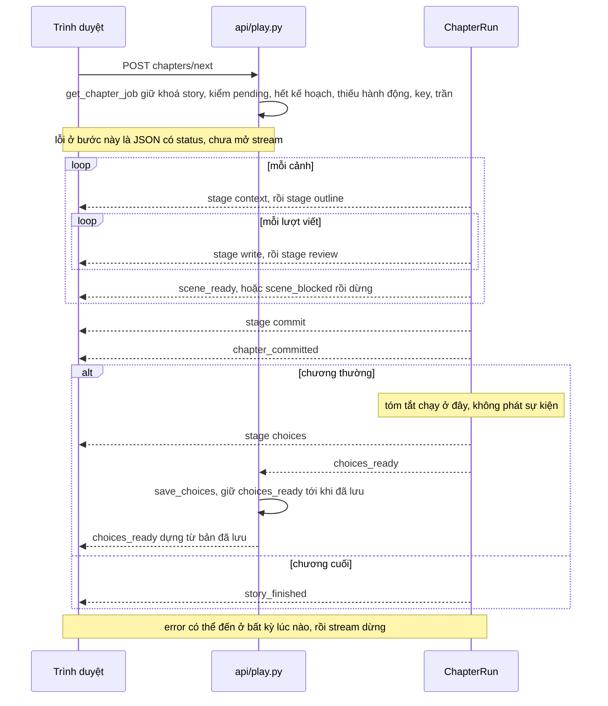

Schema sự kiện: `pipeline/events.py`. Sự kiện chỉ mang chữ đã qua kiểm. Lỗi ở bước lựa chọn đến sau `chapter_committed`: chương đã được ghi, và bộ lựa chọn tạo lại được bằng `POST /stories/{id}/choices`. Giao diện đọc SSE bằng `fetch`, không dùng `EventSource` (`frontend/src/api/sse.ts`, D-69). Người chơi ngắt kết nối thì đồ thị bị huỷ và khoá được nhả sau khi đồ thị dừng hẳn (D-63).

**Đăng nhập, CSRF, chủ sở hữu.** Ở `AUTH_MODE=invite`, người chơi đổi mã mời lấy phiên. Token phiên nằm trong cookie HttpOnly; Postgres chỉ giữ phần tra của mã (`selector`, không bí mật), băm của phần bí mật, và băm của token (`db/auth.py`, `0009_invite_login.sql`). Mọi method ghi phải là `application/json` và cùng origin (`api/deps.py` `api_guard`, `_same_origin_json`). Truyện, phiên khởi tạo, key và chi phí đều khoá theo `owner_id` của phiên; truyện của người khác báo như không có (`STORY_NOT_FOUND`). Bộ đếm lần nhập mã tính theo địa chỉ máy, lấy qua proxy tin cậy. Mối đe doạ, chi tiết và test: `docs/security.md`, mục "Đăng nhập bằng mã mời (D-89)"; lệnh tạo mã: `docs/runbook.md`.

## 11. Postgres

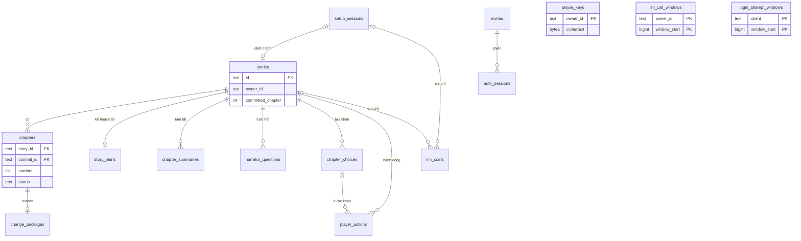

| Bảng | Vai trò |
|---|---|
| `stories`, `chapters`, `change_packages` | truyện, chương theo `commit_id` với trạng thái `pending`, `committed`, `failed`, và outbox gói đồ thị (D-6) |
| `story_plans` | bản kế hoạch ẩn; không ra API (G1) |
| `chapter_summaries` | tóm tắt chương, chỉ dùng nội bộ (D-49) |
| `chapter_choices`, `player_actions` | bộ lựa chọn phía máy chủ (có id nút thật, không ra API) và hành động dẫn tới chương sau (D-46, D-55); hành động tự viết mang `feasibility` của bộ phân loại, không ra API (G6, migration 0011, D-138) |
| `narrator_questions` | số câu đã hỏi người kể theo chương |
| `setup_sessions` | phiên khởi tạo; giữ các lựa chọn của từng bước |
| `player_keys` | key OpenRouter, chỉ bản mã hoá (G7) |
| `llm_costs`, `llm_call_windows` | nhật ký chi phí theo vai; bộ đếm lời gọi mỗi phút (D-44, D-56, D-64) |
| `invites`, `auth_sessions`, `login_attempt_windows` | mã mời, phiên, bộ đếm lần nhập mã (D-89) |

`player_keys`, `llm_call_windows` và các bảng theo `owner_id` chưa có khoá ngoại tới `invites` (chú thích trong `0009_invite_login.sql`). Mỗi request mở một kết nối Postgres riêng, vì khoá advisory gắn với kết nối (`api/deps.py` `get_pg_conn`, `db/locks.py`).

Migration: SQL thuần trong `db/migrations/`, chạy theo thứ tự tên file bằng `db/migrate.py`, mọi file còn thiếu chạy trong một transaction (D-20). Ở prod, migration chạy lúc khởi động; ở dev thì chạy tay (`docs/runbook.md`, mục "Migration Postgres").

## 12. Bộ đo

| Bài | Đo phần nào của kiến trúc | Module |
|---|---|---|
| A, bộ nhớ | đồ thị làm bộ nhớ so với không nhớ, tóm tắt cuốn chiếu, RAG, toàn văn, đồ thị kèm đoạn trang (mục 8) | `pipeline/bench_a.py`, `bench_a_systems.py`, `bench_a_retrieval.py` |
| B, người canh | các phép kiểm bằng code của `guard/` trên gói cài lỗi và gói sạch | `guard/bench_b.py` |
| C, trích thay đổi | vai `extract` và `to_package`, đo trên lớp người chơi biết | `pipeline/bench_c.py` |
| D, chất lượng văn | model viết trên dàn ý cảnh | `quality/bench_d.py` |
| E, người kể không lộ | ranh giới G1 và G2 của đường người kể, cả truy hồi sổ tay lớn | `pipeline/bench_e.py`, `bench_e_story.py` |
| F, so model viết | toàn bộ đường viết trên cùng một thế giới, kèm chi phí thật | `quality/bench_bakeoff.py`, `pipeline/bench_run.py` |
| Chạy cả truyện | đi hết đường người chơi: chi phí theo vai, lỗi, kế hoạch so với kết quả | `pipeline/bench_run.py` |
| Red-team G5, G6, G9 | phân loại ô tự viết (cả `feasibility`), vai `overreach` chấm trang, kiểm duyệt nội dung | `safety/bench_g5.py`, `safety/bench_g6.py`, `safety/bench_g9.py` |

Đề, dữ liệu, cách chấm và lệnh chạy: `docs/eval.md`. Kết quả: `evals/results/<ngày>-<tên>/`.

## 13. Hạn chế và chỗ chưa xong đã biết

Các mục dưới đây đọc được trong code. Tài liệu chỉ liệt kê; sửa thì cần quyết định riêng.

- **Ở dev, chương kẹt `pending` vẫn phải áp lại bằng tay.** Áp lại lúc khởi động chỉ chạy ở `APP_ENV=prod`, cùng migration (D-105). Lệnh tay: `docs/runbook.md`, mục "Ghi chương bị kẹt `pending`". Lệnh chạy cả truyện (`pipeline/bench_run.py`) ghi chương không qua khoá `story`; nó chạy trên kho dev, không chung kho với chồng prod (suy luận).
- **G6 dựa vào hai lời gọi model, mới đo một lần.** Lời gọi phân loại chấm `feasibility`, vai `overreach` chấm trang (D-138); một lần chạy, đạt theo luật khai trước (`evals/results/2026-10-30-g6-check/notes.md`). Bộ phân loại chấm "trong luật" thì chương đó chỉ còn dòng dặn trong `OUTLINE_SYSTEM_PROMPT` (`pipeline/scene.py`). `guard/rules.py` vẫn không có phép kiểm nào cho G6 (D-88; `docs/security.md`, mục "Chưa giải quyết").
- **Model viết không đi qua `role_extra`.** `_write` (`pipeline/chapter.py`) dựng `extra` bằng `reasoning_extra(tier.reasoning)`, nên `provider_ignore` (D-100) không áp cho model viết; mọi vai trong `roles` thì có (D-106). Hiện `provider_ignore` rỗng (D-102) nên không có tác động. Chưa rõ có cố ý không.
- **Không có migration `0006`.** Thư mục `db/migrations/` nhảy từ `0005` sang `0007`, và lịch sử git không có file `0006` nào. `migrate` chạy theo thứ tự tên nên không hỏng (suy luận).
- Các điểm chưa làm của lớp đồ thị (lời người chơi đã nghe, quan hệ trong sổ tay, `writer_context` trên `GraphState`): `docs/graph-schema.md`, mục "Chưa làm". Các điểm bảo mật còn mở: `docs/security.md`, mục "Chưa giải quyết".
