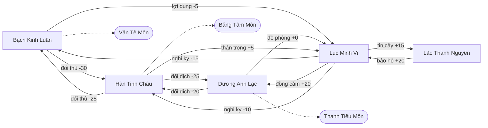

# Video script: run-20261021-ky-ao-vua-2-f8a61160

> **SPOILER / TRUTH WARNING: this file is built from the full truth layer of the story (secrets, backstage, what characters hide) and from text the reader has seen. It reveals everything. Do not show it to players. | CẢNH BÁO LỘ BÍ MẬT: bản xuất dựng từ toàn bộ lớp truth của truyện; chỉ admin được giữ, không đưa cho người chơi.**

- Dialogue language: `zh` (Chinese (Mandarin))
- Chapters: 1, 2, 3
- Model: `openai/gpt-6-luna` · prompt version `video-1` · calls 14 · cost 0.0128 USD

## Characters

| id | Name | Name in dialogue | Look set at story setup (Vietnamese) | Canonical English description | Source |
|---|---|---|---|---|---|
| bach_kinh_luan | Bạch Kinh Luân | 白景伦 |  | Middle-aged man with a lean build, angular face, neatly tied black hair streaked at the temples, ivory robes with dark blue trim and a jade clasp, a small scar through his left eyebrow. | inferred at export |
| duong_anh_lac | Dương Anh Lạc | 杨英乐 |  | Adult woman with a tall, athletic build, oval face, black hair in a tight high knot, charcoal uniform robes, fitted leather gloves and a narrow silver belt, a small mole beneath her right eye. | inferred at export |
| han_tinh_chau | Hàn Tinh Châu | 韩星洲 |  | Middle-aged man with a slender build, pale narrow face, long black hair bound with a silver crown, layered ice-blue robes with a white fur collar, a faint frost-shaped birthmark at his temple. | inferred at export |
| lao_thanh_nguyen | Lão Thành Nguyên | 老成元 |  | Elderly man with a slight build, lined square face, sparse white hair tied low, muted brown-gray scholar robes and a plain wooden cane, a dark age spot on his left cheek. | inferred at export |
| protagonist | Lục Minh Vi (protagonist) | 陆明薇 |  | Young adult woman with a wiry build, alert oval face, dark eyes, black hair in a practical high ponytail, weathered blue-gray travel robes with a leather shoulder strap, a thin scar across her right knuckle. | inferred at export |
| thieu_kiem_hoai | Thiệu Kiếm Hoài | 邵剑怀 |  | Elderly man with a compact build, long lined face, iron-gray hair bound beneath a plain black cap, dark ink-blue official robes with a narrow sash, a small ink stain on his right cuff. | inferred at export |

## Locations

| id | Name | Name in dialogue | Look set at story setup (Vietnamese) | Canonical English description | Source |
|---|---|---|---|---|---|
| ben_may_lac | Bến Mây Lạc | 落云渡 |  | Cool dawn light over a windswept floating-island mooring; weathered gray stone piers, dark timber posts, iron anchor rings and rope lines edge the cloud-filled drop, with empty sky docks receding into pale mist. | inferred at export |
| cuu_tieu_dai | Cửu Tiêu Đài | 九霄台 |  | Bright, high-altitude daylight across a neutral floating island of pale stone and weathered bronze; broad terraces, cloud-ringed cliffs, tiled halls and elevated mooring platforms stand in crisp windblown air. | inferred at export |
| dai_nghi_su | Đại Nghị Sảnh | 大议厅 |  | Cool daylight and amber lantern glow fill a solemn stone council hall; massive closed gray doors, dark timber beams, polished floor slabs, orderly rows of carved seats and narrow controlled exits define the space. | inferred at export |
| hanh_lang_phong_luan | Hành Lang Phong Luân | 风轮回廊 |  | Dim blue-white light washes a narrow stone corridor around the island's base; bronze wind-wheel mechanisms, timber doors to archive rooms, exposed conduits and a recessed control platform line the rough walls above open cloud views. | inferred at export |

## Chapter 1

### Relationship map (end of chapter)



**Where they are:** Bạch Kinh Luân at Đại Nghị Sảnh; Dương Anh Lạc at Đại Nghị Sảnh; Hàn Tinh Châu at Đại Nghị Sảnh; Lão Thành Nguyên at Đại Nghị Sảnh; Lục Minh Vi at Đại Nghị Sảnh; Thiệu Kiếm Hoài at Hành Lang Phong Luân
- **Learns (Fact):** Lục Minh Vi (chứng kiến): Cửa Đại Nghị Sảnh đã bị khóa từ phía trong khi cuộc tranh luận bắt đầu.
- **Learns (Fact):** Lục Minh Vi (chứng kiến): Hộp Phong Ấn được phát hiện trống ngay trước khi lời buộc tội đầu tiên được đưa ra.
- **Learns (Fact):** Lục Minh Vi (chứng kiến): Thiệu Kiếm Hoài mất tích trước khi cửa Đại Nghị Sảnh bị khóa.

### Scene 1.1

*Moderation: allow*

#### Shot 1: medium · eye_level · pan · 8 s · unknown · Đại Nghị Sảnh

- Appears: Bạch Kinh Luân, Lục Minh Vi
- Action: Bạch Kinh Luân turns toward Lục Minh Vi and places one hand on the stone table. Lục Minh Vi faces him across the table.
- Bạch Kinh Luân: "陆明薇，明镖局的护送队曾经过争议地带，对吗？" (original: "Lục Minh Vi, chuyến hộ tống của Minh Hộ Tống từng đi qua vùng tranh chấp, phải không?")

```text
Medium shot, eye-level angle, pan. Setting: Cool daylight and amber lantern glow fill a solemn stone council hall; massive closed gray doors, dark timber beams, polished floor slabs, orderly rows of carved seats and narrow controlled exits define the space. Characters: Bạch Kinh Luân: Middle-aged man with a lean build, angular face, neatly tied black hair streaked at the temples, ivory robes with dark blue trim and a jade clasp, a small scar through his left eyebrow. Lục Minh Vi: Young adult woman with a wiry build, alert oval face, dark eyes, black hair in a practical high ponytail, weathered blue-gray travel robes with a leather shoulder strap, a thin scar across her right knuckle. Action: Bạch Kinh Luân turns toward Lục Minh Vi and places one hand on the stone table. Lục Minh Vi faces him across the table. Spoken line in Chinese (Mandarin) by Bạch Kinh Luân: "陆明薇，明镖局的护送队曾经过争议地带，对吗？" Duration: 8 seconds.
```

#### Shot 2: wide · high · push_in · 6 s · unknown · Đại Nghị Sảnh

- Appears: Bạch Kinh Luân
- Action: The open Seal Box sits behind Bạch Kinh Luân, its empty interior lit from above. He keeps a hand on the table as the assembly looks toward him.
- Bạch Kinh Luân: "门派之外之人的证词，可以判定是谁先破了规矩。" (original: "Lời khai của người ngoài các đại môn phái có thể phân định ai đã phá luật trước.")

```text
Wide shot, high angle, slow push-in. Setting: Cool daylight and amber lantern glow fill a solemn stone council hall; massive closed gray doors, dark timber beams, polished floor slabs, orderly rows of carved seats and narrow controlled exits define the space. Characters: Bạch Kinh Luân: Middle-aged man with a lean build, angular face, neatly tied black hair streaked at the temples, ivory robes with dark blue trim and a jade clasp, a small scar through his left eyebrow. Action: The open Seal Box sits behind Bạch Kinh Luân, its empty interior lit from above. He keeps a hand on the table as the assembly looks toward him. Spoken line in Chinese (Mandarin) by Bạch Kinh Luân: "门派之外之人的证词，可以判定是谁先破了规矩。" Duration: 6 seconds.
```

#### Shot 3: medium_close_up · eye_level · static · 5 s · unknown · Đại Nghị Sảnh

- Appears: Hàn Tinh Châu, Lục Minh Vi
- Action: Hàn Tinh Châu cuts in, keeping his gaze fixed on Lục Minh Vi.
- Hàn Tinh Châu: "一个低阶弟子也值得如此信任吗？" (original: "Một môn sinh cấp thấp cũng đáng tin đến thế sao?")

```text
Medium close-up, eye-level angle, static camera. Setting: Cool daylight and amber lantern glow fill a solemn stone council hall; massive closed gray doors, dark timber beams, polished floor slabs, orderly rows of carved seats and narrow controlled exits define the space. Characters: Hàn Tinh Châu: Middle-aged man with a slender build, pale narrow face, long black hair bound with a silver crown, layered ice-blue robes with a white fur collar, a faint frost-shaped birthmark at his temple. Lục Minh Vi: Young adult woman with a wiry build, alert oval face, dark eyes, black hair in a practical high ponytail, weathered blue-gray travel robes with a leather shoulder strap, a thin scar across her right knuckle. Action: Hàn Tinh Châu cuts in, keeping his gaze fixed on Lục Minh Vi. Spoken line in Chinese (Mandarin) by Hàn Tinh Châu: "一个低阶弟子也值得如此信任吗？" Duration: 5 seconds.
```

#### Shot 4: medium · over_the_shoulder · pan · 8 s · unknown · Đại Nghị Sảnh

- Appears: Hàn Tinh Châu, Lục Minh Vi
- Action: Hàn Tinh Châu taps the chair arm as several sect leaders glance toward Lục Minh Vi and exchange looks. Lục Minh Vi holds both hands inside her sleeves.
- Hàn Tinh Châu: "若证词含糊，各方只会更有借口动手。你该知道自己会把谁推向哪一边。" (original: "Nếu lời khai mập mờ, các phe chỉ càng có cớ động thủ. Cô nên biết mình đang đẩy ai về phía nào.")

```text
Medium shot, over-the-shoulder angle, pan. Setting: Cool daylight and amber lantern glow fill a solemn stone council hall; massive closed gray doors, dark timber beams, polished floor slabs, orderly rows of carved seats and narrow controlled exits define the space. Characters: Hàn Tinh Châu: Middle-aged man with a slender build, pale narrow face, long black hair bound with a silver crown, layered ice-blue robes with a white fur collar, a faint frost-shaped birthmark at his temple. Lục Minh Vi: Young adult woman with a wiry build, alert oval face, dark eyes, black hair in a practical high ponytail, weathered blue-gray travel robes with a leather shoulder strap, a thin scar across her right knuckle. Action: Hàn Tinh Châu taps the chair arm as several sect leaders glance toward Lục Minh Vi and exchange looks. Lục Minh Vi holds both hands inside her sleeves. Spoken line in Chinese (Mandarin) by Hàn Tinh Châu: "若证词含糊，各方只会更有借口动手。你该知道自己会把谁推向哪一边。" Duration: 8 seconds.
```

#### Shot 5: medium · low · tilt · 8 s · unknown · Đại Nghị Sảnh

- Appears: Dương Anh Lạc
- Action: Dương Anh Lạc rises, and her chair scrapes across the stone floor. She addresses the assembly without raising her voice.
- Dương Anh Lạc: "大议厅的门已经锁了。邵剑怀仍然失踪。谁也不许擅自离开，也不许用指控代替证据。" (original: "Cửa Đại Nghị Sảnh đã khóa. Thiệu Kiếm Hoài vẫn mất tích. Không ai tự ý rời đi, cũng không ai được lấy lời buộc tội thay cho chứng cứ.")

```text
Medium shot, low angle, tilt. Setting: Cool daylight and amber lantern glow fill a solemn stone council hall; massive closed gray doors, dark timber beams, polished floor slabs, orderly rows of carved seats and narrow controlled exits define the space. Characters: Dương Anh Lạc: Adult woman with a tall, athletic build, oval face, black hair in a tight high knot, charcoal uniform robes, fitted leather gloves and a narrow silver belt, a small mole beneath her right eye. Action: Dương Anh Lạc rises, and her chair scrapes across the stone floor. She addresses the assembly without raising her voice. Spoken line in Chinese (Mandarin) by Dương Anh Lạc: "大议厅的门已经锁了。邵剑怀仍然失踪。谁也不许擅自离开，也不许用指控代替证据。" Duration: 8 seconds.
```

#### Shot 6: wide · eye_level · track · 6 s · unknown · Đại Nghị Sảnh

- Appears: Dương Anh Lạc
- Action: Two people pause as they begin to rise. A hand leaves a sword hilt and settles on the table while the assembly falls quiet under Dương Anh Lạc’s gaze.

```text
Wide shot, eye-level angle, tracking shot. Setting: Cool daylight and amber lantern glow fill a solemn stone council hall; massive closed gray doors, dark timber beams, polished floor slabs, orderly rows of carved seats and narrow controlled exits define the space. Characters: Dương Anh Lạc: Adult woman with a tall, athletic build, oval face, black hair in a tight high knot, charcoal uniform robes, fitted leather gloves and a narrow silver belt, a small mole beneath her right eye. Action: Two people pause as they begin to rise. A hand leaves a sword hilt and settles on the table while the assembly falls quiet under Dương Anh Lạc’s gaze. Duration: 6 seconds.
```

#### Shot 7: extreme_wide · high · static · 5 s · unknown · Đại Nghị Sảnh

- Appears: -
- Action: Lamps tremble along the stone walls as air passes through the gaps. The assembly remains still around the council table.

```text
Extreme wide shot, high angle, static camera. Setting: Cool daylight and amber lantern glow fill a solemn stone council hall; massive closed gray doors, dark timber beams, polished floor slabs, orderly rows of carved seats and narrow controlled exits define the space. Action: Lamps tremble along the stone walls as air passes through the gaps. The assembly remains still around the council table. Duration: 5 seconds.
```

#### Shot 8: medium · eye_level · push_in · 8 s · unknown · Đại Nghị Sảnh

- Appears: Lão Thành Nguyên, Lục Minh Vi
- Action: Lão Thành Nguyên extends an open hand toward Lục Minh Vi. She looks toward him across the table.
- Lão Thành Nguyên: "明薇，你只说自己亲眼所见。别猜是谁从封印盒里拿走了天阙碎片。" (original: "Minh Vi, con chỉ nói điều mình tận mắt chứng kiến. Đừng suy đoán ai đã lấy Mảnh Thiên Khuyết khỏi Hộp Phong Ấn.")

```text
Medium shot, eye-level angle, slow push-in. Setting: Cool daylight and amber lantern glow fill a solemn stone council hall; massive closed gray doors, dark timber beams, polished floor slabs, orderly rows of carved seats and narrow controlled exits define the space. Characters: Lão Thành Nguyên: Elderly man with a slight build, lined square face, sparse white hair tied low, muted brown-gray scholar robes and a plain wooden cane, a dark age spot on his left cheek. Lục Minh Vi: Young adult woman with a wiry build, alert oval face, dark eyes, black hair in a practical high ponytail, weathered blue-gray travel robes with a leather shoulder strap, a thin scar across her right knuckle. Action: Lão Thành Nguyên extends an open hand toward Lục Minh Vi. She looks toward him across the table. Spoken line in Chinese (Mandarin) by Lão Thành Nguyên: "明薇，你只说自己亲眼所见。别猜是谁从封印盒里拿走了天阙碎片。" Duration: 8 seconds.
```

#### Shot 9: medium_close_up · eye_level · static · 4 s · unknown · Đại Nghị Sảnh

- Appears: Bạch Kinh Luân, Lục Minh Vi
- Action: Bạch Kinh Luân tilts his head toward Lục Minh Vi.
- Bạch Kinh Luân: "沉默也是一种选择。" (original: "Im lặng cũng là một lựa chọn.")

```text
Medium close-up, eye-level angle, static camera. Setting: Cool daylight and amber lantern glow fill a solemn stone council hall; massive closed gray doors, dark timber beams, polished floor slabs, orderly rows of carved seats and narrow controlled exits define the space. Characters: Bạch Kinh Luân: Middle-aged man with a lean build, angular face, neatly tied black hair streaked at the temples, ivory robes with dark blue trim and a jade clasp, a small scar through his left eyebrow. Lục Minh Vi: Young adult woman with a wiry build, alert oval face, dark eyes, black hair in a practical high ponytail, weathered blue-gray travel robes with a leather shoulder strap, a thin scar across her right knuckle. Action: Bạch Kinh Luân tilts his head toward Lục Minh Vi. Spoken line in Chinese (Mandarin) by Bạch Kinh Luân: "沉默也是一种选择。" Duration: 4 seconds.
```

#### Shot 10: medium_close_up · low · push_in · 6 s · unknown · Đại Nghị Sảnh

- Appears: Hàn Tinh Châu, Lục Minh Vi
- Action: Hàn Tinh Châu looks directly at Lục Minh Vi as she faces the council table.
- Hàn Tinh Châu: "那趟行程有没有带人或物经过争议地带？说清楚。" (original: "Chuyến đi ấy có đưa người hay vật qua vùng tranh chấp hay không? Nói rõ.")

```text
Medium close-up, low angle, slow push-in. Setting: Cool daylight and amber lantern glow fill a solemn stone council hall; massive closed gray doors, dark timber beams, polished floor slabs, orderly rows of carved seats and narrow controlled exits define the space. Characters: Hàn Tinh Châu: Middle-aged man with a slender build, pale narrow face, long black hair bound with a silver crown, layered ice-blue robes with a white fur collar, a faint frost-shaped birthmark at his temple. Lục Minh Vi: Young adult woman with a wiry build, alert oval face, dark eyes, black hair in a practical high ponytail, weathered blue-gray travel robes with a leather shoulder strap, a thin scar across her right knuckle. Action: Hàn Tinh Châu looks directly at Lục Minh Vi as she faces the council table. Spoken line in Chinese (Mandarin) by Hàn Tinh Châu: "那趟行程有没有带人或物经过争议地带？说清楚。" Duration: 6 seconds.
```

#### Shot 11: medium · eye_level · push_in · 8 s · unknown · Đại Nghị Sảnh

- Appears: Lục Minh Vi
- Action: Lục Minh Vi looks around the faces gathered at the table, then addresses the assembly.
- Lục Minh Vi: "我会如实说出自己知道的一切。但我不会替任何门派确认指控。" (original: "Tôi sẽ kể đúng những gì mình biết. Nhưng tôi không xác nhận lời buộc tội thay cho bất kỳ môn phái nào.")

```text
Medium shot, eye-level angle, slow push-in. Setting: Cool daylight and amber lantern glow fill a solemn stone council hall; massive closed gray doors, dark timber beams, polished floor slabs, orderly rows of carved seats and narrow controlled exits define the space. Characters: Lục Minh Vi: Young adult woman with a wiry build, alert oval face, dark eyes, black hair in a practical high ponytail, weathered blue-gray travel robes with a leather shoulder strap, a thin scar across her right knuckle. Action: Lục Minh Vi looks around the faces gathered at the table, then addresses the assembly. Spoken line in Chinese (Mandarin) by Lục Minh Vi: "我会如实说出自己知道的一切。但我不会替任何门派确认指控。" Duration: 8 seconds.
```

#### Shot 12: wide · eye_level · pull_out · 8 s · unknown · Đại Nghị Sảnh

- Appears: Lục Minh Vi, Bạch Kinh Luân, Hàn Tinh Châu, Dương Anh Lạc, Lão Thành Nguyên
- Action: Bạch Kinh Luân and Hàn Tinh Châu rise from their chairs as Dương Anh Lạc grips her glove strap and Lão Thành Nguyên lowers his hand. Lục Minh Vi stands between the stone pillars, facing the council table while the assembly watches her.

```text
Wide shot, eye-level angle, slow pull-out. Setting: Cool daylight and amber lantern glow fill a solemn stone council hall; massive closed gray doors, dark timber beams, polished floor slabs, orderly rows of carved seats and narrow controlled exits define the space. Characters: Lục Minh Vi: Young adult woman with a wiry build, alert oval face, dark eyes, black hair in a practical high ponytail, weathered blue-gray travel robes with a leather shoulder strap, a thin scar across her right knuckle. Bạch Kinh Luân: Middle-aged man with a lean build, angular face, neatly tied black hair streaked at the temples, ivory robes with dark blue trim and a jade clasp, a small scar through his left eyebrow. Hàn Tinh Châu: Middle-aged man with a slender build, pale narrow face, long black hair bound with a silver crown, layered ice-blue robes with a white fur collar, a faint frost-shaped birthmark at his temple. Dương Anh Lạc: Adult woman with a tall, athletic build, oval face, black hair in a tight high knot, charcoal uniform robes, fitted leather gloves and a narrow silver belt, a small mole beneath her right eye. Lão Thành Nguyên: Elderly man with a slight build, lined square face, sparse white hair tied low, muted brown-gray scholar robes and a plain wooden cane, a dark age spot on his left cheek. Action: Bạch Kinh Luân and Hàn Tinh Châu rise from their chairs as Dương Anh Lạc grips her glove strap and Lão Thành Nguyên lowers his hand. Lục Minh Vi stands between the stone pillars, facing the council table while the assembly watches her. Duration: 8 seconds.
```

### Scene 1.2

*Moderation: allow*

#### Shot 1: medium · eye_level · static · 5 s · unknown · Đại Nghị Sảnh

- Appears: Lục Minh Vi
- Action: Lục Minh Vi stands beside the meeting table and turns her gaze away from the open, empty Hộp Phong Ấn.

```text
Medium shot, eye-level angle, static camera. Setting: Cool daylight and amber lantern glow fill a solemn stone council hall; massive closed gray doors, dark timber beams, polished floor slabs, orderly rows of carved seats and narrow controlled exits define the space. Characters: Lục Minh Vi: Young adult woman with a wiry build, alert oval face, dark eyes, black hair in a practical high ponytail, weathered blue-gray travel robes with a leather shoulder strap, a thin scar across her right knuckle. Action: Lục Minh Vi stands beside the meeting table and turns her gaze away from the open, empty Hộp Phong Ấn. Duration: 5 seconds.
```

#### Shot 2: medium_close_up · eye_level · push_in · 10 s · unknown · Đại Nghị Sảnh

- Appears: Lục Minh Vi
- Action: Lục Minh Vi addresses the people around the table, then pauses as murmurs rise.
- Lục Minh Vi: "我们的护送队曾护送人穿过争议地区。我在路上，看见被护送的人、边界标记和巡逻队。但我没有亲眼看见谁拿走了天阙碎片，也不能说该由哪个门派负责。" (original: "Đoàn hộ tống của chúng tôi từng đưa người qua vùng tranh chấp. Tôi có mặt trên đường đi, thấy người được đưa qua, thấy những cột mốc ranh giới và những toán tuần tra. Nhưng tôi không chứng kiến ai lấy Mảnh Thiên Khuyết, cũng không thể nói môn phái nào phải chịu trách nhiệm.")

```text
Medium close-up, eye-level angle, slow push-in. Setting: Cool daylight and amber lantern glow fill a solemn stone council hall; massive closed gray doors, dark timber beams, polished floor slabs, orderly rows of carved seats and narrow controlled exits define the space. Characters: Lục Minh Vi: Young adult woman with a wiry build, alert oval face, dark eyes, black hair in a practical high ponytail, weathered blue-gray travel robes with a leather shoulder strap, a thin scar across her right knuckle. Action: Lục Minh Vi addresses the people around the table, then pauses as murmurs rise. Spoken line in Chinese (Mandarin) by Lục Minh Vi: "我们的护送队曾护送人穿过争议地区。我在路上，看见被护送的人、边界标记和巡逻队。但我没有亲眼看见谁拿走了天阙碎片，也不能说该由哪个门派负责。" Duration: 10 seconds.
```

#### Shot 3: medium · low · static · 5 s · unknown · Đại Nghị Sảnh

- Appears: Bạch Kinh Luân, Lục Minh Vi
- Action: Bạch Kinh Luân questions Lục Minh Vi without moving the hand resting on the stone table.
- Bạch Kinh Luân: "那么，那趟行程是否越过了仙门划定的边界？" (original: "Vậy hành trình ấy có vượt qua ranh giới do các tiên môn đặt ra hay không?")

```text
Medium shot, low angle, static camera. Setting: Cool daylight and amber lantern glow fill a solemn stone council hall; massive closed gray doors, dark timber beams, polished floor slabs, orderly rows of carved seats and narrow controlled exits define the space. Characters: Bạch Kinh Luân: Middle-aged man with a lean build, angular face, neatly tied black hair streaked at the temples, ivory robes with dark blue trim and a jade clasp, a small scar through his left eyebrow. Lục Minh Vi: Young adult woman with a wiry build, alert oval face, dark eyes, black hair in a practical high ponytail, weathered blue-gray travel robes with a leather shoulder strap, a thin scar across her right knuckle. Action: Bạch Kinh Luân questions Lục Minh Vi without moving the hand resting on the stone table. Spoken line in Chinese (Mandarin) by Bạch Kinh Luân: "那么，那趟行程是否越过了仙门划定的边界？" Duration: 5 seconds.
```

#### Shot 4: medium_close_up · over_the_shoulder · static · 9 s · unknown · Đại Nghị Sảnh

- Appears: Lục Minh Vi
- Action: Lục Minh Vi answers from her place at the table, keeping her hands still.
- Lục Minh Vi: "我可以陈述队伍经过了哪里、遇见了谁、看见了什么。至于行程是否违反边界，我无权代仙门作出结论。" (original: "Tôi có thể thuật lại đoàn đi qua đâu, gặp ai, nhìn thấy gì. Còn việc chuyến đi có vi phạm ranh giới hay không, tôi không có thẩm quyền kết luận thay các tiên môn.")

```text
Medium close-up, over-the-shoulder angle, static camera. Setting: Cool daylight and amber lantern glow fill a solemn stone council hall; massive closed gray doors, dark timber beams, polished floor slabs, orderly rows of carved seats and narrow controlled exits define the space. Characters: Lục Minh Vi: Young adult woman with a wiry build, alert oval face, dark eyes, black hair in a practical high ponytail, weathered blue-gray travel robes with a leather shoulder strap, a thin scar across her right knuckle. Action: Lục Minh Vi answers from her place at the table, keeping her hands still. Spoken line in Chinese (Mandarin) by Lục Minh Vi: "我可以陈述队伍经过了哪里、遇见了谁、看见了什么。至于行程是否违反边界，我无权代仙门作出结论。" Duration: 9 seconds.
```

#### Shot 5: close_up · eye_level · pan · 7 s · unknown · Đại Nghị Sảnh

- Appears: Bạch Kinh Luân, Hàn Tinh Châu
- Action: Bạch Kinh Luân's mouth shifts slightly as Hàn Tinh Châu taps one finger against the chair.
- Hàn Tinh Châu: "这样的证词能分辨什么是非？" (original: "Lời khai như thế thì phân định được đúng sai gì?")

```text
Close-up, eye-level angle, pan. Setting: Cool daylight and amber lantern glow fill a solemn stone council hall; massive closed gray doors, dark timber beams, polished floor slabs, orderly rows of carved seats and narrow controlled exits define the space. Characters: Bạch Kinh Luân: Middle-aged man with a lean build, angular face, neatly tied black hair streaked at the temples, ivory robes with dark blue trim and a jade clasp, a small scar through his left eyebrow. Hàn Tinh Châu: Middle-aged man with a slender build, pale narrow face, long black hair bound with a silver crown, layered ice-blue robes with a white fur collar, a faint frost-shaped birthmark at his temple. Action: Bạch Kinh Luân's mouth shifts slightly as Hàn Tinh Châu taps one finger against the chair. Spoken line in Chinese (Mandarin) by Hàn Tinh Châu: "这样的证词能分辨什么是非？" Duration: 7 seconds.
```

#### Shot 6: medium · eye_level · pan · 8 s · unknown · Đại Nghị Sảnh

- Appears: Dương Anh Lạc, Lục Minh Vi
- Action: Dương Anh Lạc speaks briefly and looks across the hands near the sword hilts; one person withdraws a hand, then another, and the metallic scraping stops.
- Dương Anh Lạc: "至少这不能让任何人仅凭证据空缺就抓人。" (original: "Ít ra nó không cho ai quyền bắt người chỉ vì muốn lấp chỗ trống trong chứng cứ.")

```text
Medium shot, eye-level angle, pan. Setting: Cool daylight and amber lantern glow fill a solemn stone council hall; massive closed gray doors, dark timber beams, polished floor slabs, orderly rows of carved seats and narrow controlled exits define the space. Characters: Dương Anh Lạc: Adult woman with a tall, athletic build, oval face, black hair in a tight high knot, charcoal uniform robes, fitted leather gloves and a narrow silver belt, a small mole beneath her right eye. Lục Minh Vi: Young adult woman with a wiry build, alert oval face, dark eyes, black hair in a practical high ponytail, weathered blue-gray travel robes with a leather shoulder strap, a thin scar across her right knuckle. Action: Dương Anh Lạc speaks briefly and looks across the hands near the sword hilts; one person withdraws a hand, then another, and the metallic scraping stops. Spoken line in Chinese (Mandarin) by Dương Anh Lạc: "至少这不能让任何人仅凭证据空缺就抓人。" Duration: 8 seconds.
```

#### Shot 7: medium_close_up · over_the_shoulder · static · 4 s · unknown · Đại Nghị Sảnh

- Appears: Hàn Tinh Châu, Dương Anh Lạc
- Action: Hàn Tinh Châu turns his face toward Dương Anh Lạc.
- Hàn Tinh Châu: "杨执法想让这件事就这样过去？" (original: "Chấp luật Dương muốn để chuyện này trôi qua?")

```text
Medium close-up, over-the-shoulder angle, static camera. Setting: Cool daylight and amber lantern glow fill a solemn stone council hall; massive closed gray doors, dark timber beams, polished floor slabs, orderly rows of carved seats and narrow controlled exits define the space. Characters: Hàn Tinh Châu: Middle-aged man with a slender build, pale narrow face, long black hair bound with a silver crown, layered ice-blue robes with a white fur collar, a faint frost-shaped birthmark at his temple. Dương Anh Lạc: Adult woman with a tall, athletic build, oval face, black hair in a tight high knot, charcoal uniform robes, fitted leather gloves and a narrow silver belt, a small mole beneath her right eye. Action: Hàn Tinh Châu turns his face toward Dương Anh Lạc. Spoken line in Chinese (Mandarin) by Hàn Tinh Châu: "杨执法想让这件事就这样过去？" Duration: 4 seconds.
```

#### Shot 8: medium · eye_level · push_in · 10 s · unknown · Đại Nghị Sảnh

- Appears: Dương Anh Lạc
- Action: Dương Anh Lạc places both hands on the table, keeping them away from her sword hilt as she answers.
- Dương Anh Lạc: "我不想让任何人拿不充分的证词当作定罪的借口。门已锁上，守印人失踪，盒子是空的。再扣留一个人，也不会让证据凭空出现。" (original: "Tôi muốn không ai lấy lời chưa đủ làm cớ kết tội. Cửa đã khóa, người giữ ấn mất tích, hộp thì trống. Thêm một người bị giữ lại cũng chẳng khiến chứng cứ tự mọc ra.")

```text
Medium shot, eye-level angle, slow push-in. Setting: Cool daylight and amber lantern glow fill a solemn stone council hall; massive closed gray doors, dark timber beams, polished floor slabs, orderly rows of carved seats and narrow controlled exits define the space. Characters: Dương Anh Lạc: Adult woman with a tall, athletic build, oval face, black hair in a tight high knot, charcoal uniform robes, fitted leather gloves and a narrow silver belt, a small mole beneath her right eye. Action: Dương Anh Lạc places both hands on the table, keeping them away from her sword hilt as she answers. Spoken line in Chinese (Mandarin) by Dương Anh Lạc: "我不想让任何人拿不充分的证词当作定罪的借口。门已锁上，守印人失踪，盒子是空的。再扣留一个人，也不会让证据凭空出现。" Duration: 10 seconds.
```

#### Shot 9: medium · low · tilt · 6 s · unknown · Đại Nghị Sảnh

- Appears: Lão Thành Nguyên
- Action: Lão Thành Nguyên rises, bracing himself on his staff; its tip strikes the stone floor.
- Lão Thành Nguyên: "就在这里把陆明薇的证词记录成书面证词。所有在场的人都听清了，日后就没人能说她讲过别的话。" (original: "Ghi lời khai của Minh Vi thành chứng từ ngay tại đây. Ai có mặt đều nghe rõ, sau này khỏi ai bảo nàng nói khác.")

```text
Medium shot, low angle, tilt. Setting: Cool daylight and amber lantern glow fill a solemn stone council hall; massive closed gray doors, dark timber beams, polished floor slabs, orderly rows of carved seats and narrow controlled exits define the space. Characters: Lão Thành Nguyên: Elderly man with a slight build, lined square face, sparse white hair tied low, muted brown-gray scholar robes and a plain wooden cane, a dark age spot on his left cheek. Action: Lão Thành Nguyên rises, bracing himself on his staff; its tip strikes the stone floor. Spoken line in Chinese (Mandarin) by Lão Thành Nguyên: "就在这里把陆明薇的证词记录成书面证词。所有在场的人都听清了，日后就没人能说她讲过别的话。" Duration: 6 seconds.
```

#### Shot 10: wide · eye_level · static · 7 s · unknown · Đại Nghị Sảnh

- Appears: Lão Thành Nguyên, Bạch Kinh Luân
- Action: Lão Thành Nguyên looks around the table as the gathered leaders remain silent; Bạch Kinh Luân smooths a fold in his sleeve.
- Lão Thành Nguyên: "在有更多证据之前，任何人都不得擅自碰封印盒，也不得指控任何门派。" (original: "Cho đến khi có thêm chứng cứ, không ai được tự ý động vào Hộp Phong Ấn hay buộc tội môn phái nào.")
- Bạch Kinh Luân: "记录就记录。但证词里的每一句话，你都要负责。" (original: "Ghi thì ghi. Nhưng từng câu trong lời khai, cô phải chịu trách nhiệm.")

```text
Wide shot, eye-level angle, static camera. Setting: Cool daylight and amber lantern glow fill a solemn stone council hall; massive closed gray doors, dark timber beams, polished floor slabs, orderly rows of carved seats and narrow controlled exits define the space. Characters: Lão Thành Nguyên: Elderly man with a slight build, lined square face, sparse white hair tied low, muted brown-gray scholar robes and a plain wooden cane, a dark age spot on his left cheek. Bạch Kinh Luân: Middle-aged man with a lean build, angular face, neatly tied black hair streaked at the temples, ivory robes with dark blue trim and a jade clasp, a small scar through his left eyebrow. Action: Lão Thành Nguyên looks around the table as the gathered leaders remain silent; Bạch Kinh Luân smooths a fold in his sleeve. Spoken line in Chinese (Mandarin) by Lão Thành Nguyên: "在有更多证据之前，任何人都不得擅自碰封印盒，也不得指控任何门派。" Spoken line in Chinese (Mandarin) by Bạch Kinh Luân: "记录就记录。但证词里的每一句话，你都要负责。" Duration: 7 seconds.
```

#### Shot 11: medium_close_up · eye_level · push_in · 7 s · unknown · Đại Nghị Sảnh

- Appears: Lục Minh Vi, Bạch Kinh Luân
- Action: Lục Minh Vi looks at Bạch Kinh Luân and answers; he does not respond immediately.
- Lục Minh Vi: "我对自己亲眼所见、亲口所说的负责。证词不是判决。" (original: "Tôi chịu trách nhiệm về điều mình đã thấy và đã nói. Lời chứng không phải bản án.")

```text
Medium close-up, eye-level angle, slow push-in. Setting: Cool daylight and amber lantern glow fill a solemn stone council hall; massive closed gray doors, dark timber beams, polished floor slabs, orderly rows of carved seats and narrow controlled exits define the space. Characters: Lục Minh Vi: Young adult woman with a wiry build, alert oval face, dark eyes, black hair in a practical high ponytail, weathered blue-gray travel robes with a leather shoulder strap, a thin scar across her right knuckle. Bạch Kinh Luân: Middle-aged man with a lean build, angular face, neatly tied black hair streaked at the temples, ivory robes with dark blue trim and a jade clasp, a small scar through his left eyebrow. Action: Lục Minh Vi looks at Bạch Kinh Luân and answers; he does not respond immediately. Spoken line in Chinese (Mandarin) by Lục Minh Vi: "我对自己亲眼所见、亲口所说的负责。证词不是判决。" Duration: 7 seconds.
```

#### Shot 12: wide · high · pull_out · 8 s · unknown · Đại Nghị Sảnh

- Appears: Lục Minh Vi, Bạch Kinh Luân, Hàn Tinh Châu, Dương Anh Lạc, Lão Thành Nguyên
- Action: A written statement is placed in the middle of the table as the leaders look down without signing. Lục Minh Vi stands beside the table while the clerk's pen moves across the page; no hands return to the sword hilts.
- *Note: the quoted source phrase was not found verbatim in the scene.*

```text
Wide shot, high angle, slow pull-out. Setting: Cool daylight and amber lantern glow fill a solemn stone council hall; massive closed gray doors, dark timber beams, polished floor slabs, orderly rows of carved seats and narrow controlled exits define the space. Characters: Lục Minh Vi: Young adult woman with a wiry build, alert oval face, dark eyes, black hair in a practical high ponytail, weathered blue-gray travel robes with a leather shoulder strap, a thin scar across her right knuckle. Bạch Kinh Luân: Middle-aged man with a lean build, angular face, neatly tied black hair streaked at the temples, ivory robes with dark blue trim and a jade clasp, a small scar through his left eyebrow. Hàn Tinh Châu: Middle-aged man with a slender build, pale narrow face, long black hair bound with a silver crown, layered ice-blue robes with a white fur collar, a faint frost-shaped birthmark at his temple. Dương Anh Lạc: Adult woman with a tall, athletic build, oval face, black hair in a tight high knot, charcoal uniform robes, fitted leather gloves and a narrow silver belt, a small mole beneath her right eye. Lão Thành Nguyên: Elderly man with a slight build, lined square face, sparse white hair tied low, muted brown-gray scholar robes and a plain wooden cane, a dark age spot on his left cheek. Action: A written statement is placed in the middle of the table as the leaders look down without signing. Lục Minh Vi stands beside the table while the clerk's pen moves across the page; no hands return to the sword hilts. Duration: 8 seconds.
```

## Chapter 2

### Relationship map (end of chapter)


**Where they are:** Bạch Kinh Luân at Đại Nghị Sảnh; Dương Anh Lạc at Đại Nghị Sảnh; Hàn Tinh Châu at Đại Nghị Sảnh; Lão Thành Nguyên at Đại Nghị Sảnh; Lục Minh Vi at Đại Nghị Sảnh; Thiệu Kiếm Hoài at Hành Lang Phong Luân
- **Learns (Fact):** Lục Minh Vi (chứng kiến): Bang Luận Kiếm muốn trao quyền quản giữ thần khí cho một hội đồng do các tiên môn lớn chi phối.

### Scene 2.1

*Moderation: allow*

#### Shot 1: medium_close_up · eye_level · push_in · 7 s · unknown · Đại Nghị Sảnh

- Appears: Lục Minh Vi
- Action: Lục Minh Vi looks down at the document on the table, then raises her gaze toward the others.
- Lục Minh Vi: "请从头再读一遍。我只对自己亲眼所见的事负责。" (original: "Xin đọc lại từ đầu. Ta chỉ chịu trách nhiệm cho điều mình tận mắt chứng kiến.")

```text
Medium close-up, eye-level angle, slow push-in. Setting: Cool daylight and amber lantern glow fill a solemn stone council hall; massive closed gray doors, dark timber beams, polished floor slabs, orderly rows of carved seats and narrow controlled exits define the space. Characters: Lục Minh Vi: Young adult woman with a wiry build, alert oval face, dark eyes, black hair in a practical high ponytail, weathered blue-gray travel robes with a leather shoulder strap, a thin scar across her right knuckle. Action: Lục Minh Vi looks down at the document on the table, then raises her gaze toward the others. Spoken line in Chinese (Mandarin) by Lục Minh Vi: "请从头再读一遍。我只对自己亲眼所见的事负责。" Duration: 7 seconds.
```

#### Shot 2: medium · eye_level · static · 8 s · unknown · Đại Nghị Sảnh

- Appears: Lão Thành Nguyên, Lục Minh Vi
- Action: The murmurs die down. Lão Thành Nguyên nods, draws the paper toward himself, and lifts the record to read.
- Lão Thành Nguyên: "好。我就在这里逐句读给大家听。" (original: "Được. Ta đọc ngay tại đây, từng câu một.")

```text
Medium shot, eye-level angle, static camera. Setting: Cool daylight and amber lantern glow fill a solemn stone council hall; massive closed gray doors, dark timber beams, polished floor slabs, orderly rows of carved seats and narrow controlled exits define the space. Characters: Lão Thành Nguyên: Elderly man with a slight build, lined square face, sparse white hair tied low, muted brown-gray scholar robes and a plain wooden cane, a dark age spot on his left cheek. Lục Minh Vi: Young adult woman with a wiry build, alert oval face, dark eyes, black hair in a practical high ponytail, weathered blue-gray travel robes with a leather shoulder strap, a thin scar across her right knuckle. Action: The murmurs die down. Lão Thành Nguyên nods, draws the paper toward himself, and lifts the record to read. Spoken line in Chinese (Mandarin) by Lão Thành Nguyên: "好。我就在这里逐句读给大家听。" Duration: 8 seconds.
```

#### Shot 3: medium · over_the_shoulder · static · 8 s · unknown · Đại Nghị Sảnh

- Appears: Lão Thành Nguyên, Lục Minh Vi
- Action: Lão Thành Nguyên reads from the record as the closed windows rattle faintly in the wind. Lục Minh Vi interrupts him.
- Lão Thành Nguyên: "明护送的护卫队经过了争议地区，那里有界碑和巡逻队——" (original: "Đoàn hộ tống của Minh Hộ Tống đã đi qua vùng tranh chấp, nơi có cột mốc và toán tuần tra-")
- Lục Minh Vi: "请停在那里。" (original: "Xin dừng ở đó.")

```text
Medium shot, over-the-shoulder angle, static camera. Setting: Cool daylight and amber lantern glow fill a solemn stone council hall; massive closed gray doors, dark timber beams, polished floor slabs, orderly rows of carved seats and narrow controlled exits define the space. Characters: Lão Thành Nguyên: Elderly man with a slight build, lined square face, sparse white hair tied low, muted brown-gray scholar robes and a plain wooden cane, a dark age spot on his left cheek. Lục Minh Vi: Young adult woman with a wiry build, alert oval face, dark eyes, black hair in a practical high ponytail, weathered blue-gray travel robes with a leather shoulder strap, a thin scar across her right knuckle. Action: Lão Thành Nguyên reads from the record as the closed windows rattle faintly in the wind. Lục Minh Vi interrupts him. Spoken line in Chinese (Mandarin) by Lão Thành Nguyên: "明护送的护卫队经过了争议地区，那里有界碑和巡逻队——" Spoken line in Chinese (Mandarin) by Lục Minh Vi: "请停在那里。" Duration: 8 seconds.
```

#### Shot 4: medium_close_up · eye_level · push_in · 10 s · unknown · Đại Nghị Sảnh

- Appears: Lục Minh Vi, Lão Thành Nguyên
- Action: Lão Thành Nguyên lowers the paper. Lục Minh Vi points to a line without touching the ink.
- Lục Minh Vi: "我看见了界碑，也看见了巡逻队。但我无法确定那块界碑标记的是哪条边界，也认不出那些巡逻者属于哪个门派。" (original: "Tôi thấy cột mốc. Tôi thấy toán tuần tra. Nhưng tôi không xác định được cột mốc ấy đánh dấu ranh giới nào, cũng không nhận ra môn phái của những người tuần tra.")

```text
Medium close-up, eye-level angle, slow push-in. Setting: Cool daylight and amber lantern glow fill a solemn stone council hall; massive closed gray doors, dark timber beams, polished floor slabs, orderly rows of carved seats and narrow controlled exits define the space. Characters: Lục Minh Vi: Young adult woman with a wiry build, alert oval face, dark eyes, black hair in a practical high ponytail, weathered blue-gray travel robes with a leather shoulder strap, a thin scar across her right knuckle. Lão Thành Nguyên: Elderly man with a slight build, lined square face, sparse white hair tied low, muted brown-gray scholar robes and a plain wooden cane, a dark age spot on his left cheek. Action: Lão Thành Nguyên lowers the paper. Lục Minh Vi points to a line without touching the ink. Spoken line in Chinese (Mandarin) by Lục Minh Vi: "我看见了界碑，也看见了巡逻队。但我无法确定那块界碑标记的是哪条边界，也认不出那些巡逻者属于哪个门派。" Duration: 10 seconds.
```

#### Shot 5: wide · low · tilt · 12 s · unknown · Đại Nghị Sảnh

- Appears: Bạch Kinh Luân, Lục Minh Vi, Lão Thành Nguyên
- Action: Bạch Kinh Luân rises, his sleeve passing the edge of the table, and addresses the assembly.
- Bạch Kinh Luân: "即使她认不出门派，那支队伍仍经过了争议地区。这样的行程足以说明，现行规则无法维持秩序。天阙碎片不能交由各门派自行争夺，必须由大型仙门组成的议会掌控。" (original: "Dù nàng không nhận ra môn phái, đoàn người vẫn đi qua vùng tranh chấp. Một chuyến đi như vậy đủ cho thấy luật hiện hành không thể giữ nổi trật tự. Mảnh Thiên Khuyết không thể giao cho từng môn phái tự tranh đoạt. Hội đồng các tiên môn lớn phải nắm quyền kiểm soát.")

```text
Wide shot, low angle, tilt. Setting: Cool daylight and amber lantern glow fill a solemn stone council hall; massive closed gray doors, dark timber beams, polished floor slabs, orderly rows of carved seats and narrow controlled exits define the space. Characters: Bạch Kinh Luân: Middle-aged man with a lean build, angular face, neatly tied black hair streaked at the temples, ivory robes with dark blue trim and a jade clasp, a small scar through his left eyebrow. Lục Minh Vi: Young adult woman with a wiry build, alert oval face, dark eyes, black hair in a practical high ponytail, weathered blue-gray travel robes with a leather shoulder strap, a thin scar across her right knuckle. Lão Thành Nguyên: Elderly man with a slight build, lined square face, sparse white hair tied low, muted brown-gray scholar robes and a plain wooden cane, a dark age spot on his left cheek. Action: Bạch Kinh Luân rises, his sleeve passing the edge of the table, and addresses the assembly. Spoken line in Chinese (Mandarin) by Bạch Kinh Luân: "即使她认不出门派，那支队伍仍经过了争议地区。这样的行程足以说明，现行规则无法维持秩序。天阙碎片不能交由各门派自行争夺，必须由大型仙门组成的议会掌控。" Duration: 12 seconds.
```

#### Shot 6: medium · eye_level · pan · 11 s · unknown · Đại Nghị Sảnh

- Appears: Hàn Tinh Châu, Bạch Kinh Luân
- Action: Hàn Tinh Châu lets out a dry laugh. Bạch Kinh Luân turns toward him as he answers.
- Hàn Tinh Châu: "她的供词不能证明是谁拿走了神器碎片。你把一次护送扯进来，好借机要求保管它，未免太顺手了。" (original: "Bản khai của nàng không chứng minh ai lấy mảnh thần khí. Ông kéo chuyện một chuyến hộ tống vào đây để xin quyền giữ nó, nghe cũng thuận tay quá.")
- Bạch Kinh Luân: "那你想让空盒子和失踪的印信保管人就这么摆着，然后称之为中立？" (original: "Còn ông muốn để chiếc hộp trống và người giữ ấn mất tích, rồi gọi đó là trung lập?")

```text
Medium shot, eye-level angle, pan. Setting: Cool daylight and amber lantern glow fill a solemn stone council hall; massive closed gray doors, dark timber beams, polished floor slabs, orderly rows of carved seats and narrow controlled exits define the space. Characters: Hàn Tinh Châu: Middle-aged man with a slender build, pale narrow face, long black hair bound with a silver crown, layered ice-blue robes with a white fur collar, a faint frost-shaped birthmark at his temple. Bạch Kinh Luân: Middle-aged man with a lean build, angular face, neatly tied black hair streaked at the temples, ivory robes with dark blue trim and a jade clasp, a small scar through his left eyebrow. Action: Hàn Tinh Châu lets out a dry laugh. Bạch Kinh Luân turns toward him as he answers. Spoken line in Chinese (Mandarin) by Hàn Tinh Châu: "她的供词不能证明是谁拿走了神器碎片。你把一次护送扯进来，好借机要求保管它，未免太顺手了。" Spoken line in Chinese (Mandarin) by Bạch Kinh Luân: "那你想让空盒子和失踪的印信保管人就这么摆着，然后称之为中立？" Duration: 11 seconds.
```

#### Shot 7: medium · eye_level · track · 10 s · unknown · Đại Nghị Sảnh

- Appears: Hàn Tinh Châu, Dương Anh Lạc, Lão Thành Nguyên
- Action: Hàn Tinh Châu taps the table twice with one finger. Dương Anh Lạc steps forward before Lão Thành Nguyên can speak, looking from the record to the scribe.
- Dương Anh Lạc: "只有她亲眼看见的内容才能记入证词。属于推测的部分，就删掉。" (original: "Chỉ những câu nàng tận mắt thấy mới được ghi thành chứng từ. Phần nào là suy đoán thì bỏ đi.")

```text
Medium shot, eye-level angle, tracking shot. Setting: Cool daylight and amber lantern glow fill a solemn stone council hall; massive closed gray doors, dark timber beams, polished floor slabs, orderly rows of carved seats and narrow controlled exits define the space. Characters: Hàn Tinh Châu: Middle-aged man with a slender build, pale narrow face, long black hair bound with a silver crown, layered ice-blue robes with a white fur collar, a faint frost-shaped birthmark at his temple. Dương Anh Lạc: Adult woman with a tall, athletic build, oval face, black hair in a tight high knot, charcoal uniform robes, fitted leather gloves and a narrow silver belt, a small mole beneath her right eye. Lão Thành Nguyên: Elderly man with a slight build, lined square face, sparse white hair tied low, muted brown-gray scholar robes and a plain wooden cane, a dark age spot on his left cheek. Action: Hàn Tinh Châu taps the table twice with one finger. Dương Anh Lạc steps forward before Lão Thành Nguyên can speak, looking from the record to the scribe. Spoken line in Chinese (Mandarin) by Dương Anh Lạc: "只有她亲眼看见的内容才能记入证词。属于推测的部分，就删掉。" Duration: 10 seconds.
```

#### Shot 8: medium_close_up · over_the_shoulder · pan · 10 s · unknown · Đại Nghị Sảnh

- Appears: Dương Anh Lạc, Bạch Kinh Luân
- Action: Dương Anh Lạc turns her gaze toward Bạch Kinh Luân. He responds, and she answers without looking away.
- Dương Anh Lạc: "逼证人确认她没说过的话，这场议事就再也称不上中立了。" (original: "Ép nhân chứng xác nhận điều nàng chưa nói, phiên nghị sự này sẽ chẳng còn gì để gọi là trung lập.")
- Bạch Kinh Luân: "我可没有逼她确认。" (original: "Ta đâu có ép nàng xác nhận.")
- Dương Anh Lạc: "那就别把这份证词当成它不是的东西。" (original: "Vậy thì đừng dùng lời khai ấy làm thứ nó không phải.")

```text
Medium close-up, over-the-shoulder angle, pan. Setting: Cool daylight and amber lantern glow fill a solemn stone council hall; massive closed gray doors, dark timber beams, polished floor slabs, orderly rows of carved seats and narrow controlled exits define the space. Characters: Dương Anh Lạc: Adult woman with a tall, athletic build, oval face, black hair in a tight high knot, charcoal uniform robes, fitted leather gloves and a narrow silver belt, a small mole beneath her right eye. Bạch Kinh Luân: Middle-aged man with a lean build, angular face, neatly tied black hair streaked at the temples, ivory robes with dark blue trim and a jade clasp, a small scar through his left eyebrow. Action: Dương Anh Lạc turns her gaze toward Bạch Kinh Luân. He responds, and she answers without looking away. Spoken line in Chinese (Mandarin) by Dương Anh Lạc: "逼证人确认她没说过的话，这场议事就再也称不上中立了。" Spoken line in Chinese (Mandarin) by Bạch Kinh Luân: "我可没有逼她确认。" Spoken line in Chinese (Mandarin) by Dương Anh Lạc: "那就别把这份证词当成它不是的东西。" Duration: 10 seconds.
```

#### Shot 9: wide · high · static · 10 s · unknown · Đại Nghị Sảnh

- Appears: Lục Minh Vi, Lão Thành Nguyên, Bạch Kinh Luân, Hàn Tinh Châu, Dương Anh Lạc
- Action: People shift in their seats around the table; hands appear on sword hilts beneath sleeves. The scribe's pen stops mid-line as Lục Minh Vi gives a precise instruction.
- Lục Minh Vi: "删掉‘护卫队越过某个门派控制的边界’这一部分。照我的原话重写：我看见了界碑和巡逻队，但无法确定边界，也认不出他们所属的门派。" (original: "Gạch bỏ phần nói đoàn hộ tống đã vượt qua ranh giới do một môn phái nào đó kiểm soát. Ghi lại đúng lời tôi: tôi thấy cột mốc và toán tuần tra, nhưng không xác định được ranh giới hay môn phái của họ.")

```text
Wide shot, high angle, static camera. Setting: Cool daylight and amber lantern glow fill a solemn stone council hall; massive closed gray doors, dark timber beams, polished floor slabs, orderly rows of carved seats and narrow controlled exits define the space. Characters: Lục Minh Vi: Young adult woman with a wiry build, alert oval face, dark eyes, black hair in a practical high ponytail, weathered blue-gray travel robes with a leather shoulder strap, a thin scar across her right knuckle. Lão Thành Nguyên: Elderly man with a slight build, lined square face, sparse white hair tied low, muted brown-gray scholar robes and a plain wooden cane, a dark age spot on his left cheek. Bạch Kinh Luân: Middle-aged man with a lean build, angular face, neatly tied black hair streaked at the temples, ivory robes with dark blue trim and a jade clasp, a small scar through his left eyebrow. Hàn Tinh Châu: Middle-aged man with a slender build, pale narrow face, long black hair bound with a silver crown, layered ice-blue robes with a white fur collar, a faint frost-shaped birthmark at his temple. Dương Anh Lạc: Adult woman with a tall, athletic build, oval face, black hair in a tight high knot, charcoal uniform robes, fitted leather gloves and a narrow silver belt, a small mole beneath her right eye. Action: People shift in their seats around the table; hands appear on sword hilts beneath sleeves. The scribe's pen stops mid-line as Lục Minh Vi gives a precise instruction. Spoken line in Chinese (Mandarin) by Lục Minh Vi: "删掉‘护卫队越过某个门派控制的边界’这一部分。照我的原话重写：我看见了界碑和巡逻队，但无法确定边界，也认不出他们所属的门派。" Duration: 10 seconds.
```

#### Shot 10: close_up · eye_level · tilt · 9 s · unknown · Đại Nghị Sảnh

- Appears: Lục Minh Vi, Lão Thành Nguyên
- Action: Lão Thành Nguyên looks to Lục Minh Vi, who nods. The scribe crosses out the old sentence and writes a new one; Lục Minh Vi reads the fresh ink.
- Lục Minh Vi: "记录已修改。我确认我亲眼所见的事，不对任何一方的结论负责。" (original: "Bản ghi đã sửa. Ta xác nhận những điều ta tận mắt chứng kiến, không nhận trách nhiệm cho kết luận của bất kỳ phe nào.")

```text
Close-up, eye-level angle, tilt. Setting: Cool daylight and amber lantern glow fill a solemn stone council hall; massive closed gray doors, dark timber beams, polished floor slabs, orderly rows of carved seats and narrow controlled exits define the space. Characters: Lục Minh Vi: Young adult woman with a wiry build, alert oval face, dark eyes, black hair in a practical high ponytail, weathered blue-gray travel robes with a leather shoulder strap, a thin scar across her right knuckle. Lão Thành Nguyên: Elderly man with a slight build, lined square face, sparse white hair tied low, muted brown-gray scholar robes and a plain wooden cane, a dark age spot on his left cheek. Action: Lão Thành Nguyên looks to Lục Minh Vi, who nods. The scribe crosses out the old sentence and writes a new one; Lục Minh Vi reads the fresh ink. Spoken line in Chinese (Mandarin) by Lục Minh Vi: "记录已修改。我确认我亲眼所见的事，不对任何一方的结论负责。" Duration: 9 seconds.
```

#### Shot 11: medium · eye_level · push_in · 9 s · unknown · Đại Nghị Sảnh

- Appears: Lục Minh Vi, Lão Thành Nguyên, Bạch Kinh Luân, Hàn Tinh Châu
- Action: Lão Thành Nguyên sets the paper before Lục Minh Vi, who signs at the bottom. Bạch Kinh Luân watches the fresh writing and speaks; Hàn Tinh Châu leans forward to answer.
- Bạch Kinh Luân: "你可以对每个字都谨慎。但各门派仍必须决定谁有权保管神器碎片。" (original: "Nàng có thể dè dặt với từng chữ. Nhưng các môn phái vẫn phải quyết định ai có quyền giữ mảnh thần khí.")
- Hàn Tinh Châu: "用这份证词来决定？那权力早就在想夺取它的人手里了。" (original: "Quyết định bằng lời khai này ư? Vậy thì quyền ấy đã nằm sẵn trong tay người muốn chiếm nó.")

```text
Medium shot, eye-level angle, slow push-in. Setting: Cool daylight and amber lantern glow fill a solemn stone council hall; massive closed gray doors, dark timber beams, polished floor slabs, orderly rows of carved seats and narrow controlled exits define the space. Characters: Lục Minh Vi: Young adult woman with a wiry build, alert oval face, dark eyes, black hair in a practical high ponytail, weathered blue-gray travel robes with a leather shoulder strap, a thin scar across her right knuckle. Lão Thành Nguyên: Elderly man with a slight build, lined square face, sparse white hair tied low, muted brown-gray scholar robes and a plain wooden cane, a dark age spot on his left cheek. Bạch Kinh Luân: Middle-aged man with a lean build, angular face, neatly tied black hair streaked at the temples, ivory robes with dark blue trim and a jade clasp, a small scar through his left eyebrow. Hàn Tinh Châu: Middle-aged man with a slender build, pale narrow face, long black hair bound with a silver crown, layered ice-blue robes with a white fur collar, a faint frost-shaped birthmark at his temple. Action: Lão Thành Nguyên sets the paper before Lục Minh Vi, who signs at the bottom. Bạch Kinh Luân watches the fresh writing and speaks; Hàn Tinh Châu leans forward to answer. Spoken line in Chinese (Mandarin) by Bạch Kinh Luân: "你可以对每个字都谨慎。但各门派仍必须决定谁有权保管神器碎片。" Spoken line in Chinese (Mandarin) by Hàn Tinh Châu: "用这份证词来决定？那权力早就在想夺取它的人手里了。" Duration: 9 seconds.
```

#### Shot 12: wide · high · pull_out · 6 s · unknown · Đại Nghị Sảnh

- Appears: Bạch Kinh Luân, Hàn Tinh Châu
- Action: Bạch Kinh Luân and Hàn Tinh Châu remain standing on either side of the amended document. The empty sealed box sits open on the table beneath the lamp.

```text
Wide shot, high angle, slow pull-out. Setting: Cool daylight and amber lantern glow fill a solemn stone council hall; massive closed gray doors, dark timber beams, polished floor slabs, orderly rows of carved seats and narrow controlled exits define the space. Characters: Bạch Kinh Luân: Middle-aged man with a lean build, angular face, neatly tied black hair streaked at the temples, ivory robes with dark blue trim and a jade clasp, a small scar through his left eyebrow. Hàn Tinh Châu: Middle-aged man with a slender build, pale narrow face, long black hair bound with a silver crown, layered ice-blue robes with a white fur collar, a faint frost-shaped birthmark at his temple. Action: Bạch Kinh Luân and Hàn Tinh Châu remain standing on either side of the amended document. The empty sealed box sits open on the table beneath the lamp. Duration: 6 seconds.
```

### Scene 2.2

*Moderation: allow*

#### Shot 1: medium · eye_level · static · 7 s · unknown · Đại Nghị Sảnh

- Appears: Lục Minh Vi
- Action: A hand lifts the testimony and reads down the page. Lục Minh Vi follows the lines of fresh ink as several people in the hall turn toward her.

```text
Medium shot, eye-level angle, static camera. Setting: Cool daylight and amber lantern glow fill a solemn stone council hall; massive closed gray doors, dark timber beams, polished floor slabs, orderly rows of carved seats and narrow controlled exits define the space. Characters: Lục Minh Vi: Young adult woman with a wiry build, alert oval face, dark eyes, black hair in a practical high ponytail, weathered blue-gray travel robes with a leather shoulder strap, a thin scar across her right knuckle. Action: A hand lifts the testimony and reads down the page. Lục Minh Vi follows the lines of fresh ink as several people in the hall turn toward her. Duration: 7 seconds.
```

#### Shot 2: medium_close_up · eye_level · push_in · 8 s · unknown · Đại Nghị Sảnh

- Appears: Lục Minh Vi
- Action: Lục Minh Vi looks from the testimony to the people around the table, then speaks while keeping her place beside the document.
- Lục Minh Vi: "对。此记录没有断定护送队越过了边界，也没有指出任何门派。我只确认自己亲眼所见。" (original: "Đúng. Bản này không kết luận đoàn hộ tống đã vượt ranh giới, cũng không chỉ ra môn phái nào. Tôi xác nhận những điều mình tận mắt chứng kiến.")

```text
Medium close-up, eye-level angle, slow push-in. Setting: Cool daylight and amber lantern glow fill a solemn stone council hall; massive closed gray doors, dark timber beams, polished floor slabs, orderly rows of carved seats and narrow controlled exits define the space. Characters: Lục Minh Vi: Young adult woman with a wiry build, alert oval face, dark eyes, black hair in a practical high ponytail, weathered blue-gray travel robes with a leather shoulder strap, a thin scar across her right knuckle. Action: Lục Minh Vi looks from the testimony to the people around the table, then speaks while keeping her place beside the document. Spoken line in Chinese (Mandarin) by Lục Minh Vi: "对。此记录没有断定护送队越过了边界，也没有指出任何门派。我只确认自己亲眼所见。" Duration: 8 seconds.
```

#### Shot 3: medium · low · track · 10 s · unknown · Đại Nghị Sảnh

- Appears: Bạch Kinh Luân, Lục Minh Vi
- Action: Bạch Kinh Luân steps beside the table and fixes his gaze on Lục Minh Vi’s signature as he addresses the assembly.
- Bạch Kinh Luân: "即使你不知道边界在哪里，那支队伍仍经过了争议地区。这足以证明现行法令无法维持秩序。会议必须把神器碎片的保管权交给大仙门联盟。" (original: "Dù nàng không biết ranh giới nằm ở đâu, đoàn ấy vẫn đi qua vùng tranh chấp. Chừng đó đủ chứng minh luật hiện hành không giữ nổi trật tự. Hội nghị phải giao quyền giữ mảnh thần khí cho liên minh các tiên môn lớn.")

```text
Medium shot, low angle, tracking shot. Setting: Cool daylight and amber lantern glow fill a solemn stone council hall; massive closed gray doors, dark timber beams, polished floor slabs, orderly rows of carved seats and narrow controlled exits define the space. Characters: Bạch Kinh Luân: Middle-aged man with a lean build, angular face, neatly tied black hair streaked at the temples, ivory robes with dark blue trim and a jade clasp, a small scar through his left eyebrow. Lục Minh Vi: Young adult woman with a wiry build, alert oval face, dark eyes, black hair in a practical high ponytail, weathered blue-gray travel robes with a leather shoulder strap, a thin scar across her right knuckle. Action: Bạch Kinh Luân steps beside the table and fixes his gaze on Lục Minh Vi’s signature as he addresses the assembly. Spoken line in Chinese (Mandarin) by Bạch Kinh Luân: "即使你不知道边界在哪里，那支队伍仍经过了争议地区。这足以证明现行法令无法维持秩序。会议必须把神器碎片的保管权交给大仙门联盟。" Duration: 10 seconds.
```

#### Shot 4: medium_close_up · eye_level · static · 8 s · unknown · Đại Nghị Sảnh

- Appears: Lục Minh Vi, Bạch Kinh Luân
- Action: Lục Minh Vi places both hands on the table edge, leaving a gap between them and the testimony, and answers Bạch Kinh Luân.
- Lục Minh Vi: "一次有界碑、有巡逻者的行程，不能证明谁违反了法令。更不能以此为证据，把神器碎片的保管权交出去。" (original: "Một chuyến đi có cột mốc, có người tuần tra, không chứng minh được ai vi phạm luật. Càng không thể lấy nó làm bằng chứng để trao quyền giữ mảnh thần khí.")

```text
Medium close-up, eye-level angle, static camera. Setting: Cool daylight and amber lantern glow fill a solemn stone council hall; massive closed gray doors, dark timber beams, polished floor slabs, orderly rows of carved seats and narrow controlled exits define the space. Characters: Lục Minh Vi: Young adult woman with a wiry build, alert oval face, dark eyes, black hair in a practical high ponytail, weathered blue-gray travel robes with a leather shoulder strap, a thin scar across her right knuckle. Bạch Kinh Luân: Middle-aged man with a lean build, angular face, neatly tied black hair streaked at the temples, ivory robes with dark blue trim and a jade clasp, a small scar through his left eyebrow. Action: Lục Minh Vi places both hands on the table edge, leaving a gap between them and the testimony, and answers Bạch Kinh Luân. Spoken line in Chinese (Mandarin) by Lục Minh Vi: "一次有界碑、有巡逻者的行程，不能证明谁违反了法令。更不能以此为证据，把神器碎片的保管权交出去。" Duration: 8 seconds.
```

#### Shot 5: medium · over_the_shoulder · pan · 8 s · unknown · Đại Nghị Sảnh

- Appears: Dương Anh Lạc, Lục Minh Vi, Bạch Kinh Luân
- Action: Dương Anh Lạc looks around the table as several hands slowly loosen their grips on sword hilts. She speaks toward Bạch Kinh Luân.
- Dương Anh Lạc: "请分清证人的证词与谋求权力者的推断。她只说了自己亲眼所见。其余都是你的说辞。" (original: "Hãy phân biệt chứng từ của nhân chứng với suy luận của người muốn nắm quyền. Nàng ấy chỉ nói điều mình tận mắt thấy. Phần còn lại là lời của ông.")

```text
Medium shot, over-the-shoulder angle, pan. Setting: Cool daylight and amber lantern glow fill a solemn stone council hall; massive closed gray doors, dark timber beams, polished floor slabs, orderly rows of carved seats and narrow controlled exits define the space. Characters: Dương Anh Lạc: Adult woman with a tall, athletic build, oval face, black hair in a tight high knot, charcoal uniform robes, fitted leather gloves and a narrow silver belt, a small mole beneath her right eye. Lục Minh Vi: Young adult woman with a wiry build, alert oval face, dark eyes, black hair in a practical high ponytail, weathered blue-gray travel robes with a leather shoulder strap, a thin scar across her right knuckle. Bạch Kinh Luân: Middle-aged man with a lean build, angular face, neatly tied black hair streaked at the temples, ivory robes with dark blue trim and a jade clasp, a small scar through his left eyebrow. Action: Dương Anh Lạc looks around the table as several hands slowly loosen their grips on sword hilts. She speaks toward Bạch Kinh Luân. Spoken line in Chinese (Mandarin) by Dương Anh Lạc: "请分清证人的证词与谋求权力者的推断。她只说了自己亲眼所见。其余都是你的说辞。" Duration: 8 seconds.
```

#### Shot 6: medium · eye_level · static · 7 s · unknown · Đại Nghị Sảnh

- Appears: Bạch Kinh Luân, Lục Minh Vi
- Action: Bạch Kinh Luân tilts his head and questions the assembly. Lục Minh Vi answers without moving her hands from the table edge.
- Bạch Kinh Luân: "如果什么事都要等到证据充分，各仙门要到何时才能重整秩序？" (original: "Nếu chuyện gì cũng chờ đủ chứng cứ, các tiên môn định lập lại trật tự đến bao giờ?")
- Lục Minh Vi: "靠让别人替自己担责来重整秩序，当然快得很。" (original: "Lập trật tự bằng cách bắt người khác chịu trách nhiệm thay mình thì nhanh thật.")

```text
Medium shot, eye-level angle, static camera. Setting: Cool daylight and amber lantern glow fill a solemn stone council hall; massive closed gray doors, dark timber beams, polished floor slabs, orderly rows of carved seats and narrow controlled exits define the space. Characters: Bạch Kinh Luân: Middle-aged man with a lean build, angular face, neatly tied black hair streaked at the temples, ivory robes with dark blue trim and a jade clasp, a small scar through his left eyebrow. Lục Minh Vi: Young adult woman with a wiry build, alert oval face, dark eyes, black hair in a practical high ponytail, weathered blue-gray travel robes with a leather shoulder strap, a thin scar across her right knuckle. Action: Bạch Kinh Luân tilts his head and questions the assembly. Lục Minh Vi answers without moving her hands from the table edge. Spoken line in Chinese (Mandarin) by Bạch Kinh Luân: "如果什么事都要等到证据充分，各仙门要到何时才能重整秩序？" Spoken line in Chinese (Mandarin) by Lục Minh Vi: "靠让别人替自己担责来重整秩序，当然快得很。" Duration: 7 seconds.
```

#### Shot 7: medium_close_up · low · push_in · 6 s · unknown · Đại Nghị Sảnh

- Appears: Hàn Tinh Châu
- Action: Hàn Tinh Châu taps one finger on the table and addresses the assembly.
- Hàn Tinh Châu: "把我的反对意见明确记入会议记录。我不接受把这份证词当作借口，将权力交给白景伦的联盟。" (original: "Ghi rõ lời phản đối của ta vào biên bản. Ta không chấp nhận dùng bản khai này làm cớ trao quyền cho liên minh của Bạch Kinh Luân.")

```text
Medium close-up, low angle, slow push-in. Setting: Cool daylight and amber lantern glow fill a solemn stone council hall; massive closed gray doors, dark timber beams, polished floor slabs, orderly rows of carved seats and narrow controlled exits define the space. Characters: Hàn Tinh Châu: Middle-aged man with a slender build, pale narrow face, long black hair bound with a silver crown, layered ice-blue robes with a white fur collar, a faint frost-shaped birthmark at his temple. Action: Hàn Tinh Châu taps one finger on the table and addresses the assembly. Spoken line in Chinese (Mandarin) by Hàn Tinh Châu: "把我的反对意见明确记入会议记录。我不接受把这份证词当作借口，将权力交给白景伦的联盟。" Duration: 6 seconds.
```

#### Shot 8: medium · eye_level · pan · 9 s · unknown · Đại Nghị Sảnh

- Appears: Lão Thành Nguyên, Bạch Kinh Luân
- Action: Lão Thành Nguyên pulls the paper toward himself and holds one hand on its corner. Bạch Kinh Luân turns toward him and challenges him.
- Lão Thành Nguyên: "证词既已确认，就应原样保留。不得用它作为定罪依据，也不得据此表决，将神器碎片的控制权交出去。" (original: "Lời khai đã xác nhận thì giữ nguyên như vậy. Không được dùng nó làm căn cứ kết tội, cũng không được lấy nó để biểu quyết trao quyền kiểm soát mảnh thần khí.")
- Bạch Kinh Luân: "元老打算靠守着一张纸，就阻止整个会议作出决定吗？" (original: "Nguyên lão định giữ một tờ giấy để ngăn cả hội nghị quyết định sao?")

```text
Medium shot, eye-level angle, pan. Setting: Cool daylight and amber lantern glow fill a solemn stone council hall; massive closed gray doors, dark timber beams, polished floor slabs, orderly rows of carved seats and narrow controlled exits define the space. Characters: Lão Thành Nguyên: Elderly man with a slight build, lined square face, sparse white hair tied low, muted brown-gray scholar robes and a plain wooden cane, a dark age spot on his left cheek. Bạch Kinh Luân: Middle-aged man with a lean build, angular face, neatly tied black hair streaked at the temples, ivory robes with dark blue trim and a jade clasp, a small scar through his left eyebrow. Action: Lão Thành Nguyên pulls the paper toward himself and holds one hand on its corner. Bạch Kinh Luân turns toward him and challenges him. Spoken line in Chinese (Mandarin) by Lão Thành Nguyên: "证词既已确认，就应原样保留。不得用它作为定罪依据，也不得据此表决，将神器碎片的控制权交出去。" Spoken line in Chinese (Mandarin) by Bạch Kinh Luân: "元老打算靠守着一张纸，就阻止整个会议作出决定吗？" Duration: 9 seconds.
```

#### Shot 9: close_up · eye_level · static · 5 s · unknown · Đại Nghị Sảnh

- Appears: Lão Thành Nguyên, Bạch Kinh Luân
- Action: Lão Thành Nguyên keeps his hand on the paper as he answers Bạch Kinh Luân.
- Lão Thành Nguyên: "我是在保护证人的话，不让它被改成控罪。" (original: "Ta giữ lời nhân chứng khỏi bị sửa thành lời buộc tội.")

```text
Close-up, eye-level angle, static camera. Setting: Cool daylight and amber lantern glow fill a solemn stone council hall; massive closed gray doors, dark timber beams, polished floor slabs, orderly rows of carved seats and narrow controlled exits define the space. Characters: Lão Thành Nguyên: Elderly man with a slight build, lined square face, sparse white hair tied low, muted brown-gray scholar robes and a plain wooden cane, a dark age spot on his left cheek. Bạch Kinh Luân: Middle-aged man with a lean build, angular face, neatly tied black hair streaked at the temples, ivory robes with dark blue trim and a jade clasp, a small scar through his left eyebrow. Action: Lão Thành Nguyên keeps his hand on the paper as he answers Bạch Kinh Luân. Spoken line in Chinese (Mandarin) by Lão Thành Nguyên: "我是在保护证人的话，不让它被改成控罪。" Duration: 5 seconds.
```

#### Shot 10: medium_close_up · over_the_shoulder · tilt · 7 s · unknown · Đại Nghị Sảnh

- Appears: Lục Minh Vi, Lão Thành Nguyên, Bạch Kinh Luân
- Action: A pen waits at the edge of the page. Bạch Kinh Luân looks toward Lục Minh Vi, who leaves the testimony untouched; Lão Thành Nguyên gives a small nod as the pen begins writing beside it.

```text
Medium close-up, over-the-shoulder angle, tilt. Setting: Cool daylight and amber lantern glow fill a solemn stone council hall; massive closed gray doors, dark timber beams, polished floor slabs, orderly rows of carved seats and narrow controlled exits define the space. Characters: Lục Minh Vi: Young adult woman with a wiry build, alert oval face, dark eyes, black hair in a practical high ponytail, weathered blue-gray travel robes with a leather shoulder strap, a thin scar across her right knuckle. Lão Thành Nguyên: Elderly man with a slight build, lined square face, sparse white hair tied low, muted brown-gray scholar robes and a plain wooden cane, a dark age spot on his left cheek. Bạch Kinh Luân: Middle-aged man with a lean build, angular face, neatly tied black hair streaked at the temples, ivory robes with dark blue trim and a jade clasp, a small scar through his left eyebrow. Action: A pen waits at the edge of the page. Bạch Kinh Luân looks toward Lục Minh Vi, who leaves the testimony untouched; Lão Thành Nguyên gives a small nod as the pen begins writing beside it. Duration: 7 seconds.
```

#### Shot 11: wide · high · pull_out · 9 s · unknown · Đại Nghị Sảnh

- Appears: Lục Minh Vi, Bạch Kinh Luân, Dương Anh Lạc, Hàn Tinh Châu, Lão Thành Nguyên
- Action: The two sides withdraw to opposite ends of the meeting table, leaving the testimony and the added objection between them. Beyond the large closed door, the bolt remains still as the dispute shifts to who may give orders.

```text
Wide shot, high angle, slow pull-out. Setting: Cool daylight and amber lantern glow fill a solemn stone council hall; massive closed gray doors, dark timber beams, polished floor slabs, orderly rows of carved seats and narrow controlled exits define the space. Characters: Lục Minh Vi: Young adult woman with a wiry build, alert oval face, dark eyes, black hair in a practical high ponytail, weathered blue-gray travel robes with a leather shoulder strap, a thin scar across her right knuckle. Bạch Kinh Luân: Middle-aged man with a lean build, angular face, neatly tied black hair streaked at the temples, ivory robes with dark blue trim and a jade clasp, a small scar through his left eyebrow. Dương Anh Lạc: Adult woman with a tall, athletic build, oval face, black hair in a tight high knot, charcoal uniform robes, fitted leather gloves and a narrow silver belt, a small mole beneath her right eye. Hàn Tinh Châu: Middle-aged man with a slender build, pale narrow face, long black hair bound with a silver crown, layered ice-blue robes with a white fur collar, a faint frost-shaped birthmark at his temple. Lão Thành Nguyên: Elderly man with a slight build, lined square face, sparse white hair tied low, muted brown-gray scholar robes and a plain wooden cane, a dark age spot on his left cheek. Action: The two sides withdraw to opposite ends of the meeting table, leaving the testimony and the added objection between them. Beyond the large closed door, the bolt remains still as the dispute shifts to who may give orders. Duration: 9 seconds.
```

## Chapter 3

### Relationship map (end of chapter)


**Where they are:** Bạch Kinh Luân at Đại Nghị Sảnh; Dương Anh Lạc at Đại Nghị Sảnh; Hàn Tinh Châu at Đại Nghị Sảnh; Lão Thành Nguyên at Đại Nghị Sảnh; Lục Minh Vi at Đại Nghị Sảnh; Thiệu Kiếm Hoài at Hành Lang Phong Luân

### Scene 3.1

*Moderation: allow*

#### Shot 1: close_up · eye_level · static · 5 s · unknown · Đại Nghị Sảnh

- Appears: Lục Minh Vi, Bạch Kinh Luân
- Action: Lục Minh Vi looks down at the dry ink and her signature on the testimony. Across the table, Bạch Kinh Luân waits, then turns toward the others.

```text
Close-up, eye-level angle, static camera. Setting: Cool daylight and amber lantern glow fill a solemn stone council hall; massive closed gray doors, dark timber beams, polished floor slabs, orderly rows of carved seats and narrow controlled exits define the space. Characters: Lục Minh Vi: Young adult woman with a wiry build, alert oval face, dark eyes, black hair in a practical high ponytail, weathered blue-gray travel robes with a leather shoulder strap, a thin scar across her right knuckle. Bạch Kinh Luân: Middle-aged man with a lean build, angular face, neatly tied black hair streaked at the temples, ivory robes with dark blue trim and a jade clasp, a small scar through his left eyebrow. Action: Lục Minh Vi looks down at the dry ink and her signature on the testimony. Across the table, Bạch Kinh Luân waits, then turns toward the others. Duration: 5 seconds.
```

#### Shot 2: medium · over_the_shoulder · pan · 6 s · unknown · Đại Nghị Sảnh

- Appears: Bạch Kinh Luân
- Action: Bạch Kinh Luân addresses the people gathered around the table. The locked door remains in the background.
- Bạch Kinh Luân: "门还锁着。在此期间，必须有人有权下令。" (original: "Cửa vẫn khóa. Trong lúc này, phải có người được quyền ra lệnh.")

```text
Medium shot, over-the-shoulder angle, pan. Setting: Cool daylight and amber lantern glow fill a solemn stone council hall; massive closed gray doors, dark timber beams, polished floor slabs, orderly rows of carved seats and narrow controlled exits define the space. Characters: Bạch Kinh Luân: Middle-aged man with a lean build, angular face, neatly tied black hair streaked at the temples, ivory robes with dark blue trim and a jade clasp, a small scar through his left eyebrow. Action: Bạch Kinh Luân addresses the people gathered around the table. The locked door remains in the background. Spoken line in Chinese (Mandarin) by Bạch Kinh Luân: "门还锁着。在此期间，必须有人有权下令。" Duration: 6 seconds.
```

#### Shot 3: medium_close_up · low · push_in · 8 s · unknown · Đại Nghị Sảnh

- Appears: Hàn Tinh Châu
- Action: Hàn Tinh Châu places a hand on the edge of the table and addresses the gathered leaders.
- Hàn Tinh Châu: "今天获得下令权的人，要持有这权力到什么时候？别拿门锁着当借口，把整个天律台交给一派。" (original: "Người được quyền ra lệnh hôm nay sẽ giữ quyền ấy đến khi nào? Đừng lấy cửa khóa làm cớ trao cả Đài Thiên Luật cho một phe.")

```text
Medium close-up, low angle, slow push-in. Setting: Cool daylight and amber lantern glow fill a solemn stone council hall; massive closed gray doors, dark timber beams, polished floor slabs, orderly rows of carved seats and narrow controlled exits define the space. Characters: Hàn Tinh Châu: Middle-aged man with a slender build, pale narrow face, long black hair bound with a silver crown, layered ice-blue robes with a white fur collar, a faint frost-shaped birthmark at his temple. Action: Hàn Tinh Châu places a hand on the edge of the table and addresses the gathered leaders. Spoken line in Chinese (Mandarin) by Hàn Tinh Châu: "今天获得下令权的人，要持有这权力到什么时候？别拿门锁着当借口，把整个天律台交给一派。" Duration: 8 seconds.
```

#### Shot 4: wide · eye_level · track · 9 s · unknown · Đại Nghị Sảnh

- Appears: Dương Anh Lạc
- Action: Dương Anh Lạc steps between the leaders and the empty sealed box without touching it, then gestures for everyone to move back.
- Dương Anh Lạc: "所有人都离那只盒子远点。没有证据，谁也不许逮捕别人，更不许擅自搜查。" (original: "Tất cả lùi khỏi chiếc hộp. Chưa có chứng cứ thì không ai được bắt giữ người khác, càng không ai được tự ý lục soát.")

```text
Wide shot, eye-level angle, tracking shot. Setting: Cool daylight and amber lantern glow fill a solemn stone council hall; massive closed gray doors, dark timber beams, polished floor slabs, orderly rows of carved seats and narrow controlled exits define the space. Characters: Dương Anh Lạc: Adult woman with a tall, athletic build, oval face, black hair in a tight high knot, charcoal uniform robes, fitted leather gloves and a narrow silver belt, a small mole beneath her right eye. Action: Dương Anh Lạc steps between the leaders and the empty sealed box without touching it, then gestures for everyone to move back. Spoken line in Chinese (Mandarin) by Dương Anh Lạc: "所有人都离那只盒子远点。没有证据，谁也不许逮捕别人，更不许擅自搜查。" Duration: 9 seconds.
```

#### Shot 5: medium_close_up · eye_level · push_in · 7 s · unknown · Đại Nghị Sảnh

- Appears: Bạch Kinh Luân, Dương Anh Lạc
- Action: Bạch Kinh Luân looks at Dương Anh Lạc, then glances around the gathering as he speaks.
- Bạch Kinh Luân: "等待也是一种选择。等到又有人遇险，别说今天没人愿意负责。" (original: "Chờ đợi cũng là một lựa chọn. Đến khi có người khác gặp nạn, đừng nói hôm nay không ai chịu trách nhiệm.")

```text
Medium close-up, eye-level angle, slow push-in. Setting: Cool daylight and amber lantern glow fill a solemn stone council hall; massive closed gray doors, dark timber beams, polished floor slabs, orderly rows of carved seats and narrow controlled exits define the space. Characters: Bạch Kinh Luân: Middle-aged man with a lean build, angular face, neatly tied black hair streaked at the temples, ivory robes with dark blue trim and a jade clasp, a small scar through his left eyebrow. Dương Anh Lạc: Adult woman with a tall, athletic build, oval face, black hair in a tight high knot, charcoal uniform robes, fitted leather gloves and a narrow silver belt, a small mole beneath her right eye. Action: Bạch Kinh Luân looks at Dương Anh Lạc, then glances around the gathering as he speaks. Spoken line in Chinese (Mandarin) by Bạch Kinh Luân: "等待也是一种选择。等到又有人遇险，别说今天没人愿意负责。" Duration: 7 seconds.
```

#### Shot 6: medium · over_the_shoulder · pan · 8 s · unknown · Đại Nghị Sảnh

- Appears: Lục Minh Vi, Lão Thành Nguyên
- Action: Lục Minh Vi turns from the table toward Lão Thành Nguyên. He taps the head of his staff once, then stills his hand.
- Lục Minh Vi: "元老，有没有办法检查门而不破坏锁？" (original: "Nguyên lão, còn cách nào kiểm tra cửa mà không phá khóa không?")
- Lão Thành Nguyên: "锁的机关仍完好。但刚才，我感到台内深处传来一阵很微弱的回应。听起来不像门开启的声音。" (original: "Cơ chế khóa vẫn nguyên. Nhưng vừa rồi, ta cảm nhận được một nhịp đáp rất yếu từ sâu bên trong đài. Không giống tiếng cửa mở.")

```text
Medium shot, over-the-shoulder angle, pan. Setting: Cool daylight and amber lantern glow fill a solemn stone council hall; massive closed gray doors, dark timber beams, polished floor slabs, orderly rows of carved seats and narrow controlled exits define the space. Characters: Lục Minh Vi: Young adult woman with a wiry build, alert oval face, dark eyes, black hair in a practical high ponytail, weathered blue-gray travel robes with a leather shoulder strap, a thin scar across her right knuckle. Lão Thành Nguyên: Elderly man with a slight build, lined square face, sparse white hair tied low, muted brown-gray scholar robes and a plain wooden cane, a dark age spot on his left cheek. Action: Lục Minh Vi turns from the table toward Lão Thành Nguyên. He taps the head of his staff once, then stills his hand. Spoken line in Chinese (Mandarin) by Lục Minh Vi: "元老，有没有办法检查门而不破坏锁？" Spoken line in Chinese (Mandarin) by Lão Thành Nguyên: "锁的机关仍完好。但刚才，我感到台内深处传来一阵很微弱的回应。听起来不像门开启的声音。" Duration: 8 seconds.
```

#### Shot 7: medium · eye_level · static · 9 s · unknown · Đại Nghị Sảnh

- Appears: Hàn Tinh Châu, Lão Thành Nguyên
- Action: Hàn Tinh Châu questions Lão Thành Nguyên. He looks toward the rune-carved doors at the far end of the hall before answering.
- Hàn Tinh Châu: "你确定吗？" (original: "Ông chắc chứ?")
- Lão Thành Nguyên: "我只说自己感受到的。那可能是机关的余响，也可能是别的东西。" (original: "Ta chỉ nói điều mình cảm nhận được. Nó có thể là dư âm của cơ chế, cũng có thể là thứ khác.")

```text
Medium shot, eye-level angle, static camera. Setting: Cool daylight and amber lantern glow fill a solemn stone council hall; massive closed gray doors, dark timber beams, polished floor slabs, orderly rows of carved seats and narrow controlled exits define the space. Characters: Hàn Tinh Châu: Middle-aged man with a slender build, pale narrow face, long black hair bound with a silver crown, layered ice-blue robes with a white fur collar, a faint frost-shaped birthmark at his temple. Lão Thành Nguyên: Elderly man with a slight build, lined square face, sparse white hair tied low, muted brown-gray scholar robes and a plain wooden cane, a dark age spot on his left cheek. Action: Hàn Tinh Châu questions Lão Thành Nguyên. He looks toward the rune-carved doors at the far end of the hall before answering. Spoken line in Chinese (Mandarin) by Hàn Tinh Châu: "你确定吗？" Spoken line in Chinese (Mandarin) by Lão Thành Nguyên: "我只说自己感受到的。那可能是机关的余响，也可能是别的东西。" Duration: 9 seconds.
```

#### Shot 8: wide · eye_level · track · 8 s · unknown · Đại Nghị Sảnh

- Appears: Lục Minh Vi, Dương Anh Lạc
- Action: Lục Minh Vi steps away from the table, her shoe stopping beside a thin crack in the stone floor. Dương Anh Lạc nods as Lục Minh Vi addresses the group.
- Lục Minh Vi: "那就别在这里争夺下令权了。我们检查里面的通道，只为了解台内的情况。任何人都不得用检查结果给别人定罪或争夺那只盒子。" (original: "Vậy đừng tranh quyền ra lệnh ở đây nữa. Chúng ta kiểm tra các lối bên trong, chỉ để biết tình trạng của đài. Không ai được dùng kết quả để kết tội người khác hay giành chiếc hộp.")
- Dương Anh Lạc: "我同行。若有人想抓人，我会阻止。" (original: "Ta đi cùng. Nếu có ai định bắt người, ta sẽ ngăn lại.")

```text
Wide shot, eye-level angle, tracking shot. Setting: Cool daylight and amber lantern glow fill a solemn stone council hall; massive closed gray doors, dark timber beams, polished floor slabs, orderly rows of carved seats and narrow controlled exits define the space. Characters: Lục Minh Vi: Young adult woman with a wiry build, alert oval face, dark eyes, black hair in a practical high ponytail, weathered blue-gray travel robes with a leather shoulder strap, a thin scar across her right knuckle. Dương Anh Lạc: Adult woman with a tall, athletic build, oval face, black hair in a tight high knot, charcoal uniform robes, fitted leather gloves and a narrow silver belt, a small mole beneath her right eye. Action: Lục Minh Vi steps away from the table, her shoe stopping beside a thin crack in the stone floor. Dương Anh Lạc nods as Lục Minh Vi addresses the group. Spoken line in Chinese (Mandarin) by Lục Minh Vi: "那就别在这里争夺下令权了。我们检查里面的通道，只为了解台内的情况。任何人都不得用检查结果给别人定罪或争夺那只盒子。" Spoken line in Chinese (Mandarin) by Dương Anh Lạc: "我同行。若有人想抓人，我会阻止。" Duration: 8 seconds.
```

#### Shot 9: medium · over_the_shoulder · pan · 8 s · unknown · Đại Nghị Sảnh

- Appears: Bạch Kinh Luân, Hàn Tinh Châu
- Action: Bạch Kinh Luân looks toward the signed testimony, then toward the inner door. Hàn Tinh Châu faces the group as he adds his condition.
- Bạch Kinh Luân: "我同意，条件是所有事情都要有人作证。" (original: "Ta chấp thuận, với điều kiện có người làm chứng cho mọi việc.")
- Hàn Tinh Châu: "我也一样。而且谁都不许单独行动。" (original: "Ta cũng vậy. Và không ai được đi một mình.")

```text
Medium shot, over-the-shoulder angle, pan. Setting: Cool daylight and amber lantern glow fill a solemn stone council hall; massive closed gray doors, dark timber beams, polished floor slabs, orderly rows of carved seats and narrow controlled exits define the space. Characters: Bạch Kinh Luân: Middle-aged man with a lean build, angular face, neatly tied black hair streaked at the temples, ivory robes with dark blue trim and a jade clasp, a small scar through his left eyebrow. Hàn Tinh Châu: Middle-aged man with a slender build, pale narrow face, long black hair bound with a silver crown, layered ice-blue robes with a white fur collar, a faint frost-shaped birthmark at his temple. Action: Bạch Kinh Luân looks toward the signed testimony, then toward the inner door. Hàn Tinh Châu faces the group as he adds his condition. Spoken line in Chinese (Mandarin) by Bạch Kinh Luân: "我同意，条件是所有事情都要有人作证。" Spoken line in Chinese (Mandarin) by Hàn Tinh Châu: "我也一样。而且谁都不许单独行动。" Duration: 8 seconds.
```

#### Shot 10: wide · eye_level · track · 7 s · unknown · Đại Nghị Sảnh

- Appears: Lục Minh Vi, Lão Thành Nguyên, Dương Anh Lạc, Bạch Kinh Luân, Hàn Tinh Châu
- Action: Lão Thành Nguyên leads with his staff, and Lục Minh Vi follows. Dương Anh Lạc keeps a little distance behind them while Bạch Kinh Luân and Hàn Tinh Châu walk on either side, watching one another.

```text
Wide shot, eye-level angle, tracking shot. Setting: Cool daylight and amber lantern glow fill a solemn stone council hall; massive closed gray doors, dark timber beams, polished floor slabs, orderly rows of carved seats and narrow controlled exits define the space. Characters: Lục Minh Vi: Young adult woman with a wiry build, alert oval face, dark eyes, black hair in a practical high ponytail, weathered blue-gray travel robes with a leather shoulder strap, a thin scar across her right knuckle. Lão Thành Nguyên: Elderly man with a slight build, lined square face, sparse white hair tied low, muted brown-gray scholar robes and a plain wooden cane, a dark age spot on his left cheek. Dương Anh Lạc: Adult woman with a tall, athletic build, oval face, black hair in a tight high knot, charcoal uniform robes, fitted leather gloves and a narrow silver belt, a small mole beneath her right eye. Bạch Kinh Luân: Middle-aged man with a lean build, angular face, neatly tied black hair streaked at the temples, ivory robes with dark blue trim and a jade clasp, a small scar through his left eyebrow. Hàn Tinh Châu: Middle-aged man with a slender build, pale narrow face, long black hair bound with a silver crown, layered ice-blue robes with a white fur collar, a faint frost-shaped birthmark at his temple. Action: Lão Thành Nguyên leads with his staff, and Lục Minh Vi follows. Dương Anh Lạc keeps a little distance behind them while Bạch Kinh Luân and Hàn Tinh Châu walk on either side, watching one another. Duration: 7 seconds.
```

#### Shot 11: medium_close_up · eye_level · push_in · 5 s · unknown · Đại Nghị Sảnh

- Appears: Lục Minh Vi, Lão Thành Nguyên, Dương Anh Lạc, Bạch Kinh Luân, Hàn Tinh Châu
- Action: The group reaches the inner doorway. Lão Thành Nguyên places a hand on the door while the others stop behind him; Lục Minh Vi watches the dark gap, waiting.

```text
Medium close-up, eye-level angle, slow push-in. Setting: Cool daylight and amber lantern glow fill a solemn stone council hall; massive closed gray doors, dark timber beams, polished floor slabs, orderly rows of carved seats and narrow controlled exits define the space. Characters: Lục Minh Vi: Young adult woman with a wiry build, alert oval face, dark eyes, black hair in a practical high ponytail, weathered blue-gray travel robes with a leather shoulder strap, a thin scar across her right knuckle. Lão Thành Nguyên: Elderly man with a slight build, lined square face, sparse white hair tied low, muted brown-gray scholar robes and a plain wooden cane, a dark age spot on his left cheek. Dương Anh Lạc: Adult woman with a tall, athletic build, oval face, black hair in a tight high knot, charcoal uniform robes, fitted leather gloves and a narrow silver belt, a small mole beneath her right eye. Bạch Kinh Luân: Middle-aged man with a lean build, angular face, neatly tied black hair streaked at the temples, ivory robes with dark blue trim and a jade clasp, a small scar through his left eyebrow. Hàn Tinh Châu: Middle-aged man with a slender build, pale narrow face, long black hair bound with a silver crown, layered ice-blue robes with a white fur collar, a faint frost-shaped birthmark at his temple. Action: The group reaches the inner doorway. Lão Thành Nguyên places a hand on the door while the others stop behind him; Lục Minh Vi watches the dark gap, waiting. Duration: 5 seconds.
```

### Scene 3.2

*Moderation: allow*

#### Shot 1: wide · eye_level · push_in · 6 s · unknown · Hành Lang Phong Luân

- Appears: Lão Thành Nguyên
- Action: Lão Thành Nguyên presses his shoulder against the inner door. It creaks open, dust falls from the threshold, and a narrow dark corridor appears beyond it.

```text
Wide shot, eye-level angle, slow push-in. Setting: Dim blue-white light washes a narrow stone corridor around the island's base; bronze wind-wheel mechanisms, timber doors to archive rooms, exposed conduits and a recessed control platform line the rough walls above open cloud views. Characters: Lão Thành Nguyên: Elderly man with a slight build, lined square face, sparse white hair tied low, muted brown-gray scholar robes and a plain wooden cane, a dark age spot on his left cheek. Action: Lão Thành Nguyên presses his shoulder against the inner door. It creaks open, dust falls from the threshold, and a narrow dark corridor appears beyond it. Duration: 6 seconds.
```

#### Shot 2: medium · over_the_shoulder · pan · 7 s · unknown · Đại Nghị Sảnh

- Appears: Lục Minh Vi, Bạch Kinh Luân, Hàn Tinh Châu
- Action: Lục Minh Vi looks back toward the sealed great doors, then turns toward the dark passage. Bạch Kinh Luân speaks, and Hàn Tinh Châu glances at him.
- Bạch Kinh Luân: "至少里面还有路可走。" (original: "Ít nhất bên trong còn lối đi.")
- Hàn Tinh Châu: "有路不等于有出口。" (original: "Lối đi không đồng nghĩa với lối thoát.")

```text
Medium shot, over-the-shoulder angle, pan. Setting: Cool daylight and amber lantern glow fill a solemn stone council hall; massive closed gray doors, dark timber beams, polished floor slabs, orderly rows of carved seats and narrow controlled exits define the space. Characters: Lục Minh Vi: Young adult woman with a wiry build, alert oval face, dark eyes, black hair in a practical high ponytail, weathered blue-gray travel robes with a leather shoulder strap, a thin scar across her right knuckle. Bạch Kinh Luân: Middle-aged man with a lean build, angular face, neatly tied black hair streaked at the temples, ivory robes with dark blue trim and a jade clasp, a small scar through his left eyebrow. Hàn Tinh Châu: Middle-aged man with a slender build, pale narrow face, long black hair bound with a silver crown, layered ice-blue robes with a white fur collar, a faint frost-shaped birthmark at his temple. Action: Lục Minh Vi looks back toward the sealed great doors, then turns toward the dark passage. Bạch Kinh Luân speaks, and Hàn Tinh Châu glances at him. Spoken line in Chinese (Mandarin) by Bạch Kinh Luân: "至少里面还有路可走。" Spoken line in Chinese (Mandarin) by Hàn Tinh Châu: "有路不等于有出口。" Duration: 7 seconds.
```

#### Shot 3: medium_close_up · low · tilt · 7 s · unknown · Hành Lang Phong Luân

- Appears: Lão Thành Nguyên, Lục Minh Vi
- Action: Lão Thành Nguyên taps the corridor floor with his staff. Lục Minh Vi bends close to inspect disturbed dust beside the wall.
- Lục Minh Vi: "这里有被扰动的灰尘。只是需要检查的痕迹，还不足以指控任何人。" (original: "Có bụi bị động ở đây. Chỉ là dấu vết cần kiểm tra, chưa đủ để buộc tội bất kỳ ai.")

```text
Medium close-up, low angle, tilt. Setting: Dim blue-white light washes a narrow stone corridor around the island's base; bronze wind-wheel mechanisms, timber doors to archive rooms, exposed conduits and a recessed control platform line the rough walls above open cloud views. Characters: Lão Thành Nguyên: Elderly man with a slight build, lined square face, sparse white hair tied low, muted brown-gray scholar robes and a plain wooden cane, a dark age spot on his left cheek. Lục Minh Vi: Young adult woman with a wiry build, alert oval face, dark eyes, black hair in a practical high ponytail, weathered blue-gray travel robes with a leather shoulder strap, a thin scar across her right knuckle. Action: Lão Thành Nguyên taps the corridor floor with his staff. Lục Minh Vi bends close to inspect disturbed dust beside the wall. Spoken line in Chinese (Mandarin) by Lục Minh Vi: "这里有被扰动的灰尘。只是需要检查的痕迹，还不足以指控任何人。" Duration: 7 seconds.
```

#### Shot 4: medium · eye_level · static · 8 s · unknown · Hành Lang Phong Luân

- Appears: Lục Minh Vi, Bạch Kinh Luân
- Action: Bạch Kinh Luân looks down at the dust without touching it. Lục Minh Vi raises her head to answer him.
- Bạch Kinh Luân: "要是这是守印人的脚印呢？" (original: "Nếu là dấu chân của người giữ ấn thì sao?")
- Lục Minh Vi: "如果你知道是谁的脚印，就请说清楚。眼下，我们还不知道。" (original: "Nếu ông biết đó là dấu chân của ai, cứ nói rõ. Còn hiện giờ, ta chưa biết.")

```text
Medium shot, eye-level angle, static camera. Setting: Dim blue-white light washes a narrow stone corridor around the island's base; bronze wind-wheel mechanisms, timber doors to archive rooms, exposed conduits and a recessed control platform line the rough walls above open cloud views. Characters: Lục Minh Vi: Young adult woman with a wiry build, alert oval face, dark eyes, black hair in a practical high ponytail, weathered blue-gray travel robes with a leather shoulder strap, a thin scar across her right knuckle. Bạch Kinh Luân: Middle-aged man with a lean build, angular face, neatly tied black hair streaked at the temples, ivory robes with dark blue trim and a jade clasp, a small scar through his left eyebrow. Action: Bạch Kinh Luân looks down at the dust without touching it. Lục Minh Vi raises her head to answer him. Spoken line in Chinese (Mandarin) by Bạch Kinh Luân: "要是这是守印人的脚印呢？" Spoken line in Chinese (Mandarin) by Lục Minh Vi: "如果你知道是谁的脚印，就请说清楚。眼下，我们还不知道。" Duration: 8 seconds.
```

#### Shot 5: medium · over_the_shoulder · pan · 8 s · unknown · Hành Lang Phong Luân

- Appears: Hàn Tinh Châu, Bạch Kinh Luân
- Action: Hàn Tinh Châu turns toward Bạch Kinh Luân as they trade accusations in the corridor.
- Hàn Tinh Châu: "白掌门想让整队人跟着一片模糊的灰尘走，然后把它叫作证据。" (original: "Trưởng môn Bạch muốn cả đoàn bước theo một vệt bụi mờ, rồi gọi đó là chứng cứ.")
- Bạch Kinh Luân: "你是想站着不动，等痕迹自己消失吗？" (original: "Còn ngươi muốn đứng yên đến khi dấu vết tự biến mất?")

```text
Medium shot, over-the-shoulder angle, pan. Setting: Dim blue-white light washes a narrow stone corridor around the island's base; bronze wind-wheel mechanisms, timber doors to archive rooms, exposed conduits and a recessed control platform line the rough walls above open cloud views. Characters: Hàn Tinh Châu: Middle-aged man with a slender build, pale narrow face, long black hair bound with a silver crown, layered ice-blue robes with a white fur collar, a faint frost-shaped birthmark at his temple. Bạch Kinh Luân: Middle-aged man with a lean build, angular face, neatly tied black hair streaked at the temples, ivory robes with dark blue trim and a jade clasp, a small scar through his left eyebrow. Action: Hàn Tinh Châu turns toward Bạch Kinh Luân as they trade accusations in the corridor. Spoken line in Chinese (Mandarin) by Hàn Tinh Châu: "白掌门想让整队人跟着一片模糊的灰尘走，然后把它叫作证据。" Spoken line in Chinese (Mandarin) by Bạch Kinh Luân: "你是想站着不动，等痕迹自己消失吗？" Duration: 8 seconds.
```

#### Shot 6: medium · eye_level · push_in · 8 s · unknown · Hành Lang Phong Luân

- Appears: Dương Anh Lạc, Bạch Kinh Luân, Hàn Tinh Châu
- Action: Dương Anh Lạc steps between the two men, one hand held away from her sword hilt. Both men stop speaking as she gives her instructions.
- Dương Anh Lạc: "一起行动。谁也不许擅自岔开，也不许在大家看到之前触碰任何东西。记录痕迹，然后回到这里。" (original: "Đi cùng nhau. Không ai tự ý rẽ lối hay chạm vào thứ gì trước khi mọi người nhìn thấy. Ghi nhận dấu vết, rồi quay lại đây.")

```text
Medium shot, eye-level angle, slow push-in. Setting: Dim blue-white light washes a narrow stone corridor around the island's base; bronze wind-wheel mechanisms, timber doors to archive rooms, exposed conduits and a recessed control platform line the rough walls above open cloud views. Characters: Dương Anh Lạc: Adult woman with a tall, athletic build, oval face, black hair in a tight high knot, charcoal uniform robes, fitted leather gloves and a narrow silver belt, a small mole beneath her right eye. Bạch Kinh Luân: Middle-aged man with a lean build, angular face, neatly tied black hair streaked at the temples, ivory robes with dark blue trim and a jade clasp, a small scar through his left eyebrow. Hàn Tinh Châu: Middle-aged man with a slender build, pale narrow face, long black hair bound with a silver crown, layered ice-blue robes with a white fur collar, a faint frost-shaped birthmark at his temple. Action: Dương Anh Lạc steps between the two men, one hand held away from her sword hilt. Both men stop speaking as she gives her instructions. Spoken line in Chinese (Mandarin) by Dương Anh Lạc: "一起行动。谁也不许擅自岔开，也不许在大家看到之前触碰任何东西。记录痕迹，然后回到这里。" Duration: 8 seconds.
```

#### Shot 7: close_up · eye_level · static · 8 s · unknown · Hành Lang Phong Luân

- Appears: Lão Thành Nguyên, Bạch Kinh Luân, Lục Minh Vi
- Action: Lão Thành Nguyên closes his eyes to listen. A faint sound rings from deeper in the corridor; Lục Minh Vi grips her sleeve as Bạch Kinh Luân steps forward.
- Lão Thành Nguyên: "可能与台上的机关有关。我不敢说得更确定。" (original: "Có thể liên quan đến cơ chế của đài. Ta không dám chắc hơn.")

```text
Close-up, eye-level angle, static camera. Setting: Dim blue-white light washes a narrow stone corridor around the island's base; bronze wind-wheel mechanisms, timber doors to archive rooms, exposed conduits and a recessed control platform line the rough walls above open cloud views. Characters: Lão Thành Nguyên: Elderly man with a slight build, lined square face, sparse white hair tied low, muted brown-gray scholar robes and a plain wooden cane, a dark age spot on his left cheek. Bạch Kinh Luân: Middle-aged man with a lean build, angular face, neatly tied black hair streaked at the temples, ivory robes with dark blue trim and a jade clasp, a small scar through his left eyebrow. Lục Minh Vi: Young adult woman with a wiry build, alert oval face, dark eyes, black hair in a practical high ponytail, weathered blue-gray travel robes with a leather shoulder strap, a thin scar across her right knuckle. Action: Lão Thành Nguyên closes his eyes to listen. A faint sound rings from deeper in the corridor; Lục Minh Vi grips her sleeve as Bạch Kinh Luân steps forward. Spoken line in Chinese (Mandarin) by Lão Thành Nguyên: "可能与台上的机关有关。我不敢说得更确定。" Duration: 8 seconds.
```

#### Shot 8: medium · low · pan · 9 s · unknown · Hành Lang Phong Luân

- Appears: Bạch Kinh Luân, Hàn Tinh Châu, Dương Anh Lạc, Lão Thành Nguyên
- Action: Bạch Kinh Luân steps forward, and Hàn Tinh Châu puts a hand on his sword hilt. Dương Anh Lạc raises her hand between them and lays out the order of the group.
- Bạch Kinh Luân: "那么曾经守印的人应该带路。我走在最前面。" (original: "Vậy người từng giữ ấn nên dẫn đường. Ta sẽ đi đầu.")
- Hàn Tinh Châu: "不用你替大家选路。我走在前面。要是有机关，至少我还能认出来。" (original: "Không cần ông chọn đường cho mọi người. Ta sẽ đi trước. Nếu có cơ quan, ít nhất ta còn nhận ra.")
- Bạch Kinh Luân: "你倒是很快就能认出所有对自己有利的东西。" (original: "Ngươi nhận ra mọi thứ có lợi cho mình rất nhanh.")
- Dương Anh Lạc: "谁也不许独自走在前面。我留在队伍中间。老成元走在前面，其余人紧跟。发现什么就停下，一起查看。" (original: "Không ai đi đầu một mình. Ta sẽ giữ giữa đội hình. Lão Thành Nguyên đi trước, những người còn lại theo sát. Có dấu gì thì dừng lại, cùng xem.")

```text
Medium shot, low angle, pan. Setting: Dim blue-white light washes a narrow stone corridor around the island's base; bronze wind-wheel mechanisms, timber doors to archive rooms, exposed conduits and a recessed control platform line the rough walls above open cloud views. Characters: Bạch Kinh Luân: Middle-aged man with a lean build, angular face, neatly tied black hair streaked at the temples, ivory robes with dark blue trim and a jade clasp, a small scar through his left eyebrow. Hàn Tinh Châu: Middle-aged man with a slender build, pale narrow face, long black hair bound with a silver crown, layered ice-blue robes with a white fur collar, a faint frost-shaped birthmark at his temple. Dương Anh Lạc: Adult woman with a tall, athletic build, oval face, black hair in a tight high knot, charcoal uniform robes, fitted leather gloves and a narrow silver belt, a small mole beneath her right eye. Lão Thành Nguyên: Elderly man with a slight build, lined square face, sparse white hair tied low, muted brown-gray scholar robes and a plain wooden cane, a dark age spot on his left cheek. Action: Bạch Kinh Luân steps forward, and Hàn Tinh Châu puts a hand on his sword hilt. Dương Anh Lạc raises her hand between them and lays out the order of the group. Spoken line in Chinese (Mandarin) by Bạch Kinh Luân: "那么曾经守印的人应该带路。我走在最前面。" Spoken line in Chinese (Mandarin) by Hàn Tinh Châu: "不用你替大家选路。我走在前面。要是有机关，至少我还能认出来。" Spoken line in Chinese (Mandarin) by Bạch Kinh Luân: "你倒是很快就能认出所有对自己有利的东西。" Spoken line in Chinese (Mandarin) by Dương Anh Lạc: "谁也不许独自走在前面。我留在队伍中间。老成元走在前面，其余人紧跟。发现什么就停下，一起查看。" Duration: 9 seconds.
```

#### Shot 9: medium_close_up · eye_level · push_in · 9 s · unknown · Hành Lang Phong Luân

- Appears: Lục Minh Vi, Lão Thành Nguyên, Dương Anh Lạc
- Action: Lục Minh Vi faces into the darkness and speaks to the group. Lão Thành Nguyên nods, and Dương Anh Lạc glances at her before turning toward the corridor.
- Lục Minh Vi: "我同意继续走。但我们只寻找邵剑怀的踪迹和通道的状况。不下结论说他还在台上，也不猜是谁把他带走。" (original: "Tôi đồng ý đi tiếp. Nhưng chúng ta chỉ tìm dấu vết của Thiệu Kiếm Hoài và tình trạng lối đi. Không kết luận ông còn ở trong đài, cũng không đoán ai đã đưa ông đi.")

```text
Medium close-up, eye-level angle, slow push-in. Setting: Dim blue-white light washes a narrow stone corridor around the island's base; bronze wind-wheel mechanisms, timber doors to archive rooms, exposed conduits and a recessed control platform line the rough walls above open cloud views. Characters: Lục Minh Vi: Young adult woman with a wiry build, alert oval face, dark eyes, black hair in a practical high ponytail, weathered blue-gray travel robes with a leather shoulder strap, a thin scar across her right knuckle. Lão Thành Nguyên: Elderly man with a slight build, lined square face, sparse white hair tied low, muted brown-gray scholar robes and a plain wooden cane, a dark age spot on his left cheek. Dương Anh Lạc: Adult woman with a tall, athletic build, oval face, black hair in a tight high knot, charcoal uniform robes, fitted leather gloves and a narrow silver belt, a small mole beneath her right eye. Action: Lục Minh Vi faces into the darkness and speaks to the group. Lão Thành Nguyên nods, and Dương Anh Lạc glances at her before turning toward the corridor. Spoken line in Chinese (Mandarin) by Lục Minh Vi: "我同意继续走。但我们只寻找邵剑怀的踪迹和通道的状况。不下结论说他还在台上，也不猜是谁把他带走。" Duration: 9 seconds.
```

#### Shot 10: wide · high · track · 10 s · unknown · Hành Lang Phong Luân

- Appears: Lục Minh Vi, Lão Thành Nguyên, Dương Anh Lạc, Bạch Kinh Luân, Hàn Tinh Châu
- Action: The group advances into the corridor behind Lão Thành Nguyên as the hall's light disappears behind the doorway. They stop at a dark bend, remaining together while Lão Thành Nguyên faces the way ahead.

```text
Wide shot, high angle, tracking shot. Setting: Dim blue-white light washes a narrow stone corridor around the island's base; bronze wind-wheel mechanisms, timber doors to archive rooms, exposed conduits and a recessed control platform line the rough walls above open cloud views. Characters: Lục Minh Vi: Young adult woman with a wiry build, alert oval face, dark eyes, black hair in a practical high ponytail, weathered blue-gray travel robes with a leather shoulder strap, a thin scar across her right knuckle. Lão Thành Nguyên: Elderly man with a slight build, lined square face, sparse white hair tied low, muted brown-gray scholar robes and a plain wooden cane, a dark age spot on his left cheek. Dương Anh Lạc: Adult woman with a tall, athletic build, oval face, black hair in a tight high knot, charcoal uniform robes, fitted leather gloves and a narrow silver belt, a small mole beneath her right eye. Bạch Kinh Luân: Middle-aged man with a lean build, angular face, neatly tied black hair streaked at the temples, ivory robes with dark blue trim and a jade clasp, a small scar through his left eyebrow. Hàn Tinh Châu: Middle-aged man with a slender build, pale narrow face, long black hair bound with a silver crown, layered ice-blue robes with a white fur collar, a faint frost-shaped birthmark at his temple. Action: The group advances into the corridor behind Lão Thành Nguyên as the hall's light disappears behind the doorway. They stop at a dark bend, remaining together while Lão Thành Nguyên faces the way ahead. Duration: 10 seconds.
```
