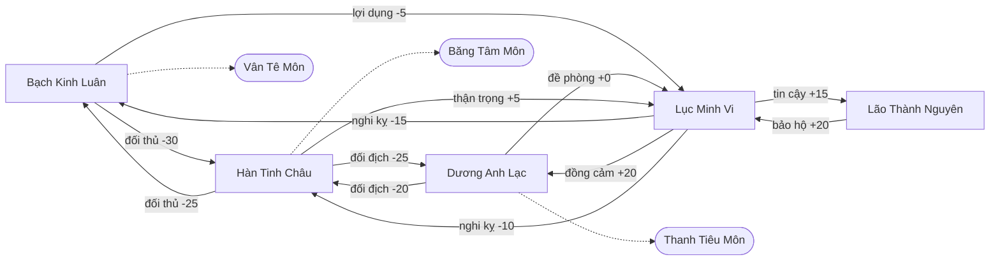

# Video script: run-20261021-ky-ao-vua-2-f8a61160

> **SPOILER / TRUTH WARNING: this file is built from the full truth layer of the story (secrets, backstage, what characters hide) and from text the reader has seen. It reveals everything. Do not show it to players. | CẢNH BÁO LỘ BÍ MẬT: bản xuất dựng từ toàn bộ lớp truth của truyện; chỉ admin được giữ, không đưa cho người chơi.**

- Dialogue language: `zh` (Chinese (Mandarin))
- Chapters: 1, 2, 3
- Model: `openai/gpt-6-luna` · prompt version `video-2` · calls 16 · cost 0.0164 USD

## Characters

| id | Name | Name in dialogue | Look set at story setup (Vietnamese) | Canonical English description | Source |
|---|---|---|---|---|---|
| bach_kinh_luan | Bạch Kinh Luân | 白经纶 |  | Middle-aged man with a lean build, long angular face, straight black hair tied in a high knot, ivory robe with dark teal edging and a jade belt, thin scar through his left eyebrow. | inferred at export |
| duong_anh_lac | Dương Anh Lạc | 杨英乐 |  | Young adult woman with a sturdy build, oval face, dark eyes, black hair in a tight high bun, charcoal-gray uniform robe with a stiff collar and fitted leather gloves, small mole below her right eye. | inferred at export |
| han_tinh_chau | Hàn Tinh Châu | 韩星洲 |  | Middle-aged man with a slender build, narrow pale face, long black hair secured with a silver clasp, layered ice-blue robes with a white fur collar, faint vertical scar beside his right eye. | inferred at export |
| lao_thanh_nguyen | Lão Thành Nguyên | 老成元 |  | Elderly man with a slight build, deeply lined face, sparse white hair tied at the nape, muted brown scholar's robe and a plain wooden cane, dark age spot on his left cheek. | inferred at export |
| protagonist | Lục Minh Vi (protagonist) | 陆明薇 |  | Young adult woman with a wiry build, alert oval face, dark brown eyes, black hair in a practical low braid, slate-blue travel robe with a weathered leather shoulder strap, small crescent-shaped scar on her chin. | inferred at export |
| thieu_kiem_hoai | Thiệu Kiếm Hoài | 邵剑怀 |  | Elderly man with a lean build, long lined face, salt-and-pepper hair in a neat topknot, deep navy official robe with a bronze seal clasp, small notch in his right earlobe. | inferred at export |

## Locations

| id | Name | Name in dialogue | Look set at story setup (Vietnamese) | Canonical English description | Source |
|---|---|---|---|---|---|
| ben_may_lac | Bến Mây Lạc | 宾梅乐 |  | Open-air mooring platform at the edge of a floating island, pale stone paving and dark iron rings set into the floor, cloud-bright daylight, wind-worn wooden posts and suspended docks fading into mist. | inferred at export |
| cuu_tieu_dai | Cửu Tiêu Đài | 九霄台 |  | Neutral floating island beneath clear high-altitude light, broad terraces of pale stone, dark tiled roofs and suspended bridges, ringed by cloud and crossed by wind-carved cliffs and narrow waterfalls. | inferred at export |
| dai_nghi_su | Đại Nghị Sảnh | 大议厅 |  | Vast stone council hall lit by cool shafts from high windows, gray flagstone floor and dark timber beams, massive closed stone doors, tiered benches and controlled side passages beneath a solemn vaulted ceiling. | inferred at export |
| hanh_lang_phong_luan | Hành Lang Phong Luân | 风轮走廊 |  | Narrow covered corridor circling the base of a floating platform, cool blue light on gray stone walls and iron fittings, exposed wind vanes, storage-room doors and a compact mechanical gate-control panel. | inferred at export |

## Chapter 1

### Relationship map (end of chapter)


**Where they are:** Bạch Kinh Luân at Đại Nghị Sảnh; Dương Anh Lạc at Đại Nghị Sảnh; Hàn Tinh Châu at Đại Nghị Sảnh; Lão Thành Nguyên at Đại Nghị Sảnh; Lục Minh Vi at Đại Nghị Sảnh; Thiệu Kiếm Hoài at Hành Lang Phong Luân
- **Learns (Fact):** Lục Minh Vi (chứng kiến): Cửa Đại Nghị Sảnh đã bị khóa từ phía trong khi cuộc tranh luận bắt đầu.
- **Learns (Fact):** Lục Minh Vi (chứng kiến): Hộp Phong Ấn được phát hiện trống ngay trước khi lời buộc tội đầu tiên được đưa ra.
- **Learns (Fact):** Lục Minh Vi (chứng kiến): Thiệu Kiếm Hoài mất tích trước khi cửa Đại Nghị Sảnh bị khóa.

### Scene 1.1

*Moderation: allow*

#### Shot 1: medium · eye_level · pan · 8 s · unknown · Đại Nghị Sảnh

- Appears: Bạch Kinh Luân, Lục Minh Vi
- Action: Bạch Kinh Luân turns toward Lục Minh Vi and rests one hand on the stone table.
- Bạch Kinh Luân: "陆明薇，明护镖局的护送队曾经过争议地区，对吗？" (original: "Lục Minh Vi, chuyến hộ tống của Minh Hộ Tống từng đi qua vùng tranh chấp, phải không?")

```text
Medium shot, eye-level angle, pan. Setting: Vast stone council hall lit by cool shafts from high windows, gray flagstone floor and dark timber beams, massive closed stone doors, tiered benches and controlled side passages beneath a solemn vaulted ceiling. Characters: Bạch Kinh Luân: Middle-aged man with a lean build, long angular face, straight black hair tied in a high knot, ivory robe with dark teal edging and a jade belt, thin scar through his left eyebrow. Lục Minh Vi: Young adult woman with a wiry build, alert oval face, dark brown eyes, black hair in a practical low braid, slate-blue travel robe with a weathered leather shoulder strap, small crescent-shaped scar on her chin. Action: Bạch Kinh Luân turns toward Lục Minh Vi and rests one hand on the stone table. Spoken line in Chinese (Mandarin) by Bạch Kinh Luân: "陆明薇，明护镖局的护送队曾经过争议地区，对吗？" Duration: 8 seconds.
```

#### Shot 2: wide · eye_level · push_in · 7 s · unknown · Đại Nghị Sảnh

- Appears: Bạch Kinh Luân
- Action: Behind Bạch Kinh Luân, the Seal Box remains open and empty beneath the overhead light.
- Bạch Kinh Luân: "门派之外之人的证词，可以判定谁先破了规矩。" (original: "Lời khai của người ngoài các đại môn phái có thể phân định ai đã phá luật trước.")

```text
Wide shot, eye-level angle, slow push-in. Setting: Vast stone council hall lit by cool shafts from high windows, gray flagstone floor and dark timber beams, massive closed stone doors, tiered benches and controlled side passages beneath a solemn vaulted ceiling. Characters: Bạch Kinh Luân: Middle-aged man with a lean build, long angular face, straight black hair tied in a high knot, ivory robe with dark teal edging and a jade belt, thin scar through his left eyebrow. Action: Behind Bạch Kinh Luân, the Seal Box remains open and empty beneath the overhead light. Spoken line in Chinese (Mandarin) by Bạch Kinh Luân: "门派之外之人的证词，可以判定谁先破了规矩。" Duration: 7 seconds.
```

#### Shot 3: medium_close_up · over_the_shoulder · static · 5 s · unknown · Đại Nghị Sảnh

- Appears: Hàn Tinh Châu, Lục Minh Vi
- Action: Hàn Tinh Châu cuts in, keeping his gaze fixed on Lục Minh Vi.
- Hàn Tinh Châu: "一个低阶弟子也值得如此信任吗？" (original: "Một môn sinh cấp thấp cũng đáng tin đến thế sao?")

```text
Medium close-up, over-the-shoulder angle, static camera. Setting: Vast stone council hall lit by cool shafts from high windows, gray flagstone floor and dark timber beams, massive closed stone doors, tiered benches and controlled side passages beneath a solemn vaulted ceiling. Characters: Hàn Tinh Châu: Middle-aged man with a slender build, narrow pale face, long black hair secured with a silver clasp, layered ice-blue robes with a white fur collar, faint vertical scar beside his right eye. Lục Minh Vi: Young adult woman with a wiry build, alert oval face, dark brown eyes, black hair in a practical low braid, slate-blue travel robe with a weathered leather shoulder strap, small crescent-shaped scar on her chin. Action: Hàn Tinh Châu cuts in, keeping his gaze fixed on Lục Minh Vi. Spoken line in Chinese (Mandarin) by Hàn Tinh Châu: "一个低阶弟子也值得如此信任吗？" Duration: 5 seconds.
```

#### Shot 4: medium · low · push_in · 7 s · unknown · Đại Nghị Sảnh

- Appears: Hàn Tinh Châu, Lục Minh Vi
- Action: Hàn Tinh Châu taps the chair edge with one finger as several elders look toward Lục Minh Vi and exchange glances.
- Hàn Tinh Châu: "证词若含糊，各方只会更有理由动手。你该知道自己在把谁推向哪一边。" (original: "Nếu lời khai mập mờ, các phe chỉ càng có cớ động thủ. Cô nên biết mình đang đẩy ai về phía nào.")

```text
Medium shot, low angle, slow push-in. Setting: Vast stone council hall lit by cool shafts from high windows, gray flagstone floor and dark timber beams, massive closed stone doors, tiered benches and controlled side passages beneath a solemn vaulted ceiling. Characters: Hàn Tinh Châu: Middle-aged man with a slender build, narrow pale face, long black hair secured with a silver clasp, layered ice-blue robes with a white fur collar, faint vertical scar beside his right eye. Lục Minh Vi: Young adult woman with a wiry build, alert oval face, dark brown eyes, black hair in a practical low braid, slate-blue travel robe with a weathered leather shoulder strap, small crescent-shaped scar on her chin. Action: Hàn Tinh Châu taps the chair edge with one finger as several elders look toward Lục Minh Vi and exchange glances. Spoken line in Chinese (Mandarin) by Hàn Tinh Châu: "证词若含糊，各方只会更有理由动手。你该知道自己在把谁推向哪一边。" Duration: 7 seconds.
```

#### Shot 5: wide · eye_level · track · 10 s · unknown · Đại Nghị Sảnh

- Appears: Dương Anh Lạc, Lục Minh Vi
- Action: Dương Anh Lạc rises, scraping her chair across the stone floor, while two people stop moving away from their seats.
- Dương Anh Lạc: "大议厅的门已经锁了。邵剑怀仍然失踪。谁也不许擅自离开，也不许用指控代替证据。" (original: "Cửa Đại Nghị Sảnh đã khóa. Thiệu Kiếm Hoài vẫn mất tích. Không ai tự ý rời đi, cũng không ai được lấy lời buộc tội thay cho chứng cứ.")

```text
Wide shot, eye-level angle, tracking shot. Setting: Vast stone council hall lit by cool shafts from high windows, gray flagstone floor and dark timber beams, massive closed stone doors, tiered benches and controlled side passages beneath a solemn vaulted ceiling. Characters: Dương Anh Lạc: Young adult woman with a sturdy build, oval face, dark eyes, black hair in a tight high bun, charcoal-gray uniform robe with a stiff collar and fitted leather gloves, small mole below her right eye. Lục Minh Vi: Young adult woman with a wiry build, alert oval face, dark brown eyes, black hair in a practical low braid, slate-blue travel robe with a weathered leather shoulder strap, small crescent-shaped scar on her chin. Action: Dương Anh Lạc rises, scraping her chair across the stone floor, while two people stop moving away from their seats. Spoken line in Chinese (Mandarin) by Dương Anh Lạc: "大议厅的门已经锁了。邵剑怀仍然失踪。谁也不许擅自离开，也不许用指控代替证据。" Duration: 10 seconds.
```

#### Shot 6: medium_close_up · eye_level · static · 9 s · unknown · Đại Nghị Sảnh

- Appears: Lão Thành Nguyên, Lục Minh Vi
- Action: Lão Thành Nguyên extends an open hand toward Lục Minh Vi.
- Lão Thành Nguyên: "明薇，你只说自己亲眼所见。别猜是谁从封印盒里拿走了天阙碎片。" (original: "Minh Vi, con chỉ nói điều mình tận mắt chứng kiến. Đừng suy đoán ai đã lấy Mảnh Thiên Khuyết khỏi Hộp Phong Ấn.")

```text
Medium close-up, eye-level angle, static camera. Setting: Vast stone council hall lit by cool shafts from high windows, gray flagstone floor and dark timber beams, massive closed stone doors, tiered benches and controlled side passages beneath a solemn vaulted ceiling. Characters: Lão Thành Nguyên: Elderly man with a slight build, deeply lined face, sparse white hair tied at the nape, muted brown scholar's robe and a plain wooden cane, dark age spot on his left cheek. Lục Minh Vi: Young adult woman with a wiry build, alert oval face, dark brown eyes, black hair in a practical low braid, slate-blue travel robe with a weathered leather shoulder strap, small crescent-shaped scar on her chin. Action: Lão Thành Nguyên extends an open hand toward Lục Minh Vi. Spoken line in Chinese (Mandarin) by Lão Thành Nguyên: "明薇，你只说自己亲眼所见。别猜是谁从封印盒里拿走了天阙碎片。" Duration: 9 seconds.
```

#### Shot 7: medium_close_up · low · static · 4 s · unknown · Đại Nghị Sảnh

- Appears: Bạch Kinh Luân, Lục Minh Vi
- Action: Bạch Kinh Luân tilts his head toward Lục Minh Vi.
- Bạch Kinh Luân: "沉默也是一种选择。" (original: "Im lặng cũng là một lựa chọn.")

```text
Medium close-up, low angle, static camera. Setting: Vast stone council hall lit by cool shafts from high windows, gray flagstone floor and dark timber beams, massive closed stone doors, tiered benches and controlled side passages beneath a solemn vaulted ceiling. Characters: Bạch Kinh Luân: Middle-aged man with a lean build, long angular face, straight black hair tied in a high knot, ivory robe with dark teal edging and a jade belt, thin scar through his left eyebrow. Lục Minh Vi: Young adult woman with a wiry build, alert oval face, dark brown eyes, black hair in a practical low braid, slate-blue travel robe with a weathered leather shoulder strap, small crescent-shaped scar on her chin. Action: Bạch Kinh Luân tilts his head toward Lục Minh Vi. Spoken line in Chinese (Mandarin) by Bạch Kinh Luân: "沉默也是一种选择。" Duration: 4 seconds.
```

#### Shot 8: close_up · eye_level · push_in · 8 s · unknown · Đại Nghị Sảnh

- Appears: Hàn Tinh Châu, Lục Minh Vi
- Action: Hàn Tinh Châu looks directly at Lục Minh Vi as she looks around the table.
- Hàn Tinh Châu: "那趟行程有没有把人或物带过争议地区？说清楚。" (original: "Chuyến đi ấy có đưa người hay vật qua vùng tranh chấp hay không? Nói rõ.")

```text
Close-up, eye-level angle, slow push-in. Setting: Vast stone council hall lit by cool shafts from high windows, gray flagstone floor and dark timber beams, massive closed stone doors, tiered benches and controlled side passages beneath a solemn vaulted ceiling. Characters: Hàn Tinh Châu: Middle-aged man with a slender build, narrow pale face, long black hair secured with a silver clasp, layered ice-blue robes with a white fur collar, faint vertical scar beside his right eye. Lục Minh Vi: Young adult woman with a wiry build, alert oval face, dark brown eyes, black hair in a practical low braid, slate-blue travel robe with a weathered leather shoulder strap, small crescent-shaped scar on her chin. Action: Hàn Tinh Châu looks directly at Lục Minh Vi as she looks around the table. Spoken line in Chinese (Mandarin) by Hàn Tinh Châu: "那趟行程有没有把人或物带过争议地区？说清楚。" Duration: 8 seconds.
```

#### Shot 9: medium_close_up · eye_level · push_in · 9 s · unknown · Đại Nghị Sảnh

- Appears: Lục Minh Vi
- Action: Lục Minh Vi holds her hands inside her sleeves, then faces the people around the table.
- Lục Minh Vi: "我会如实讲述自己知道的一切。但我不会替任何门派确认指控。" (original: "Tôi sẽ kể đúng những gì mình biết. Nhưng tôi không xác nhận lời buộc tội thay cho bất kỳ môn phái nào.")

```text
Medium close-up, eye-level angle, slow push-in. Setting: Vast stone council hall lit by cool shafts from high windows, gray flagstone floor and dark timber beams, massive closed stone doors, tiered benches and controlled side passages beneath a solemn vaulted ceiling. Characters: Lục Minh Vi: Young adult woman with a wiry build, alert oval face, dark brown eyes, black hair in a practical low braid, slate-blue travel robe with a weathered leather shoulder strap, small crescent-shaped scar on her chin. Action: Lục Minh Vi holds her hands inside her sleeves, then faces the people around the table. Spoken line in Chinese (Mandarin) by Lục Minh Vi: "我会如实讲述自己知道的一切。但我不会替任何门派确认指控。" Duration: 9 seconds.
```

#### Shot 10: medium · eye_level · pan · 6 s · unknown · Đại Nghị Sảnh

- Appears: Bạch Kinh Luân, Hàn Tinh Châu, Dương Anh Lạc, Lão Thành Nguyên, Lục Minh Vi
- Action: Bạch Kinh Luân pushes himself up, Hàn Tinh Châu rises from his chair, Dương Anh Lạc tightens her glove strap, and Lão Thành Nguyên lowers his hand. The people around the table begin speaking over one another.

```text
Medium shot, eye-level angle, pan. Setting: Vast stone council hall lit by cool shafts from high windows, gray flagstone floor and dark timber beams, massive closed stone doors, tiered benches and controlled side passages beneath a solemn vaulted ceiling. Characters: Bạch Kinh Luân: Middle-aged man with a lean build, long angular face, straight black hair tied in a high knot, ivory robe with dark teal edging and a jade belt, thin scar through his left eyebrow. Hàn Tinh Châu: Middle-aged man with a slender build, narrow pale face, long black hair secured with a silver clasp, layered ice-blue robes with a white fur collar, faint vertical scar beside his right eye. Dương Anh Lạc: Young adult woman with a sturdy build, oval face, dark eyes, black hair in a tight high bun, charcoal-gray uniform robe with a stiff collar and fitted leather gloves, small mole below her right eye. Lão Thành Nguyên: Elderly man with a slight build, deeply lined face, sparse white hair tied at the nape, muted brown scholar's robe and a plain wooden cane, dark age spot on his left cheek. Lục Minh Vi: Young adult woman with a wiry build, alert oval face, dark brown eyes, black hair in a practical low braid, slate-blue travel robe with a weathered leather shoulder strap, small crescent-shaped scar on her chin. Action: Bạch Kinh Luân pushes himself up, Hàn Tinh Châu rises from his chair, Dương Anh Lạc tightens her glove strap, and Lão Thành Nguyên lowers his hand. The people around the table begin speaking over one another. Duration: 6 seconds.
```

#### Shot 11: wide · high · pull_out · 7 s · unknown · Đại Nghị Sảnh

- Appears: Lục Minh Vi, Bạch Kinh Luân, Hàn Tinh Châu, Dương Anh Lạc, Lão Thành Nguyên
- Action: Lục Minh Vi stands among the stone columns facing the council table as everyone keeps their eyes on her.

```text
Wide shot, high angle, slow pull-out. Setting: Vast stone council hall lit by cool shafts from high windows, gray flagstone floor and dark timber beams, massive closed stone doors, tiered benches and controlled side passages beneath a solemn vaulted ceiling. Characters: Lục Minh Vi: Young adult woman with a wiry build, alert oval face, dark brown eyes, black hair in a practical low braid, slate-blue travel robe with a weathered leather shoulder strap, small crescent-shaped scar on her chin. Bạch Kinh Luân: Middle-aged man with a lean build, long angular face, straight black hair tied in a high knot, ivory robe with dark teal edging and a jade belt, thin scar through his left eyebrow. Hàn Tinh Châu: Middle-aged man with a slender build, narrow pale face, long black hair secured with a silver clasp, layered ice-blue robes with a white fur collar, faint vertical scar beside his right eye. Dương Anh Lạc: Young adult woman with a sturdy build, oval face, dark eyes, black hair in a tight high bun, charcoal-gray uniform robe with a stiff collar and fitted leather gloves, small mole below her right eye. Lão Thành Nguyên: Elderly man with a slight build, deeply lined face, sparse white hair tied at the nape, muted brown scholar's robe and a plain wooden cane, dark age spot on his left cheek. Action: Lục Minh Vi stands among the stone columns facing the council table as everyone keeps their eyes on her. Duration: 7 seconds.
```

### Scene 1.2

*Moderation: allow*

#### Shot 1: medium_close_up · eye_level · push_in · 12 s · unknown · Đại Nghị Sảnh

- Appears: Lục Minh Vi
- Action: Lục Minh Vi turns away from the open box and addresses the people around the table.
- Lục Minh Vi: "我们的护送队曾带人穿过争议地区。我在途中，见过被护送的人、界碑和巡逻队。但我没亲眼见谁拿了天阙碎片，也不能说哪个门派该负责。" (original: "Đoàn hộ tống của chúng tôi từng đưa người qua vùng tranh chấp. Tôi có mặt trên đường đi, thấy người được đưa qua, thấy những cột mốc ranh giới và những toán tuần tra. Nhưng tôi không chứng kiến ai lấy Mảnh Thiên Khuyết, cũng không thể nói môn phái nào phải chịu trách nhiệm.")

```text
Medium close-up, eye-level angle, slow push-in. Setting: Vast stone council hall lit by cool shafts from high windows, gray flagstone floor and dark timber beams, massive closed stone doors, tiered benches and controlled side passages beneath a solemn vaulted ceiling. Characters: Lục Minh Vi: Young adult woman with a wiry build, alert oval face, dark brown eyes, black hair in a practical low braid, slate-blue travel robe with a weathered leather shoulder strap, small crescent-shaped scar on her chin. Action: Lục Minh Vi turns away from the open box and addresses the people around the table. Spoken line in Chinese (Mandarin) by Lục Minh Vi: "我们的护送队曾带人穿过争议地区。我在途中，见过被护送的人、界碑和巡逻队。但我没亲眼见谁拿了天阙碎片，也不能说哪个门派该负责。" Duration: 12 seconds.
```

#### Shot 2: medium · over_the_shoulder · static · 6 s · unknown · Đại Nghị Sảnh

- Appears: Bạch Kinh Luân, Lục Minh Vi
- Action: Bạch Kinh Luân keeps one hand still on the stone tabletop as he questions Lục Minh Vi.
- Bạch Kinh Luân: "那么，那趟行程是否越过了仙门划定的边界？" (original: "Vậy hành trình ấy có vượt qua ranh giới do các tiên môn đặt ra hay không?")

```text
Medium shot, over-the-shoulder angle, static camera. Setting: Vast stone council hall lit by cool shafts from high windows, gray flagstone floor and dark timber beams, massive closed stone doors, tiered benches and controlled side passages beneath a solemn vaulted ceiling. Characters: Bạch Kinh Luân: Middle-aged man with a lean build, long angular face, straight black hair tied in a high knot, ivory robe with dark teal edging and a jade belt, thin scar through his left eyebrow. Lục Minh Vi: Young adult woman with a wiry build, alert oval face, dark brown eyes, black hair in a practical low braid, slate-blue travel robe with a weathered leather shoulder strap, small crescent-shaped scar on her chin. Action: Bạch Kinh Luân keeps one hand still on the stone tabletop as he questions Lục Minh Vi. Spoken line in Chinese (Mandarin) by Bạch Kinh Luân: "那么，那趟行程是否越过了仙门划定的边界？" Duration: 6 seconds.
```

#### Shot 3: medium_close_up · eye_level · static · 12 s · unknown · Đại Nghị Sảnh

- Appears: Lục Minh Vi
- Action: Lục Minh Vi answers from beside the table without looking away from the gathered assembly.
- Lục Minh Vi: "我可以陈述队伍经过哪里、遇见谁、看见什么。至于行程是否违反边界，我无权代仙门下结论。" (original: "Tôi có thể thuật lại đoàn đi qua đâu, gặp ai, nhìn thấy gì. Còn việc chuyến đi có vi phạm ranh giới hay không, tôi không có thẩm quyền kết luận thay các tiên môn.")

```text
Medium close-up, eye-level angle, static camera. Setting: Vast stone council hall lit by cool shafts from high windows, gray flagstone floor and dark timber beams, massive closed stone doors, tiered benches and controlled side passages beneath a solemn vaulted ceiling. Characters: Lục Minh Vi: Young adult woman with a wiry build, alert oval face, dark brown eyes, black hair in a practical low braid, slate-blue travel robe with a weathered leather shoulder strap, small crescent-shaped scar on her chin. Action: Lục Minh Vi answers from beside the table without looking away from the gathered assembly. Spoken line in Chinese (Mandarin) by Lục Minh Vi: "我可以陈述队伍经过哪里、遇见谁、看见什么。至于行程是否违反边界，我无权代仙门下结论。" Duration: 12 seconds.
```

#### Shot 4: medium_close_up · low · push_in · 6 s · unknown · Đại Nghị Sảnh

- Appears: Hàn Tinh Châu
- Action: Hàn Tinh Châu taps one finger against the side of his chair and speaks across the table.
- Hàn Tinh Châu: "这样的证词，能分辨什么对错？" (original: "Lời khai như thế thì phân định được đúng sai gì?")

```text
Medium close-up, low angle, slow push-in. Setting: Vast stone council hall lit by cool shafts from high windows, gray flagstone floor and dark timber beams, massive closed stone doors, tiered benches and controlled side passages beneath a solemn vaulted ceiling. Characters: Hàn Tinh Châu: Middle-aged man with a slender build, narrow pale face, long black hair secured with a silver clasp, layered ice-blue robes with a white fur collar, faint vertical scar beside his right eye. Action: Hàn Tinh Châu taps one finger against the side of his chair and speaks across the table. Spoken line in Chinese (Mandarin) by Hàn Tinh Châu: "这样的证词，能分辨什么对错？" Duration: 6 seconds.
```

#### Shot 5: medium · eye_level · pan · 9 s · unknown · Đại Nghị Sảnh

- Appears: Dương Anh Lạc
- Action: Dương Anh Lạc speaks briefly as hands near sword hilts withdraw from the table.
- Dương Anh Lạc: "至少不能让任何人仅凭证据缺口就抓人。" (original: "Ít ra nó không cho ai quyền bắt người chỉ vì muốn lấp chỗ trống trong chứng cứ.")

```text
Medium shot, eye-level angle, pan. Setting: Vast stone council hall lit by cool shafts from high windows, gray flagstone floor and dark timber beams, massive closed stone doors, tiered benches and controlled side passages beneath a solemn vaulted ceiling. Characters: Dương Anh Lạc: Young adult woman with a sturdy build, oval face, dark eyes, black hair in a tight high bun, charcoal-gray uniform robe with a stiff collar and fitted leather gloves, small mole below her right eye. Action: Dương Anh Lạc speaks briefly as hands near sword hilts withdraw from the table. Spoken line in Chinese (Mandarin) by Dương Anh Lạc: "至少不能让任何人仅凭证据缺口就抓人。" Duration: 9 seconds.
```

#### Shot 6: medium · over_the_shoulder · pan · 6 s · unknown · Đại Nghị Sảnh

- Appears: Hàn Tinh Châu, Dương Anh Lạc
- Action: Hàn Tinh Châu turns his face toward Dương Anh Lạc and addresses her.
- Hàn Tinh Châu: "杨执律想让此事不了了之？" (original: "Chấp luật Dương muốn để chuyện này trôi qua?")

```text
Medium shot, over-the-shoulder angle, pan. Setting: Vast stone council hall lit by cool shafts from high windows, gray flagstone floor and dark timber beams, massive closed stone doors, tiered benches and controlled side passages beneath a solemn vaulted ceiling. Characters: Hàn Tinh Châu: Middle-aged man with a slender build, narrow pale face, long black hair secured with a silver clasp, layered ice-blue robes with a white fur collar, faint vertical scar beside his right eye. Dương Anh Lạc: Young adult woman with a sturdy build, oval face, dark eyes, black hair in a tight high bun, charcoal-gray uniform robe with a stiff collar and fitted leather gloves, small mole below her right eye. Action: Hàn Tinh Châu turns his face toward Dương Anh Lạc and addresses her. Spoken line in Chinese (Mandarin) by Hàn Tinh Châu: "杨执律想让此事不了了之？" Duration: 6 seconds.
```

#### Shot 7: medium_close_up · eye_level · push_in · 12 s · unknown · Đại Nghị Sảnh

- Appears: Dương Anh Lạc
- Action: Dương Anh Lạc keeps her hands on the table, away from her sword hilt, as she replies.
- Dương Anh Lạc: "我不想让人拿不充分的证词定罪。门已锁，守印人失踪，盒子空了。再扣一个人，也不会凭空长出证据。" (original: "Tôi muốn không ai lấy lời chưa đủ làm cớ kết tội. Cửa đã khóa, người giữ ấn mất tích, hộp thì trống. Thêm một người bị giữ lại cũng chẳng khiến chứng cứ tự mọc ra.")

```text
Medium close-up, eye-level angle, slow push-in. Setting: Vast stone council hall lit by cool shafts from high windows, gray flagstone floor and dark timber beams, massive closed stone doors, tiered benches and controlled side passages beneath a solemn vaulted ceiling. Characters: Dương Anh Lạc: Young adult woman with a sturdy build, oval face, dark eyes, black hair in a tight high bun, charcoal-gray uniform robe with a stiff collar and fitted leather gloves, small mole below her right eye. Action: Dương Anh Lạc keeps her hands on the table, away from her sword hilt, as she replies. Spoken line in Chinese (Mandarin) by Dương Anh Lạc: "我不想让人拿不充分的证词定罪。门已锁，守印人失踪，盒子空了。再扣一个人，也不会凭空长出证据。" Duration: 12 seconds.
```

#### Shot 8: wide · low · tilt · 12 s · unknown · Đại Nghị Sảnh

- Appears: Lão Thành Nguyên
- Action: Lão Thành Nguyên rises, bracing himself on his cane; its tip strikes the stone floor as he addresses the table.
- Lão Thành Nguyên: "就在这里把陆明薇的证词记成文书。在场的人都听清了，免得日后有人说她讲过别的话。" (original: "Ghi lời khai của Minh Vi thành chứng từ ngay tại đây. Ai có mặt đều nghe rõ, sau này khỏi ai bảo nàng nói khác.")

```text
Wide shot, low angle, tilt. Setting: Vast stone council hall lit by cool shafts from high windows, gray flagstone floor and dark timber beams, massive closed stone doors, tiered benches and controlled side passages beneath a solemn vaulted ceiling. Characters: Lão Thành Nguyên: Elderly man with a slight build, deeply lined face, sparse white hair tied at the nape, muted brown scholar's robe and a plain wooden cane, dark age spot on his left cheek. Action: Lão Thành Nguyên rises, bracing himself on his cane; its tip strikes the stone floor as he addresses the table. Spoken line in Chinese (Mandarin) by Lão Thành Nguyên: "就在这里把陆明薇的证词记成文书。在场的人都听清了，免得日后有人说她讲过别的话。" Duration: 12 seconds.
```

#### Shot 9: wide · eye_level · static · 9 s · unknown · Đại Nghị Sảnh

- Appears: Lão Thành Nguyên
- Action: Lão Thành Nguyên looks around the table and lays down the restriction; no one answers.
- Lão Thành Nguyên: "有更多证据之前，谁也不得擅动封印盒，也不得指控任何门派。" (original: "Cho đến khi có thêm chứng cứ, không ai được tự ý động vào Hộp Phong Ấn hay buộc tội môn phái nào.")

```text
Wide shot, eye-level angle, static camera. Setting: Vast stone council hall lit by cool shafts from high windows, gray flagstone floor and dark timber beams, massive closed stone doors, tiered benches and controlled side passages beneath a solemn vaulted ceiling. Characters: Lão Thành Nguyên: Elderly man with a slight build, deeply lined face, sparse white hair tied at the nape, muted brown scholar's robe and a plain wooden cane, dark age spot on his left cheek. Action: Lão Thành Nguyên looks around the table and lays down the restriction; no one answers. Spoken line in Chinese (Mandarin) by Lão Thành Nguyên: "有更多证据之前，谁也不得擅动封印盒，也不得指控任何门派。" Duration: 9 seconds.
```

#### Shot 10: medium_close_up · eye_level · static · 9 s · unknown · Đại Nghị Sảnh

- Appears: Bạch Kinh Luân, Lục Minh Vi
- Action: Bạch Kinh Luân slowly smooths a crease in his sleeve while speaking to Lục Minh Vi.
- Bạch Kinh Luân: "记就记。但证词里的每句话，你都得负责。" (original: "Ghi thì ghi. Nhưng từng câu trong lời khai, cô phải chịu trách nhiệm.")

```text
Medium close-up, eye-level angle, static camera. Setting: Vast stone council hall lit by cool shafts from high windows, gray flagstone floor and dark timber beams, massive closed stone doors, tiered benches and controlled side passages beneath a solemn vaulted ceiling. Characters: Bạch Kinh Luân: Middle-aged man with a lean build, long angular face, straight black hair tied in a high knot, ivory robe with dark teal edging and a jade belt, thin scar through his left eyebrow. Lục Minh Vi: Young adult woman with a wiry build, alert oval face, dark brown eyes, black hair in a practical low braid, slate-blue travel robe with a weathered leather shoulder strap, small crescent-shaped scar on her chin. Action: Bạch Kinh Luân slowly smooths a crease in his sleeve while speaking to Lục Minh Vi. Spoken line in Chinese (Mandarin) by Bạch Kinh Luân: "记就记。但证词里的每句话，你都得负责。" Duration: 9 seconds.
```

#### Shot 11: medium_close_up · eye_level · push_in · 10 s · unknown · Đại Nghị Sảnh

- Appears: Lục Minh Vi, Bạch Kinh Luân
- Action: Lục Minh Vi looks at Bạch Kinh Luân and answers across the table.
- Lục Minh Vi: "我为自己看到和说过的事负责。证词不是判决。" (original: "Tôi chịu trách nhiệm về điều mình đã thấy và đã nói. Lời chứng không phải bản án.")

```text
Medium close-up, eye-level angle, slow push-in. Setting: Vast stone council hall lit by cool shafts from high windows, gray flagstone floor and dark timber beams, massive closed stone doors, tiered benches and controlled side passages beneath a solemn vaulted ceiling. Characters: Lục Minh Vi: Young adult woman with a wiry build, alert oval face, dark brown eyes, black hair in a practical low braid, slate-blue travel robe with a weathered leather shoulder strap, small crescent-shaped scar on her chin. Bạch Kinh Luân: Middle-aged man with a lean build, long angular face, straight black hair tied in a high knot, ivory robe with dark teal edging and a jade belt, thin scar through his left eyebrow. Action: Lục Minh Vi looks at Bạch Kinh Luân and answers across the table. Spoken line in Chinese (Mandarin) by Lục Minh Vi: "我为自己看到和说过的事负责。证词不是判决。" Duration: 10 seconds.
```

#### Shot 12: wide · high · pull_out · 8 s · unknown · Đại Nghị Sảnh

- Appears: Lục Minh Vi, Bạch Kinh Luân, Hàn Tinh Châu, Dương Anh Lạc, Lão Thành Nguyên, Thiệu Kiếm Hoài
- Action: A written statement lies in the middle of the table as a scribe writes. The leaders look down without signing, and no hands return to the sword hilts; the hall door remains locked and Thiệu Kiếm Hoài’s seat is empty.

```text
Wide shot, high angle, slow pull-out. Setting: Vast stone council hall lit by cool shafts from high windows, gray flagstone floor and dark timber beams, massive closed stone doors, tiered benches and controlled side passages beneath a solemn vaulted ceiling. Characters: Lục Minh Vi: Young adult woman with a wiry build, alert oval face, dark brown eyes, black hair in a practical low braid, slate-blue travel robe with a weathered leather shoulder strap, small crescent-shaped scar on her chin. Bạch Kinh Luân: Middle-aged man with a lean build, long angular face, straight black hair tied in a high knot, ivory robe with dark teal edging and a jade belt, thin scar through his left eyebrow. Hàn Tinh Châu: Middle-aged man with a slender build, narrow pale face, long black hair secured with a silver clasp, layered ice-blue robes with a white fur collar, faint vertical scar beside his right eye. Dương Anh Lạc: Young adult woman with a sturdy build, oval face, dark eyes, black hair in a tight high bun, charcoal-gray uniform robe with a stiff collar and fitted leather gloves, small mole below her right eye. Lão Thành Nguyên: Elderly man with a slight build, deeply lined face, sparse white hair tied at the nape, muted brown scholar's robe and a plain wooden cane, dark age spot on his left cheek. Thiệu Kiếm Hoài: Elderly man with a lean build, long lined face, salt-and-pepper hair in a neat topknot, deep navy official robe with a bronze seal clasp, small notch in his right earlobe. Action: A written statement lies in the middle of the table as a scribe writes. The leaders look down without signing, and no hands return to the sword hilts; the hall door remains locked and Thiệu Kiếm Hoài’s seat is empty. Duration: 8 seconds.
```

## Chapter 2

### Relationship map (end of chapter)



**Where they are:** Bạch Kinh Luân at Đại Nghị Sảnh; Dương Anh Lạc at Đại Nghị Sảnh; Hàn Tinh Châu at Đại Nghị Sảnh; Lão Thành Nguyên at Đại Nghị Sảnh; Lục Minh Vi at Đại Nghị Sảnh; Thiệu Kiếm Hoài at Hành Lang Phong Luân
- **Learns (Fact):** Lục Minh Vi (chứng kiến): Bang Luận Kiếm muốn trao quyền quản giữ thần khí cho một hội đồng do các tiên môn lớn chi phối.

### Scene 2.1

*Moderation: allow*

#### Shot 1: medium_close_up · high · push_in · 8 s · unknown · Đại Nghị Sảnh

- Appears: Lục Minh Vi
- Action: Lục Minh Vi looks down at the document on the table, its ink shining beneath the spirit lamp.
- Lục Minh Vi: "请从头读。我只为亲眼所见负责。" (original: "Xin đọc lại từ đầu. Ta chỉ chịu trách nhiệm cho điều mình tận mắt chứng kiến.")

```text
Medium close-up, high angle, slow push-in. Setting: Vast stone council hall lit by cool shafts from high windows, gray flagstone floor and dark timber beams, massive closed stone doors, tiered benches and controlled side passages beneath a solemn vaulted ceiling. Characters: Lục Minh Vi: Young adult woman with a wiry build, alert oval face, dark brown eyes, black hair in a practical low braid, slate-blue travel robe with a weathered leather shoulder strap, small crescent-shaped scar on her chin. Action: Lục Minh Vi looks down at the document on the table, its ink shining beneath the spirit lamp. Spoken line in Chinese (Mandarin) by Lục Minh Vi: "请从头读。我只为亲眼所见负责。" Duration: 8 seconds.
```

#### Shot 2: medium · eye_level · static · 8 s · unknown · Đại Nghị Sảnh

- Appears: Lão Thành Nguyên
- Action: The surrounding murmurs fade. Lão Thành Nguyên nods and draws the paper toward himself.
- Lão Thành Nguyên: "好。我就在这里逐句念。" (original: "Được. Ta đọc ngay tại đây, từng câu một.")

```text
Medium shot, eye-level angle, static camera. Setting: Vast stone council hall lit by cool shafts from high windows, gray flagstone floor and dark timber beams, massive closed stone doors, tiered benches and controlled side passages beneath a solemn vaulted ceiling. Characters: Lão Thành Nguyên: Elderly man with a slight build, deeply lined face, sparse white hair tied at the nape, muted brown scholar's robe and a plain wooden cane, dark age spot on his left cheek. Action: The surrounding murmurs fade. Lão Thành Nguyên nods and draws the paper toward himself. Spoken line in Chinese (Mandarin) by Lão Thành Nguyên: "好。我就在这里逐句念。" Duration: 8 seconds.
```

#### Shot 3: wide · eye_level · pan · 8 s · unknown · Đại Nghị Sảnh

- Appears: Lão Thành Nguyên, Lục Minh Vi
- Action: Lão Thành Nguyên lifts the record and reads aloud in the hall as wind brushes against the closed windows. Lục Minh Vi cuts in.
- Lão Thành Nguyên: "明护送的护卫队经过争议地带，那里有界碑和巡逻队——" (original: "Đoàn hộ tống của Minh Hộ Tống đã đi qua vùng tranh chấp, nơi có cột mốc và toán tuần tra-")
- Lục Minh Vi: "请停在这里。" (original: "Xin dừng ở đó.")

```text
Wide shot, eye-level angle, pan. Setting: Vast stone council hall lit by cool shafts from high windows, gray flagstone floor and dark timber beams, massive closed stone doors, tiered benches and controlled side passages beneath a solemn vaulted ceiling. Characters: Lão Thành Nguyên: Elderly man with a slight build, deeply lined face, sparse white hair tied at the nape, muted brown scholar's robe and a plain wooden cane, dark age spot on his left cheek. Lục Minh Vi: Young adult woman with a wiry build, alert oval face, dark brown eyes, black hair in a practical low braid, slate-blue travel robe with a weathered leather shoulder strap, small crescent-shaped scar on her chin. Action: Lão Thành Nguyên lifts the record and reads aloud in the hall as wind brushes against the closed windows. Lục Minh Vi cuts in. Spoken line in Chinese (Mandarin) by Lão Thành Nguyên: "明护送的护卫队经过争议地带，那里有界碑和巡逻队——" Spoken line in Chinese (Mandarin) by Lục Minh Vi: "请停在这里。" Duration: 8 seconds.
```

#### Shot 4: close_up · over_the_shoulder · static · 12 s · unknown · Đại Nghị Sảnh

- Appears: Lão Thành Nguyên, Lục Minh Vi
- Action: Lão Thành Nguyên lowers the paper. Lục Minh Vi points to a line without touching the ink.
- Lục Minh Vi: "我看见了界碑和巡逻队，但无法判断界碑标示哪条边界，也认不出巡逻者属于哪个门派。" (original: "Tôi thấy cột mốc. Tôi thấy toán tuần tra. Nhưng tôi không xác định được cột mốc ấy đánh dấu ranh giới nào, cũng không nhận ra môn phái của những người tuần tra.")

```text
Close-up, over-the-shoulder angle, static camera. Setting: Vast stone council hall lit by cool shafts from high windows, gray flagstone floor and dark timber beams, massive closed stone doors, tiered benches and controlled side passages beneath a solemn vaulted ceiling. Characters: Lão Thành Nguyên: Elderly man with a slight build, deeply lined face, sparse white hair tied at the nape, muted brown scholar's robe and a plain wooden cane, dark age spot on his left cheek. Lục Minh Vi: Young adult woman with a wiry build, alert oval face, dark brown eyes, black hair in a practical low braid, slate-blue travel robe with a weathered leather shoulder strap, small crescent-shaped scar on her chin. Action: Lão Thành Nguyên lowers the paper. Lục Minh Vi points to a line without touching the ink. Spoken line in Chinese (Mandarin) by Lục Minh Vi: "我看见了界碑和巡逻队，但无法判断界碑标示哪条边界，也认不出巡逻者属于哪个门派。" Duration: 12 seconds.
```

#### Shot 5: medium · low · tilt · 12 s · unknown · Đại Nghị Sảnh

- Appears: Bạch Kinh Luân
- Action: Bạch Kinh Luân rises, his sleeve passing the edge of the table, and addresses the assembly.
- Bạch Kinh Luân: "即使她认不出门派，队伍仍经过争议地带。这趟护送足以证明现行法度维持不了秩序。天阙碎片不能交由各派争夺，必须由大仙门议会掌控。" (original: "Dù nàng không nhận ra môn phái, đoàn người vẫn đi qua vùng tranh chấp. Một chuyến đi như vậy đủ cho thấy luật hiện hành không thể giữ nổi trật tự. Mảnh Thiên Khuyết không thể giao cho từng môn phái tự tranh đoạt. Hội đồng các tiên môn lớn phải nắm quyền kiểm soát.")

```text
Medium shot, low angle, tilt. Setting: Vast stone council hall lit by cool shafts from high windows, gray flagstone floor and dark timber beams, massive closed stone doors, tiered benches and controlled side passages beneath a solemn vaulted ceiling. Characters: Bạch Kinh Luân: Middle-aged man with a lean build, long angular face, straight black hair tied in a high knot, ivory robe with dark teal edging and a jade belt, thin scar through his left eyebrow. Action: Bạch Kinh Luân rises, his sleeve passing the edge of the table, and addresses the assembly. Spoken line in Chinese (Mandarin) by Bạch Kinh Luân: "即使她认不出门派，队伍仍经过争议地带。这趟护送足以证明现行法度维持不了秩序。天阙碎片不能交由各派争夺，必须由大仙门议会掌控。" Duration: 12 seconds.
```

#### Shot 6: medium_close_up · eye_level · push_in · 12 s · unknown · Đại Nghị Sảnh

- Appears: Hàn Tinh Châu, Bạch Kinh Luân
- Action: Hàn Tinh Châu gives a dry laugh. Bạch Kinh Luân turns toward him.
- Hàn Tinh Châu: "她的证词没证明谁拿了神器碎片。您把一次护送扯进来，只为争取保管权，也太顺手了。" (original: "Bản khai của nàng không chứng minh ai lấy mảnh thần khí. Ông kéo chuyện một chuyến hộ tống vào đây để xin quyền giữ nó, nghe cũng thuận tay quá.")
- Bạch Kinh Luân: "那你想让空盒和失踪的印主摆着，再称之为中立？" (original: "Còn ông muốn để chiếc hộp trống và người giữ ấn mất tích, rồi gọi đó là trung lập?")

```text
Medium close-up, eye-level angle, slow push-in. Setting: Vast stone council hall lit by cool shafts from high windows, gray flagstone floor and dark timber beams, massive closed stone doors, tiered benches and controlled side passages beneath a solemn vaulted ceiling. Characters: Hàn Tinh Châu: Middle-aged man with a slender build, narrow pale face, long black hair secured with a silver clasp, layered ice-blue robes with a white fur collar, faint vertical scar beside his right eye. Bạch Kinh Luân: Middle-aged man with a lean build, long angular face, straight black hair tied in a high knot, ivory robe with dark teal edging and a jade belt, thin scar through his left eyebrow. Action: Hàn Tinh Châu gives a dry laugh. Bạch Kinh Luân turns toward him. Spoken line in Chinese (Mandarin) by Hàn Tinh Châu: "她的证词没证明谁拿了神器碎片。您把一次护送扯进来，只为争取保管权，也太顺手了。" Spoken line in Chinese (Mandarin) by Bạch Kinh Luân: "那你想让空盒和失踪的印主摆着，再称之为中立？" Duration: 12 seconds.
```

#### Shot 7: close_up · high · tilt · 6 s · unknown · Đại Nghị Sảnh

- Appears: Hàn Tinh Châu
- Action: Hàn Tinh Châu does not answer at once. His finger taps the tabletop twice, then stops.

```text
Close-up, high angle, tilt. Setting: Vast stone council hall lit by cool shafts from high windows, gray flagstone floor and dark timber beams, massive closed stone doors, tiered benches and controlled side passages beneath a solemn vaulted ceiling. Characters: Hàn Tinh Châu: Middle-aged man with a slender build, narrow pale face, long black hair secured with a silver clasp, layered ice-blue robes with a white fur collar, faint vertical scar beside his right eye. Action: Hàn Tinh Châu does not answer at once. His finger taps the tabletop twice, then stops. Duration: 6 seconds.
```

#### Shot 8: medium · eye_level · track · 12 s · unknown · Đại Nghị Sảnh

- Appears: Dương Anh Lạc, Lão Thành Nguyên
- Action: Dương Anh Lạc steps forward before Lão Thành Nguyên can speak. She looks from the record to the scribe.
- Dương Anh Lạc: "只有她亲眼所见的句子才能记作证词。推测的部分删掉。" (original: "Chỉ những câu nàng tận mắt thấy mới được ghi thành chứng từ. Phần nào là suy đoán thì bỏ đi.")

```text
Medium shot, eye-level angle, tracking shot. Setting: Vast stone council hall lit by cool shafts from high windows, gray flagstone floor and dark timber beams, massive closed stone doors, tiered benches and controlled side passages beneath a solemn vaulted ceiling. Characters: Dương Anh Lạc: Young adult woman with a sturdy build, oval face, dark eyes, black hair in a tight high bun, charcoal-gray uniform robe with a stiff collar and fitted leather gloves, small mole below her right eye. Lão Thành Nguyên: Elderly man with a slight build, deeply lined face, sparse white hair tied at the nape, muted brown scholar's robe and a plain wooden cane, dark age spot on his left cheek. Action: Dương Anh Lạc steps forward before Lão Thành Nguyên can speak. She looks from the record to the scribe. Spoken line in Chinese (Mandarin) by Dương Anh Lạc: "只有她亲眼所见的句子才能记作证词。推测的部分删掉。" Duration: 12 seconds.
```

#### Shot 9: medium_close_up · over_the_shoulder · pan · 9 s · unknown · Đại Nghị Sảnh

- Appears: Dương Anh Lạc, Bạch Kinh Luân
- Action: Dương Anh Lạc turns her gaze toward Bạch Kinh Luân. He remains standing beside the table.
- Dương Anh Lạc: "逼证人确认她没说过的话，这场议事就谈不上中立。" (original: "Ép nhân chứng xác nhận điều nàng chưa nói, phiên nghị sự này sẽ chẳng còn gì để gọi là trung lập.")
- Bạch Kinh Luân: "我没有逼她确认。" (original: "Ta đâu có ép nàng xác nhận.")
- Dương Anh Lạc: "那就别把这份证词当成它不是的东西。" (original: "Vậy thì đừng dùng lời khai ấy làm thứ nó không phải.")

```text
Medium close-up, over-the-shoulder angle, pan. Setting: Vast stone council hall lit by cool shafts from high windows, gray flagstone floor and dark timber beams, massive closed stone doors, tiered benches and controlled side passages beneath a solemn vaulted ceiling. Characters: Dương Anh Lạc: Young adult woman with a sturdy build, oval face, dark eyes, black hair in a tight high bun, charcoal-gray uniform robe with a stiff collar and fitted leather gloves, small mole below her right eye. Bạch Kinh Luân: Middle-aged man with a lean build, long angular face, straight black hair tied in a high knot, ivory robe with dark teal edging and a jade belt, thin scar through his left eyebrow. Action: Dương Anh Lạc turns her gaze toward Bạch Kinh Luân. He remains standing beside the table. Spoken line in Chinese (Mandarin) by Dương Anh Lạc: "逼证人确认她没说过的话，这场议事就谈不上中立。" Spoken line in Chinese (Mandarin) by Bạch Kinh Luân: "我没有逼她确认。" Spoken line in Chinese (Mandarin) by Dương Anh Lạc: "那就别把这份证词当成它不是的东西。" Duration: 9 seconds.
```

#### Shot 10: wide · eye_level · pan · 12 s · unknown · Đại Nghị Sảnh

- Appears: Lục Minh Vi, Lão Thành Nguyên
- Action: People shift in the rows around the table; hands on sword hilts show beneath sleeves. The scribe's pen pauses mid-line as Lục Minh Vi speaks.
- Lục Minh Vi: "删去护送队越过某门派控制边界的说法。照我的原话重写：我看见界碑和巡逻队，但无法确认边界或他们所属的门派。" (original: "Gạch bỏ phần nói đoàn hộ tống đã vượt qua ranh giới do một môn phái nào đó kiểm soát. Ghi lại đúng lời tôi: tôi thấy cột mốc và toán tuần tra, nhưng không xác định được ranh giới hay môn phái của họ.")

```text
Wide shot, eye-level angle, pan. Setting: Vast stone council hall lit by cool shafts from high windows, gray flagstone floor and dark timber beams, massive closed stone doors, tiered benches and controlled side passages beneath a solemn vaulted ceiling. Characters: Lục Minh Vi: Young adult woman with a wiry build, alert oval face, dark brown eyes, black hair in a practical low braid, slate-blue travel robe with a weathered leather shoulder strap, small crescent-shaped scar on her chin. Lão Thành Nguyên: Elderly man with a slight build, deeply lined face, sparse white hair tied at the nape, muted brown scholar's robe and a plain wooden cane, dark age spot on his left cheek. Action: People shift in the rows around the table; hands on sword hilts show beneath sleeves. The scribe's pen pauses mid-line as Lục Minh Vi speaks. Spoken line in Chinese (Mandarin) by Lục Minh Vi: "删去护送队越过某门派控制边界的说法。照我的原话重写：我看见界碑和巡逻队，但无法确认边界或他们所属的门派。" Duration: 12 seconds.
```

#### Shot 11: medium_close_up · eye_level · static · 12 s · unknown · Đại Nghị Sảnh

- Appears: Lục Minh Vi, Lão Thành Nguyên
- Action: Lão Thành Nguyên looks to Lục Minh Vi, who nods. The scribe draws a thin line through the old sentence and writes beneath it; she reads the fresh ink, then signs the page.
- Lục Minh Vi: "记录已改。我只确认亲眼所见，不为任何一方的结论负责。" (original: "Bản ghi đã sửa. Ta xác nhận những điều ta tận mắt chứng kiến, không nhận trách nhiệm cho kết luận của bất kỳ phe nào.")

```text
Medium close-up, eye-level angle, static camera. Setting: Vast stone council hall lit by cool shafts from high windows, gray flagstone floor and dark timber beams, massive closed stone doors, tiered benches and controlled side passages beneath a solemn vaulted ceiling. Characters: Lục Minh Vi: Young adult woman with a wiry build, alert oval face, dark brown eyes, black hair in a practical low braid, slate-blue travel robe with a weathered leather shoulder strap, small crescent-shaped scar on her chin. Lão Thành Nguyên: Elderly man with a slight build, deeply lined face, sparse white hair tied at the nape, muted brown scholar's robe and a plain wooden cane, dark age spot on his left cheek. Action: Lão Thành Nguyên looks to Lục Minh Vi, who nods. The scribe draws a thin line through the old sentence and writes beneath it; she reads the fresh ink, then signs the page. Spoken line in Chinese (Mandarin) by Lục Minh Vi: "记录已改。我只确认亲眼所见，不为任何一方的结论负责。" Duration: 12 seconds.
```

#### Shot 12: wide · low · pull_out · 12 s · unknown · Đại Nghị Sảnh

- Appears: Bạch Kinh Luân, Hàn Tinh Châu
- Action: Bạch Kinh Luân remains standing as Hàn Tinh Châu leans forward. Between them, the amended document lies flat beside the open, empty sealed box beneath the lamp.
- Bạch Kinh Luân: "你可以字字谨慎，但各派仍须决定谁有权保管神器碎片。" (original: "Nàng có thể dè dặt với từng chữ. Nhưng các môn phái vẫn phải quyết định ai có quyền giữ mảnh thần khí.")
- Hàn Tinh Châu: "就凭这份证词来决定？那权力早就在想占有它的人手里了。" (original: "Quyết định bằng lời khai này ư? Vậy thì quyền ấy đã nằm sẵn trong tay người muốn chiếm nó.")

```text
Wide shot, low angle, slow pull-out. Setting: Vast stone council hall lit by cool shafts from high windows, gray flagstone floor and dark timber beams, massive closed stone doors, tiered benches and controlled side passages beneath a solemn vaulted ceiling. Characters: Bạch Kinh Luân: Middle-aged man with a lean build, long angular face, straight black hair tied in a high knot, ivory robe with dark teal edging and a jade belt, thin scar through his left eyebrow. Hàn Tinh Châu: Middle-aged man with a slender build, narrow pale face, long black hair secured with a silver clasp, layered ice-blue robes with a white fur collar, faint vertical scar beside his right eye. Action: Bạch Kinh Luân remains standing as Hàn Tinh Châu leans forward. Between them, the amended document lies flat beside the open, empty sealed box beneath the lamp. Spoken line in Chinese (Mandarin) by Bạch Kinh Luân: "你可以字字谨慎，但各派仍须决定谁有权保管神器碎片。" Spoken line in Chinese (Mandarin) by Hàn Tinh Châu: "就凭这份证词来决定？那权力早就在想占有它的人手里了。" Duration: 12 seconds.
```

### Scene 2.2

*Moderation: allow*

#### Shot 1: medium · eye_level · push_in · 8 s · unknown · Đại Nghị Sảnh

- Appears: Lục Minh Vi
- Action: Lục Minh Vi follows the lines on the document as the fresh ink catches the light. Several people in the hall turn to look at Lục Minh Vi.

```text
Medium shot, eye-level angle, slow push-in. Setting: Vast stone council hall lit by cool shafts from high windows, gray flagstone floor and dark timber beams, massive closed stone doors, tiered benches and controlled side passages beneath a solemn vaulted ceiling. Characters: Lục Minh Vi: Young adult woman with a wiry build, alert oval face, dark brown eyes, black hair in a practical low braid, slate-blue travel robe with a weathered leather shoulder strap, small crescent-shaped scar on her chin. Action: Lục Minh Vi follows the lines on the document as the fresh ink catches the light. Several people in the hall turn to look at Lục Minh Vi. Duration: 8 seconds.
```

#### Shot 2: wide · high · static · 5 s · unknown · Đại Nghị Sảnh

- Appears: Lục Minh Vi
- Action: The reading stops. Several people turn their attention toward Lục Minh Vi.

```text
Wide shot, high angle, static camera. Setting: Vast stone council hall lit by cool shafts from high windows, gray flagstone floor and dark timber beams, massive closed stone doors, tiered benches and controlled side passages beneath a solemn vaulted ceiling. Characters: Lục Minh Vi: Young adult woman with a wiry build, alert oval face, dark brown eyes, black hair in a practical low braid, slate-blue travel robe with a weathered leather shoulder strap, small crescent-shaped scar on her chin. Action: The reading stops. Several people turn their attention toward Lục Minh Vi. Duration: 5 seconds.
```

#### Shot 3: medium_close_up · eye_level · static · 10 s · unknown · Đại Nghị Sảnh

- Appears: Lục Minh Vi
- Action: Lục Minh Vi studies the document, then looks up from it.

```text
Medium close-up, eye-level angle, static camera. Setting: Vast stone council hall lit by cool shafts from high windows, gray flagstone floor and dark timber beams, massive closed stone doors, tiered benches and controlled side passages beneath a solemn vaulted ceiling. Characters: Lục Minh Vi: Young adult woman with a wiry build, alert oval face, dark brown eyes, black hair in a practical low braid, slate-blue travel robe with a weathered leather shoulder strap, small crescent-shaped scar on her chin. Action: Lục Minh Vi studies the document, then looks up from it. Duration: 10 seconds.
```

#### Shot 4: medium · eye_level · track · 12 s · unknown · Đại Nghị Sảnh

- Appears: Lục Minh Vi
- Action: Lục Minh Vi speaks while holding position beside the table.
- Lục Minh Vi: "对。此份记录没有断定护送队越过了边界，也没有指出任何门派。" (original: "Đúng. Bản này không kết luận đoàn hộ tống đã vượt ranh giới, cũng không chỉ ra môn phái nào.")
- Lục Minh Vi: "我确认自己亲眼见到的事。" (original: "Tôi xác nhận những điều mình tận mắt chứng kiến.")

```text
Medium shot, eye-level angle, tracking shot. Setting: Vast stone council hall lit by cool shafts from high windows, gray flagstone floor and dark timber beams, massive closed stone doors, tiered benches and controlled side passages beneath a solemn vaulted ceiling. Characters: Lục Minh Vi: Young adult woman with a wiry build, alert oval face, dark brown eyes, black hair in a practical low braid, slate-blue travel robe with a weathered leather shoulder strap, small crescent-shaped scar on her chin. Action: Lục Minh Vi speaks while holding position beside the table. Spoken line in Chinese (Mandarin) by Lục Minh Vi: "对。此份记录没有断定护送队越过了边界，也没有指出任何门派。" Spoken line in Chinese (Mandarin) by Lục Minh Vi: "我确认自己亲眼见到的事。" Duration: 12 seconds.
```

#### Shot 5: medium · low · track · 12 s · unknown · Đại Nghị Sảnh

- Appears: Bạch Kinh Luân, Lục Minh Vi
- Action: Bạch Kinh Luân steps up beside the table and looks down at Lục Minh Vi's signature.
- Bạch Kinh Luân: "即便你不知道边界在哪里，那支队伍仍经过了争议地区。" (original: "Dù nàng không biết ranh giới nằm ở đâu, đoàn ấy vẫn đi qua vùng tranh chấp.")
- Bạch Kinh Luân: "仅凭这一点，就足以证明现行法律无法维持秩序。" (original: "Chừng đó đủ chứng minh luật hiện hành không giữ nổi trật tự.")

```text
Medium shot, low angle, tracking shot. Setting: Vast stone council hall lit by cool shafts from high windows, gray flagstone floor and dark timber beams, massive closed stone doors, tiered benches and controlled side passages beneath a solemn vaulted ceiling. Characters: Bạch Kinh Luân: Middle-aged man with a lean build, long angular face, straight black hair tied in a high knot, ivory robe with dark teal edging and a jade belt, thin scar through his left eyebrow. Lục Minh Vi: Young adult woman with a wiry build, alert oval face, dark brown eyes, black hair in a practical low braid, slate-blue travel robe with a weathered leather shoulder strap, small crescent-shaped scar on her chin. Action: Bạch Kinh Luân steps up beside the table and looks down at Lục Minh Vi's signature. Spoken line in Chinese (Mandarin) by Bạch Kinh Luân: "即便你不知道边界在哪里，那支队伍仍经过了争议地区。" Spoken line in Chinese (Mandarin) by Bạch Kinh Luân: "仅凭这一点，就足以证明现行法律无法维持秩序。" Duration: 12 seconds.
```

#### Shot 6: close_up · eye_level · push_in · 8 s · unknown · Đại Nghị Sảnh

- Appears: Bạch Kinh Luân
- Action: Bạch Kinh Luân continues addressing the assembly from beside the table.
- Bạch Kinh Luân: "会议必须把神器碎片的保管权交给大仙门联盟。" (original: "Hội nghị phải giao quyền giữ mảnh thần khí cho liên minh các tiên môn lớn.")

```text
Close-up, eye-level angle, slow push-in. Setting: Vast stone council hall lit by cool shafts from high windows, gray flagstone floor and dark timber beams, massive closed stone doors, tiered benches and controlled side passages beneath a solemn vaulted ceiling. Characters: Bạch Kinh Luân: Middle-aged man with a lean build, long angular face, straight black hair tied in a high knot, ivory robe with dark teal edging and a jade belt, thin scar through his left eyebrow. Action: Bạch Kinh Luân continues addressing the assembly from beside the table. Spoken line in Chinese (Mandarin) by Bạch Kinh Luân: "会议必须把神器碎片的保管权交给大仙门联盟。" Duration: 8 seconds.
```

#### Shot 7: medium_close_up · eye_level · static · 12 s · unknown · Đại Nghị Sảnh

- Appears: Lục Minh Vi
- Action: Lục Minh Vi places both hands on the edge of the table, leaving space between them and the document.
- Lục Minh Vi: "一次有路标、有巡逻者的行程，不能证明谁违反了法律。" (original: "Một chuyến đi có cột mốc, có người tuần tra, không chứng minh được ai vi phạm luật.")
- Lục Minh Vi: "更不能以此作为交出神器碎片保管权的证据。" (original: "Càng không thể lấy nó làm bằng chứng để trao quyền giữ mảnh thần khí.")

```text
Medium close-up, eye-level angle, static camera. Setting: Vast stone council hall lit by cool shafts from high windows, gray flagstone floor and dark timber beams, massive closed stone doors, tiered benches and controlled side passages beneath a solemn vaulted ceiling. Characters: Lục Minh Vi: Young adult woman with a wiry build, alert oval face, dark brown eyes, black hair in a practical low braid, slate-blue travel robe with a weathered leather shoulder strap, small crescent-shaped scar on her chin. Action: Lục Minh Vi places both hands on the edge of the table, leaving space between them and the document. Spoken line in Chinese (Mandarin) by Lục Minh Vi: "一次有路标、有巡逻者的行程，不能证明谁违反了法律。" Spoken line in Chinese (Mandarin) by Lục Minh Vi: "更不能以此作为交出神器碎片保管权的证据。" Duration: 12 seconds.
```

#### Shot 8: medium · eye_level · pan · 12 s · unknown · Đại Nghị Sảnh

- Appears: Dương Anh Lạc, Lục Minh Vi
- Action: Dương Anh Lạc looks around the table as several hands slowly release their sword hilts.
- Dương Anh Lạc: "请分清证人的证词与想掌权之人的推论。" (original: "Hãy phân biệt chứng từ của nhân chứng với suy luận của người muốn nắm quyền.")
- Dương Anh Lạc: "她只说了自己亲眼所见的事。其余都是你的话。" (original: "Nàng ấy chỉ nói điều mình tận mắt thấy. Phần còn lại là lời của ông.")

```text
Medium shot, eye-level angle, pan. Setting: Vast stone council hall lit by cool shafts from high windows, gray flagstone floor and dark timber beams, massive closed stone doors, tiered benches and controlled side passages beneath a solemn vaulted ceiling. Characters: Dương Anh Lạc: Young adult woman with a sturdy build, oval face, dark eyes, black hair in a tight high bun, charcoal-gray uniform robe with a stiff collar and fitted leather gloves, small mole below her right eye. Lục Minh Vi: Young adult woman with a wiry build, alert oval face, dark brown eyes, black hair in a practical low braid, slate-blue travel robe with a weathered leather shoulder strap, small crescent-shaped scar on her chin. Action: Dương Anh Lạc looks around the table as several hands slowly release their sword hilts. Spoken line in Chinese (Mandarin) by Dương Anh Lạc: "请分清证人的证词与想掌权之人的推论。" Spoken line in Chinese (Mandarin) by Dương Anh Lạc: "她只说了自己亲眼所见的事。其余都是你的话。" Duration: 12 seconds.
```

#### Shot 9: medium_close_up · eye_level · static · 12 s · unknown · Đại Nghị Sảnh

- Appears: Bạch Kinh Luân, Dương Anh Lạc
- Action: Bạch Kinh Luân tilts his head slightly as he speaks toward Dương Anh Lạc.
- Bạch Kinh Luân: "如果事事都要等到证据充分，各大仙门要等到何时才能重整秩序？" (original: "Nếu chuyện gì cũng chờ đủ chứng cứ, các tiên môn định lập lại trật tự đến bao giờ?")

```text
Medium close-up, eye-level angle, static camera. Setting: Vast stone council hall lit by cool shafts from high windows, gray flagstone floor and dark timber beams, massive closed stone doors, tiered benches and controlled side passages beneath a solemn vaulted ceiling. Characters: Bạch Kinh Luân: Middle-aged man with a lean build, long angular face, straight black hair tied in a high knot, ivory robe with dark teal edging and a jade belt, thin scar through his left eyebrow. Dương Anh Lạc: Young adult woman with a sturdy build, oval face, dark eyes, black hair in a tight high bun, charcoal-gray uniform robe with a stiff collar and fitted leather gloves, small mole below her right eye. Action: Bạch Kinh Luân tilts his head slightly as he speaks toward Dương Anh Lạc. Spoken line in Chinese (Mandarin) by Bạch Kinh Luân: "如果事事都要等到证据充分，各大仙门要等到何时才能重整秩序？" Duration: 12 seconds.
```

#### Shot 10: medium · eye_level · pan · 12 s · unknown · Đại Nghị Sảnh

- Appears: Dương Anh Lạc, Hàn Tinh Châu
- Action: Dương Anh Lạc answers across the table. Hàn Tinh Châu taps one finger on the tabletop.
- Dương Anh Lạc: "让别人替自己担责来重整秩序，确实很快。" (original: "Lập trật tự bằng cách bắt người khác chịu trách nhiệm thay mình thì nhanh thật.")
- Hàn Tinh Châu: "把我的反对意见明确记入会议记录。" (original: "Ghi rõ lời phản đối của ta vào biên bản.")
- Hàn Tinh Châu: "我不接受用这份证词作为借口，把权力交给白经纶的联盟。" (original: "Ta không chấp nhận dùng bản khai này làm cớ trao quyền cho liên minh của Bạch Kinh Luân.")

```text
Medium shot, eye-level angle, pan. Setting: Vast stone council hall lit by cool shafts from high windows, gray flagstone floor and dark timber beams, massive closed stone doors, tiered benches and controlled side passages beneath a solemn vaulted ceiling. Characters: Dương Anh Lạc: Young adult woman with a sturdy build, oval face, dark eyes, black hair in a tight high bun, charcoal-gray uniform robe with a stiff collar and fitted leather gloves, small mole below her right eye. Hàn Tinh Châu: Middle-aged man with a slender build, narrow pale face, long black hair secured with a silver clasp, layered ice-blue robes with a white fur collar, faint vertical scar beside his right eye. Action: Dương Anh Lạc answers across the table. Hàn Tinh Châu taps one finger on the tabletop. Spoken line in Chinese (Mandarin) by Dương Anh Lạc: "让别人替自己担责来重整秩序，确实很快。" Spoken line in Chinese (Mandarin) by Hàn Tinh Châu: "把我的反对意见明确记入会议记录。" Spoken line in Chinese (Mandarin) by Hàn Tinh Châu: "我不接受用这份证词作为借口，把权力交给白经纶的联盟。" Duration: 12 seconds.
```

#### Shot 11: medium · high · static · 12 s · unknown · Đại Nghị Sảnh

- Appears: Lão Thành Nguyên, Bạch Kinh Luân
- Action: Lão Thành Nguyên pulls the paper toward himself and holds one hand over its corner. Bạch Kinh Luân turns toward him.
- Lão Thành Nguyên: "证词既已确认，就照原样保留。不得用它作为定罪依据，也不得用它表决交出神器碎片的控制权。" (original: "Lời khai đã xác nhận thì giữ nguyên như vậy. Không được dùng nó làm căn cứ kết tội, cũng không được lấy nó để biểu quyết trao quyền kiểm soát mảnh thần khí.")
- Bạch Kinh Luân: "元老要靠一张纸阻止整个会议作出决定吗？" (original: "Nguyên lão định giữ một tờ giấy để ngăn cả hội nghị quyết định sao?")

```text
Medium shot, high angle, static camera. Setting: Vast stone council hall lit by cool shafts from high windows, gray flagstone floor and dark timber beams, massive closed stone doors, tiered benches and controlled side passages beneath a solemn vaulted ceiling. Characters: Lão Thành Nguyên: Elderly man with a slight build, deeply lined face, sparse white hair tied at the nape, muted brown scholar's robe and a plain wooden cane, dark age spot on his left cheek. Bạch Kinh Luân: Middle-aged man with a lean build, long angular face, straight black hair tied in a high knot, ivory robe with dark teal edging and a jade belt, thin scar through his left eyebrow. Action: Lão Thành Nguyên pulls the paper toward himself and holds one hand over its corner. Bạch Kinh Luân turns toward him. Spoken line in Chinese (Mandarin) by Lão Thành Nguyên: "证词既已确认，就照原样保留。不得用它作为定罪依据，也不得用它表决交出神器碎片的控制权。" Spoken line in Chinese (Mandarin) by Bạch Kinh Luân: "元老要靠一张纸阻止整个会议作出决定吗？" Duration: 12 seconds.
```

#### Shot 12: close_up · eye_level · push_in · 12 s · unknown · Đại Nghị Sảnh

- Appears: Lão Thành Nguyên, Lục Minh Vi, Hàn Tinh Châu, Bạch Kinh Luân
- Action: Lão Thành Nguyên keeps his hand on the paper. The scribe writes beside the confirmed document as Lục Minh Vi leaves it untouched; the two sides withdraw in opposite directions. Beyond the shut main door, the bolt remains still.
- Lão Thành Nguyên: "我是在保护证人的话不被篡改成控罪。" (original: "Ta giữ lời nhân chứng khỏi bị sửa thành lời buộc tội.")

```text
Close-up, eye-level angle, slow push-in. Setting: Vast stone council hall lit by cool shafts from high windows, gray flagstone floor and dark timber beams, massive closed stone doors, tiered benches and controlled side passages beneath a solemn vaulted ceiling. Characters: Lão Thành Nguyên: Elderly man with a slight build, deeply lined face, sparse white hair tied at the nape, muted brown scholar's robe and a plain wooden cane, dark age spot on his left cheek. Lục Minh Vi: Young adult woman with a wiry build, alert oval face, dark brown eyes, black hair in a practical low braid, slate-blue travel robe with a weathered leather shoulder strap, small crescent-shaped scar on her chin. Hàn Tinh Châu: Middle-aged man with a slender build, narrow pale face, long black hair secured with a silver clasp, layered ice-blue robes with a white fur collar, faint vertical scar beside his right eye. Bạch Kinh Luân: Middle-aged man with a lean build, long angular face, straight black hair tied in a high knot, ivory robe with dark teal edging and a jade belt, thin scar through his left eyebrow. Action: Lão Thành Nguyên keeps his hand on the paper. The scribe writes beside the confirmed document as Lục Minh Vi leaves it untouched; the two sides withdraw in opposite directions. Beyond the shut main door, the bolt remains still. Spoken line in Chinese (Mandarin) by Lão Thành Nguyên: "我是在保护证人的话不被篡改成控罪。" Duration: 12 seconds.
```

## Chapter 3

### Relationship map (end of chapter)


**Where they are:** Bạch Kinh Luân at Đại Nghị Sảnh; Dương Anh Lạc at Đại Nghị Sảnh; Hàn Tinh Châu at Đại Nghị Sảnh; Lão Thành Nguyên at Đại Nghị Sảnh; Lục Minh Vi at Đại Nghị Sảnh; Thiệu Kiếm Hoài at Hành Lang Phong Luân

### Scene 3.1

*Moderation: allow*

#### Shot 1: medium_close_up · eye_level · push_in · 8 s · unknown · Đại Nghị Sảnh

- Appears: Lục Minh Vi, Bạch Kinh Luân
- Action: Lục Minh Vi looks down at the dry signature on the testimony while Bạch Kinh Luân waits across the table, then turns toward the others.
- Bạch Kinh Luân: "门还锁着。眼下必须有人有权下令。" (original: "Cửa vẫn khóa. Trong lúc này, phải có người được quyền ra lệnh.")

```text
Medium close-up, eye-level angle, slow push-in. Setting: Vast stone council hall lit by cool shafts from high windows, gray flagstone floor and dark timber beams, massive closed stone doors, tiered benches and controlled side passages beneath a solemn vaulted ceiling. Characters: Lục Minh Vi: Young adult woman with a wiry build, alert oval face, dark brown eyes, black hair in a practical low braid, slate-blue travel robe with a weathered leather shoulder strap, small crescent-shaped scar on her chin. Bạch Kinh Luân: Middle-aged man with a lean build, long angular face, straight black hair tied in a high knot, ivory robe with dark teal edging and a jade belt, thin scar through his left eyebrow. Action: Lục Minh Vi looks down at the dry signature on the testimony while Bạch Kinh Luân waits across the table, then turns toward the others. Spoken line in Chinese (Mandarin) by Bạch Kinh Luân: "门还锁着。眼下必须有人有权下令。" Duration: 8 seconds.
```

#### Shot 2: medium · over_the_shoulder · static · 8 s · unknown · Đại Nghị Sảnh

- Appears: Hàn Tinh Châu
- Action: Hàn Tinh Châu rests a hand on the table's edge and addresses the others without looking away from them.
- Hàn Tinh Châu: "今日有权下令的人，要握权到何时？别拿门锁当借口，把整个天律台交给一派。" (original: "Người được quyền ra lệnh hôm nay sẽ giữ quyền ấy đến khi nào? Đừng lấy cửa khóa làm cớ trao cả Đài Thiên Luật cho một phe.")

```text
Medium shot, over-the-shoulder angle, static camera. Setting: Vast stone council hall lit by cool shafts from high windows, gray flagstone floor and dark timber beams, massive closed stone doors, tiered benches and controlled side passages beneath a solemn vaulted ceiling. Characters: Hàn Tinh Châu: Middle-aged man with a slender build, narrow pale face, long black hair secured with a silver clasp, layered ice-blue robes with a white fur collar, faint vertical scar beside his right eye. Action: Hàn Tinh Châu rests a hand on the table's edge and addresses the others without looking away from them. Spoken line in Chinese (Mandarin) by Hàn Tinh Châu: "今日有权下令的人，要握权到何时？别拿门锁当借口，把整个天律台交给一派。" Duration: 8 seconds.
```

#### Shot 3: wide · eye_level · track · 9 s · unknown · Đại Nghị Sảnh

- Appears: Dương Anh Lạc
- Action: Dương Anh Lạc steps between the sect leaders and the empty sealed box, keeping her hands away from it.
- Dương Anh Lạc: "所有人离开箱子。没有证据，谁也不能抓人，更不能擅自搜查。" (original: "Tất cả lùi khỏi chiếc hộp. Chưa có chứng cứ thì không ai được bắt giữ người khác, càng không ai được tự ý lục soát.")

```text
Wide shot, eye-level angle, tracking shot. Setting: Vast stone council hall lit by cool shafts from high windows, gray flagstone floor and dark timber beams, massive closed stone doors, tiered benches and controlled side passages beneath a solemn vaulted ceiling. Characters: Dương Anh Lạc: Young adult woman with a sturdy build, oval face, dark eyes, black hair in a tight high bun, charcoal-gray uniform robe with a stiff collar and fitted leather gloves, small mole below her right eye. Action: Dương Anh Lạc steps between the sect leaders and the empty sealed box, keeping her hands away from it. Spoken line in Chinese (Mandarin) by Dương Anh Lạc: "所有人离开箱子。没有证据，谁也不能抓人，更不能擅自搜查。" Duration: 9 seconds.
```

#### Shot 4: medium_close_up · eye_level · push_in · 7 s · unknown · Đại Nghị Sảnh

- Appears: Bạch Kinh Luân, Dương Anh Lạc
- Action: Bạch Kinh Luân looks toward Dương Anh Lạc with a slight lift at the corner of his mouth.
- Bạch Kinh Luân: "等待也是一种选择。等到别人遭难，别说今天没人负责。" (original: "Chờ đợi cũng là một lựa chọn. Đến khi có người khác gặp nạn, đừng nói hôm nay không ai chịu trách nhiệm.")

```text
Medium close-up, eye-level angle, slow push-in. Setting: Vast stone council hall lit by cool shafts from high windows, gray flagstone floor and dark timber beams, massive closed stone doors, tiered benches and controlled side passages beneath a solemn vaulted ceiling. Characters: Bạch Kinh Luân: Middle-aged man with a lean build, long angular face, straight black hair tied in a high knot, ivory robe with dark teal edging and a jade belt, thin scar through his left eyebrow. Dương Anh Lạc: Young adult woman with a sturdy build, oval face, dark eyes, black hair in a tight high bun, charcoal-gray uniform robe with a stiff collar and fitted leather gloves, small mole below her right eye. Action: Bạch Kinh Luân looks toward Dương Anh Lạc with a slight lift at the corner of his mouth. Spoken line in Chinese (Mandarin) by Bạch Kinh Luân: "等待也是一种选择。等到别人遭难，别说今天没人负责。" Duration: 7 seconds.
```

#### Shot 5: close_up · eye_level · pan · 8 s · unknown · Đại Nghị Sảnh

- Appears: Lục Minh Vi, Lão Thành Nguyên
- Action: Lục Minh Vi turns toward Lão Thành Nguyên as a nearby disciple grips a sword hilt and looks at the box.
- Lục Minh Vi: "元长老，还有办法不破锁检查门吗？" (original: "Nguyên lão, còn cách nào kiểm tra cửa mà không phá khóa không?")

```text
Close-up, eye-level angle, pan. Setting: Vast stone council hall lit by cool shafts from high windows, gray flagstone floor and dark timber beams, massive closed stone doors, tiered benches and controlled side passages beneath a solemn vaulted ceiling. Characters: Lục Minh Vi: Young adult woman with a wiry build, alert oval face, dark brown eyes, black hair in a practical low braid, slate-blue travel robe with a weathered leather shoulder strap, small crescent-shaped scar on her chin. Lão Thành Nguyên: Elderly man with a slight build, deeply lined face, sparse white hair tied at the nape, muted brown scholar's robe and a plain wooden cane, dark age spot on his left cheek. Action: Lục Minh Vi turns toward Lão Thành Nguyên as a nearby disciple grips a sword hilt and looks at the box. Spoken line in Chinese (Mandarin) by Lục Minh Vi: "元长老，还有办法不破锁检查门吗？" Duration: 8 seconds.
```

#### Shot 6: medium_close_up · eye_level · static · 8 s · unknown · Đại Nghị Sảnh

- Appears: Lão Thành Nguyên
- Action: Lão Thành Nguyên taps the top of his staff once with a finger, then stills his hand.
- Lão Thành Nguyên: "锁的机关仍完好。但刚才，我感到台深处传来极微弱的一次回应。不像开门声。" (original: "Cơ chế khóa vẫn nguyên. Nhưng vừa rồi, ta cảm nhận được một nhịp đáp rất yếu từ sâu bên trong đài. Không giống tiếng cửa mở.")

```text
Medium close-up, eye-level angle, static camera. Setting: Vast stone council hall lit by cool shafts from high windows, gray flagstone floor and dark timber beams, massive closed stone doors, tiered benches and controlled side passages beneath a solemn vaulted ceiling. Characters: Lão Thành Nguyên: Elderly man with a slight build, deeply lined face, sparse white hair tied at the nape, muted brown scholar's robe and a plain wooden cane, dark age spot on his left cheek. Action: Lão Thành Nguyên taps the top of his staff once with a finger, then stills his hand. Spoken line in Chinese (Mandarin) by Lão Thành Nguyên: "锁的机关仍完好。但刚才，我感到台深处传来极微弱的一次回应。不像开门声。" Duration: 8 seconds.
```

#### Shot 7: medium · over_the_shoulder · static · 3 s · unknown · Đại Nghị Sảnh

- Appears: Hàn Tinh Châu, Lão Thành Nguyên
- Action: Hàn Tinh Châu turns his attention toward Lão Thành Nguyên.
- Hàn Tinh Châu: "你确定吗？" (original: "Ông chắc chứ?")

```text
Medium shot, over-the-shoulder angle, static camera. Setting: Vast stone council hall lit by cool shafts from high windows, gray flagstone floor and dark timber beams, massive closed stone doors, tiered benches and controlled side passages beneath a solemn vaulted ceiling. Characters: Hàn Tinh Châu: Middle-aged man with a slender build, narrow pale face, long black hair secured with a silver clasp, layered ice-blue robes with a white fur collar, faint vertical scar beside his right eye. Lão Thành Nguyên: Elderly man with a slight build, deeply lined face, sparse white hair tied at the nape, muted brown scholar's robe and a plain wooden cane, dark age spot on his left cheek. Action: Hàn Tinh Châu turns his attention toward Lão Thành Nguyên. Spoken line in Chinese (Mandarin) by Hàn Tinh Châu: "你确定吗？" Duration: 3 seconds.
```

#### Shot 8: medium · eye_level · pan · 8 s · unknown · Đại Nghị Sảnh

- Appears: Lão Thành Nguyên
- Action: Lão Thành Nguyên looks toward the rune-carved doors at the far end of the hall.
- Lão Thành Nguyên: "我只说自己感受到的。那可能是机关余响，也可能是别的东西。" (original: "Ta chỉ nói điều mình cảm nhận được. Nó có thể là dư âm của cơ chế, cũng có thể là thứ khác.")

```text
Medium shot, eye-level angle, pan. Setting: Vast stone council hall lit by cool shafts from high windows, gray flagstone floor and dark timber beams, massive closed stone doors, tiered benches and controlled side passages beneath a solemn vaulted ceiling. Characters: Lão Thành Nguyên: Elderly man with a slight build, deeply lined face, sparse white hair tied at the nape, muted brown scholar's robe and a plain wooden cane, dark age spot on his left cheek. Action: Lão Thành Nguyên looks toward the rune-carved doors at the far end of the hall. Spoken line in Chinese (Mandarin) by Lão Thành Nguyên: "我只说自己感受到的。那可能是机关余响，也可能是别的东西。" Duration: 8 seconds.
```

#### Shot 9: medium · low · tilt · 10 s · unknown · Đại Nghị Sảnh

- Appears: Lục Minh Vi
- Action: Lục Minh Vi steps away from the table; a shoe touches a thin crack in the stone floor as dust lies nearby.
- Lục Minh Vi: "那就别在这里争谁下令了。我们检查里面的通道，只确认台的状况。谁也不能拿结果定罪别人或抢箱子。" (original: "Vậy đừng tranh quyền ra lệnh ở đây nữa. Chúng ta kiểm tra các lối bên trong, chỉ để biết tình trạng của đài. Không ai được dùng kết quả để kết tội người khác hay giành chiếc hộp.")

```text
Medium shot, low angle, tilt. Setting: Vast stone council hall lit by cool shafts from high windows, gray flagstone floor and dark timber beams, massive closed stone doors, tiered benches and controlled side passages beneath a solemn vaulted ceiling. Characters: Lục Minh Vi: Young adult woman with a wiry build, alert oval face, dark brown eyes, black hair in a practical low braid, slate-blue travel robe with a weathered leather shoulder strap, small crescent-shaped scar on her chin. Action: Lục Minh Vi steps away from the table; a shoe touches a thin crack in the stone floor as dust lies nearby. Spoken line in Chinese (Mandarin) by Lục Minh Vi: "那就别在这里争谁下令了。我们检查里面的通道，只确认台的状况。谁也不能拿结果定罪别人或抢箱子。" Duration: 10 seconds.
```

#### Shot 10: medium · eye_level · static · 5 s · unknown · Đại Nghị Sảnh

- Appears: Dương Anh Lạc
- Action: Dương Anh Lạc nods once as she stands near the others.
- Dương Anh Lạc: "我同行。若有人想抓人，我会阻止。" (original: "Ta đi cùng. Nếu có ai định bắt người, ta sẽ ngăn lại.")

```text
Medium shot, eye-level angle, static camera. Setting: Vast stone council hall lit by cool shafts from high windows, gray flagstone floor and dark timber beams, massive closed stone doors, tiered benches and controlled side passages beneath a solemn vaulted ceiling. Characters: Dương Anh Lạc: Young adult woman with a sturdy build, oval face, dark eyes, black hair in a tight high bun, charcoal-gray uniform robe with a stiff collar and fitted leather gloves, small mole below her right eye. Action: Dương Anh Lạc nods once as she stands near the others. Spoken line in Chinese (Mandarin) by Dương Anh Lạc: "我同行。若有人想抓人，我会阻止。" Duration: 5 seconds.
```

#### Shot 11: medium_close_up · over_the_shoulder · push_in · 8 s · unknown · Đại Nghị Sảnh

- Appears: Bạch Kinh Luân, Lục Minh Vi
- Action: Bạch Kinh Luân looks for a long moment at Lục Minh Vi, then shifts his gaze from the signature toward the inner door.
- Bạch Kinh Luân: "我同意，但每件事都必须有人作证。" (original: "Ta chấp thuận, với điều kiện có người làm chứng cho mọi việc.")

```text
Medium close-up, over-the-shoulder angle, slow push-in. Setting: Vast stone council hall lit by cool shafts from high windows, gray flagstone floor and dark timber beams, massive closed stone doors, tiered benches and controlled side passages beneath a solemn vaulted ceiling. Characters: Bạch Kinh Luân: Middle-aged man with a lean build, long angular face, straight black hair tied in a high knot, ivory robe with dark teal edging and a jade belt, thin scar through his left eyebrow. Lục Minh Vi: Young adult woman with a wiry build, alert oval face, dark brown eyes, black hair in a practical low braid, slate-blue travel robe with a weathered leather shoulder strap, small crescent-shaped scar on her chin. Action: Bạch Kinh Luân looks for a long moment at Lục Minh Vi, then shifts his gaze from the signature toward the inner door. Spoken line in Chinese (Mandarin) by Bạch Kinh Luân: "我同意，但每件事都必须有人作证。" Duration: 8 seconds.
```

#### Shot 12: wide · eye_level · track · 12 s · unknown · Đại Nghị Sảnh

- Appears: Hàn Tinh Châu, Bạch Kinh Luân, Lão Thành Nguyên, Lục Minh Vi, Dương Anh Lạc
- Action: Hàn Tinh Châu speaks as the group moves toward the inner door behind Lão Thành Nguyên. Lục Minh Vi stops at the dark threshold while Lão Thành Nguyên places a hand on the door; everyone else halts behind them.
- Hàn Tinh Châu: "我也同意。而且谁也不许独自行动。" (original: "Ta cũng vậy. Và không ai được đi một mình.")

```text
Wide shot, eye-level angle, tracking shot. Setting: Vast stone council hall lit by cool shafts from high windows, gray flagstone floor and dark timber beams, massive closed stone doors, tiered benches and controlled side passages beneath a solemn vaulted ceiling. Characters: Hàn Tinh Châu: Middle-aged man with a slender build, narrow pale face, long black hair secured with a silver clasp, layered ice-blue robes with a white fur collar, faint vertical scar beside his right eye. Bạch Kinh Luân: Middle-aged man with a lean build, long angular face, straight black hair tied in a high knot, ivory robe with dark teal edging and a jade belt, thin scar through his left eyebrow. Lão Thành Nguyên: Elderly man with a slight build, deeply lined face, sparse white hair tied at the nape, muted brown scholar's robe and a plain wooden cane, dark age spot on his left cheek. Lục Minh Vi: Young adult woman with a wiry build, alert oval face, dark brown eyes, black hair in a practical low braid, slate-blue travel robe with a weathered leather shoulder strap, small crescent-shaped scar on her chin. Dương Anh Lạc: Young adult woman with a sturdy build, oval face, dark eyes, black hair in a tight high bun, charcoal-gray uniform robe with a stiff collar and fitted leather gloves, small mole below her right eye. Action: Hàn Tinh Châu speaks as the group moves toward the inner door behind Lão Thành Nguyên. Lục Minh Vi stops at the dark threshold while Lão Thành Nguyên places a hand on the door; everyone else halts behind them. Spoken line in Chinese (Mandarin) by Hàn Tinh Châu: "我也同意。而且谁也不许独自行动。" Duration: 12 seconds.
```

### Scene 3.2

*Moderation: allow*

#### Shot 1: wide · eye_level · push_in · 6 s · unknown · Hành Lang Phong Luân

- Appears: Lão Thành Nguyên
- Action: Lão Thành Nguyên leans his shoulder into the inner door. The hinge groans, dust falls from the threshold, and the door opens onto a narrow dark corridor.

```text
Wide shot, eye-level angle, slow push-in. Setting: Narrow covered corridor circling the base of a floating platform, cool blue light on gray stone walls and iron fittings, exposed wind vanes, storage-room doors and a compact mechanical gate-control panel. Characters: Lão Thành Nguyên: Elderly man with a slight build, deeply lined face, sparse white hair tied at the nape, muted brown scholar's robe and a plain wooden cane, dark age spot on his left cheek. Action: Lão Thành Nguyên leans his shoulder into the inner door. The hinge groans, dust falls from the threshold, and the door opens onto a narrow dark corridor. Duration: 6 seconds.
```

#### Shot 2: medium · over_the_shoulder · pan · 11 s · unknown · Đại Nghị Sảnh

- Appears: Lục Minh Vi, Bạch Kinh Luân, Hàn Tinh Châu
- Action: Lục Minh Vi looks back toward the sealed great door, then turns toward the opening. Bạch Kinh Luân speaks as Hàn Tinh Châu glances at him.
- Bạch Kinh Luân: "至少里面还有路。" (original: "Ít nhất bên trong còn lối đi.")
- Hàn Tinh Châu: "有路不等于有出口。" (original: "Lối đi không đồng nghĩa với lối thoát.")

```text
Medium shot, over-the-shoulder angle, pan. Setting: Vast stone council hall lit by cool shafts from high windows, gray flagstone floor and dark timber beams, massive closed stone doors, tiered benches and controlled side passages beneath a solemn vaulted ceiling. Characters: Lục Minh Vi: Young adult woman with a wiry build, alert oval face, dark brown eyes, black hair in a practical low braid, slate-blue travel robe with a weathered leather shoulder strap, small crescent-shaped scar on her chin. Bạch Kinh Luân: Middle-aged man with a lean build, long angular face, straight black hair tied in a high knot, ivory robe with dark teal edging and a jade belt, thin scar through his left eyebrow. Hàn Tinh Châu: Middle-aged man with a slender build, narrow pale face, long black hair secured with a silver clasp, layered ice-blue robes with a white fur collar, faint vertical scar beside his right eye. Action: Lục Minh Vi looks back toward the sealed great door, then turns toward the opening. Bạch Kinh Luân speaks as Hàn Tinh Châu glances at him. Spoken line in Chinese (Mandarin) by Bạch Kinh Luân: "至少里面还有路。" Spoken line in Chinese (Mandarin) by Hàn Tinh Châu: "有路不等于有出口。" Duration: 11 seconds.
```

#### Shot 3: medium_close_up · low · tilt · 5 s · unknown · Hành Lang Phong Luân

- Appears: Lão Thành Nguyên
- Action: Lão Thành Nguyên raises his staff and taps the corridor floor. The dry knock echoes down the passage and fades.

```text
Medium close-up, low angle, tilt. Setting: Narrow covered corridor circling the base of a floating platform, cool blue light on gray stone walls and iron fittings, exposed wind vanes, storage-room doors and a compact mechanical gate-control panel. Characters: Lão Thành Nguyên: Elderly man with a slight build, deeply lined face, sparse white hair tied at the nape, muted brown scholar's robe and a plain wooden cane, dark age spot on his left cheek. Action: Lão Thành Nguyên raises his staff and taps the corridor floor. The dry knock echoes down the passage and fades. Duration: 5 seconds.
```

#### Shot 4: close_up · high · tilt · 12 s · unknown · Hành Lang Phong Luân

- Appears: Lục Minh Vi, Bạch Kinh Luân
- Action: Lục Minh Vi crouches to inspect the disturbed dust near the wall, then looks up. Bạch Kinh Luân looks down without touching it.
- Lục Minh Vi: "这里有被扰动的灰尘。只是需要检查的痕迹，还不足以指控任何人。" (original: "Có bụi bị động ở đây. Chỉ là dấu vết cần kiểm tra, chưa đủ để buộc tội bất kỳ ai.")
- Bạch Kinh Luân: "如果这是守印人的脚印呢？" (original: "Nếu là dấu chân của người giữ ấn thì sao?")

```text
Close-up, high angle, tilt. Setting: Narrow covered corridor circling the base of a floating platform, cool blue light on gray stone walls and iron fittings, exposed wind vanes, storage-room doors and a compact mechanical gate-control panel. Characters: Lục Minh Vi: Young adult woman with a wiry build, alert oval face, dark brown eyes, black hair in a practical low braid, slate-blue travel robe with a weathered leather shoulder strap, small crescent-shaped scar on her chin. Bạch Kinh Luân: Middle-aged man with a lean build, long angular face, straight black hair tied in a high knot, ivory robe with dark teal edging and a jade belt, thin scar through his left eyebrow. Action: Lục Minh Vi crouches to inspect the disturbed dust near the wall, then looks up. Bạch Kinh Luân looks down without touching it. Spoken line in Chinese (Mandarin) by Lục Minh Vi: "这里有被扰动的灰尘。只是需要检查的痕迹，还不足以指控任何人。" Spoken line in Chinese (Mandarin) by Bạch Kinh Luân: "如果这是守印人的脚印呢？" Duration: 12 seconds.
```

#### Shot 5: medium_close_up · eye_level · push_in · 10 s · unknown · Hành Lang Phong Luân

- Appears: Lục Minh Vi, Bạch Kinh Luân, Hàn Tinh Châu
- Action: Lục Minh Vi raises their head toward Bạch Kinh Luân. Hàn Tinh Châu faces Bạch Kinh Luân as they exchange remarks.
- Lục Minh Vi: "如果您知道那是谁的脚印，就请明说。至于现在，我们还不知道。" (original: "Nếu ông biết đó là dấu chân của ai, cứ nói rõ. Còn hiện giờ, ta chưa biết.")
- Hàn Tinh Châu: "白掌门想让整队人跟着一片模糊的灰尘走，然后称之为证据。" (original: "Trưởng môn Bạch muốn cả đoàn bước theo một vệt bụi mờ, rồi gọi đó là chứng cứ.")
- *Note: dialogue pace fixed by code (the shot was split or lengthened to fit its lines).*

```text
Medium close-up, eye-level angle, slow push-in. Setting: Narrow covered corridor circling the base of a floating platform, cool blue light on gray stone walls and iron fittings, exposed wind vanes, storage-room doors and a compact mechanical gate-control panel. Characters: Lục Minh Vi: Young adult woman with a wiry build, alert oval face, dark brown eyes, black hair in a practical low braid, slate-blue travel robe with a weathered leather shoulder strap, small crescent-shaped scar on her chin. Bạch Kinh Luân: Middle-aged man with a lean build, long angular face, straight black hair tied in a high knot, ivory robe with dark teal edging and a jade belt, thin scar through his left eyebrow. Hàn Tinh Châu: Middle-aged man with a slender build, narrow pale face, long black hair secured with a silver clasp, layered ice-blue robes with a white fur collar, faint vertical scar beside his right eye. Action: Lục Minh Vi raises their head toward Bạch Kinh Luân. Hàn Tinh Châu faces Bạch Kinh Luân as they exchange remarks. Spoken line in Chinese (Mandarin) by Lục Minh Vi: "如果您知道那是谁的脚印，就请明说。至于现在，我们还不知道。" Spoken line in Chinese (Mandarin) by Hàn Tinh Châu: "白掌门想让整队人跟着一片模糊的灰尘走，然后称之为证据。" Duration: 10 seconds.
```

#### Shot 6: medium_close_up · eye_level · push_in · 4 s · unknown · Hành Lang Phong Luân

- Appears: Lục Minh Vi, Bạch Kinh Luân, Hàn Tinh Châu
- Action: Lục Minh Vi raises their head toward Bạch Kinh Luân. Hàn Tinh Châu faces Bạch Kinh Luân as they exchange remarks.
- Bạch Kinh Luân: "那你想站着不动，直到痕迹自己消失吗？" (original: "Còn ngươi muốn đứng yên đến khi dấu vết tự biến mất?")
- *Note: dialogue pace fixed by code (the shot was split or lengthened to fit its lines).*

```text
Medium close-up, eye-level angle, slow push-in. Setting: Narrow covered corridor circling the base of a floating platform, cool blue light on gray stone walls and iron fittings, exposed wind vanes, storage-room doors and a compact mechanical gate-control panel. Characters: Lục Minh Vi: Young adult woman with a wiry build, alert oval face, dark brown eyes, black hair in a practical low braid, slate-blue travel robe with a weathered leather shoulder strap, small crescent-shaped scar on her chin. Bạch Kinh Luân: Middle-aged man with a lean build, long angular face, straight black hair tied in a high knot, ivory robe with dark teal edging and a jade belt, thin scar through his left eyebrow. Hàn Tinh Châu: Middle-aged man with a slender build, narrow pale face, long black hair secured with a silver clasp, layered ice-blue robes with a white fur collar, faint vertical scar beside his right eye. Action: Lục Minh Vi raises their head toward Bạch Kinh Luân. Hàn Tinh Châu faces Bạch Kinh Luân as they exchange remarks. Spoken line in Chinese (Mandarin) by Bạch Kinh Luân: "那你想站着不动，直到痕迹自己消失吗？" Duration: 4 seconds.
```

#### Shot 7: medium · eye_level · static · 12 s · unknown · Hành Lang Phong Luân

- Appears: Dương Anh Lạc, Bạch Kinh Luân, Hàn Tinh Châu
- Action: Dương Anh Lạc moves between Bạch Kinh Luân and Hàn Tinh Châu, holding one hand away from her sword hilt. Both stop speaking.
- Dương Anh Lạc: "一起行动。谁也不许擅自分路，也不许在大家看见之前碰任何东西。记录痕迹，然后回来这里。" (original: "Đi cùng nhau. Không ai tự ý rẽ lối hay chạm vào thứ gì trước khi mọi người nhìn thấy. Ghi nhận dấu vết, rồi quay lại đây.")

```text
Medium shot, eye-level angle, static camera. Setting: Narrow covered corridor circling the base of a floating platform, cool blue light on gray stone walls and iron fittings, exposed wind vanes, storage-room doors and a compact mechanical gate-control panel. Characters: Dương Anh Lạc: Young adult woman with a sturdy build, oval face, dark eyes, black hair in a tight high bun, charcoal-gray uniform robe with a stiff collar and fitted leather gloves, small mole below her right eye. Bạch Kinh Luân: Middle-aged man with a lean build, long angular face, straight black hair tied in a high knot, ivory robe with dark teal edging and a jade belt, thin scar through his left eyebrow. Hàn Tinh Châu: Middle-aged man with a slender build, narrow pale face, long black hair secured with a silver clasp, layered ice-blue robes with a white fur collar, faint vertical scar beside his right eye. Action: Dương Anh Lạc moves between Bạch Kinh Luân and Hàn Tinh Châu, holding one hand away from her sword hilt. Both stop speaking. Spoken line in Chinese (Mandarin) by Dương Anh Lạc: "一起行动。谁也不许擅自分路，也不许在大家看见之前碰任何东西。记录痕迹，然后回来这里。" Duration: 12 seconds.
```

#### Shot 8: close_up · eye_level · push_in · 7 s · unknown · Hành Lang Phong Luân

- Appears: Lão Thành Nguyên, Bạch Kinh Luân, Hàn Tinh Châu
- Action: Lão Thành Nguyên closes his eyes as a faint note sounds from deep in the corridor and dies away. Bạch Kinh Luân steps forward slightly; Hàn Tinh Châu places a hand on his sword hilt.
- Lão Thành Nguyên: "可能与高台的机关有关。我不敢说得更多。" (original: "Có thể liên quan đến cơ chế của đài. Ta không dám chắc hơn.")
- Bạch Kinh Luân: "那么曾经守印的人应该带路。我走在最前面。" (original: "Vậy người từng giữ ấn nên dẫn đường. Ta sẽ đi đầu.")
- *Note: dialogue pace fixed by code (the shot was split or lengthened to fit its lines).*

```text
Close-up, eye-level angle, slow push-in. Setting: Narrow covered corridor circling the base of a floating platform, cool blue light on gray stone walls and iron fittings, exposed wind vanes, storage-room doors and a compact mechanical gate-control panel. Characters: Lão Thành Nguyên: Elderly man with a slight build, deeply lined face, sparse white hair tied at the nape, muted brown scholar's robe and a plain wooden cane, dark age spot on his left cheek. Bạch Kinh Luân: Middle-aged man with a lean build, long angular face, straight black hair tied in a high knot, ivory robe with dark teal edging and a jade belt, thin scar through his left eyebrow. Hàn Tinh Châu: Middle-aged man with a slender build, narrow pale face, long black hair secured with a silver clasp, layered ice-blue robes with a white fur collar, faint vertical scar beside his right eye. Action: Lão Thành Nguyên closes his eyes as a faint note sounds from deep in the corridor and dies away. Bạch Kinh Luân steps forward slightly; Hàn Tinh Châu places a hand on his sword hilt. Spoken line in Chinese (Mandarin) by Lão Thành Nguyên: "可能与高台的机关有关。我不敢说得更多。" Spoken line in Chinese (Mandarin) by Bạch Kinh Luân: "那么曾经守印的人应该带路。我走在最前面。" Duration: 7 seconds.
```

#### Shot 9: close_up · eye_level · push_in · 6 s · unknown · Hành Lang Phong Luân

- Appears: Lão Thành Nguyên, Bạch Kinh Luân, Hàn Tinh Châu
- Action: Lão Thành Nguyên closes his eyes as a faint note sounds from deep in the corridor and dies away. Bạch Kinh Luân steps forward slightly; Hàn Tinh Châu places a hand on his sword hilt.
- Hàn Tinh Châu: "不需要你替大家选路。我走前面。如果有机关，至少我还能认出来。" (original: "Không cần ông chọn đường cho mọi người. Ta sẽ đi trước. Nếu có cơ quan, ít nhất ta còn nhận ra.")
- *Note: dialogue pace fixed by code (the shot was split or lengthened to fit its lines).*

```text
Close-up, eye-level angle, slow push-in. Setting: Narrow covered corridor circling the base of a floating platform, cool blue light on gray stone walls and iron fittings, exposed wind vanes, storage-room doors and a compact mechanical gate-control panel. Characters: Lão Thành Nguyên: Elderly man with a slight build, deeply lined face, sparse white hair tied at the nape, muted brown scholar's robe and a plain wooden cane, dark age spot on his left cheek. Bạch Kinh Luân: Middle-aged man with a lean build, long angular face, straight black hair tied in a high knot, ivory robe with dark teal edging and a jade belt, thin scar through his left eyebrow. Hàn Tinh Châu: Middle-aged man with a slender build, narrow pale face, long black hair secured with a silver clasp, layered ice-blue robes with a white fur collar, faint vertical scar beside his right eye. Action: Lão Thành Nguyên closes his eyes as a faint note sounds from deep in the corridor and dies away. Bạch Kinh Luân steps forward slightly; Hàn Tinh Châu places a hand on his sword hilt. Spoken line in Chinese (Mandarin) by Hàn Tinh Châu: "不需要你替大家选路。我走前面。如果有机关，至少我还能认出来。" Duration: 6 seconds.
```

#### Shot 10: medium · eye_level · pan · 12 s · unknown · Hành Lang Phong Luân

- Appears: Bạch Kinh Luân, Hàn Tinh Châu, Dương Anh Lạc, Lão Thành Nguyên
- Action: Bạch Kinh Luân and Hàn Tinh Châu face each other. Dương Anh Lạc raises a hand between them, then gestures toward Lão Thành Nguyên.
- Bạch Kinh Luân: "你认出对自己有利的事倒是很快。" (original: "Ngươi nhận ra mọi thứ có lợi cho mình rất nhanh.")
- Dương Anh Lạc: "谁也不许独自走在前面。我在队伍中间。老成元走前面，其余人紧跟。发现什么就停下，一起查看。" (original: "Không ai đi đầu một mình. Ta sẽ giữ giữa đội hình. Lão Thành Nguyên đi trước, những người còn lại theo sát. Có dấu gì thì dừng lại, cùng xem.")

```text
Medium shot, eye-level angle, pan. Setting: Narrow covered corridor circling the base of a floating platform, cool blue light on gray stone walls and iron fittings, exposed wind vanes, storage-room doors and a compact mechanical gate-control panel. Characters: Bạch Kinh Luân: Middle-aged man with a lean build, long angular face, straight black hair tied in a high knot, ivory robe with dark teal edging and a jade belt, thin scar through his left eyebrow. Hàn Tinh Châu: Middle-aged man with a slender build, narrow pale face, long black hair secured with a silver clasp, layered ice-blue robes with a white fur collar, faint vertical scar beside his right eye. Dương Anh Lạc: Young adult woman with a sturdy build, oval face, dark eyes, black hair in a tight high bun, charcoal-gray uniform robe with a stiff collar and fitted leather gloves, small mole below her right eye. Lão Thành Nguyên: Elderly man with a slight build, deeply lined face, sparse white hair tied at the nape, muted brown scholar's robe and a plain wooden cane, dark age spot on his left cheek. Action: Bạch Kinh Luân and Hàn Tinh Châu face each other. Dương Anh Lạc raises a hand between them, then gestures toward Lão Thành Nguyên. Spoken line in Chinese (Mandarin) by Bạch Kinh Luân: "你认出对自己有利的事倒是很快。" Spoken line in Chinese (Mandarin) by Dương Anh Lạc: "谁也不许独自走在前面。我在队伍中间。老成元走前面，其余人紧跟。发现什么就停下，一起查看。" Duration: 12 seconds.
```

#### Shot 11: medium_close_up · over_the_shoulder · push_in · 12 s · unknown · Hành Lang Phong Luân

- Appears: Lục Minh Vi, Lão Thành Nguyên, Dương Anh Lạc
- Action: Lục Minh Vi looks into the corridor darkness and speaks. Lão Thành Nguyên nods; Dương Anh Lạc looks briefly toward Lục Minh Vi, then turns into the passage.
- Lục Minh Vi: "我同意继续前进。但我们只寻找邵剑怀的踪迹和通道的状况。不下结论说他还在高台里，也不猜是谁把他带走。" (original: "Tôi đồng ý đi tiếp. Nhưng chúng ta chỉ tìm dấu vết của Thiệu Kiếm Hoài và tình trạng lối đi. Không kết luận ông còn ở trong đài, cũng không đoán ai đã đưa ông đi.")

```text
Medium close-up, over-the-shoulder angle, slow push-in. Setting: Narrow covered corridor circling the base of a floating platform, cool blue light on gray stone walls and iron fittings, exposed wind vanes, storage-room doors and a compact mechanical gate-control panel. Characters: Lục Minh Vi: Young adult woman with a wiry build, alert oval face, dark brown eyes, black hair in a practical low braid, slate-blue travel robe with a weathered leather shoulder strap, small crescent-shaped scar on her chin. Lão Thành Nguyên: Elderly man with a slight build, deeply lined face, sparse white hair tied at the nape, muted brown scholar's robe and a plain wooden cane, dark age spot on his left cheek. Dương Anh Lạc: Young adult woman with a sturdy build, oval face, dark eyes, black hair in a tight high bun, charcoal-gray uniform robe with a stiff collar and fitted leather gloves, small mole below her right eye. Action: Lục Minh Vi looks into the corridor darkness and speaks. Lão Thành Nguyên nods; Dương Anh Lạc looks briefly toward Lục Minh Vi, then turns into the passage. Spoken line in Chinese (Mandarin) by Lục Minh Vi: "我同意继续前进。但我们只寻找邵剑怀的踪迹和通道的状况。不下结论说他还在高台里，也不猜是谁把他带走。" Duration: 12 seconds.
```

#### Shot 12: wide · eye_level · track · 6 s · unknown · Hành Lang Phong Luân

- Appears: Lão Thành Nguyên, Dương Anh Lạc, Lục Minh Vi, Bạch Kinh Luân, Hàn Tinh Châu
- Action: The group advances farther into the corridor behind Lão Thành Nguyên. Light from the hall disappears behind the doorway as his staff taps steadily on the stone.

```text
Wide shot, eye-level angle, tracking shot. Setting: Narrow covered corridor circling the base of a floating platform, cool blue light on gray stone walls and iron fittings, exposed wind vanes, storage-room doors and a compact mechanical gate-control panel. Characters: Lão Thành Nguyên: Elderly man with a slight build, deeply lined face, sparse white hair tied at the nape, muted brown scholar's robe and a plain wooden cane, dark age spot on his left cheek. Dương Anh Lạc: Young adult woman with a sturdy build, oval face, dark eyes, black hair in a tight high bun, charcoal-gray uniform robe with a stiff collar and fitted leather gloves, small mole below her right eye. Lục Minh Vi: Young adult woman with a wiry build, alert oval face, dark brown eyes, black hair in a practical low braid, slate-blue travel robe with a weathered leather shoulder strap, small crescent-shaped scar on her chin. Bạch Kinh Luân: Middle-aged man with a lean build, long angular face, straight black hair tied in a high knot, ivory robe with dark teal edging and a jade belt, thin scar through his left eyebrow. Hàn Tinh Châu: Middle-aged man with a slender build, narrow pale face, long black hair secured with a silver clasp, layered ice-blue robes with a white fur collar, faint vertical scar beside his right eye. Action: The group advances farther into the corridor behind Lão Thành Nguyên. Light from the hall disappears behind the doorway as his staff taps steadily on the stone. Duration: 6 seconds.
```

#### Shot 13: wide · high · static · 6 s · unknown · Hành Lang Phong Luân

- Appears: Lão Thành Nguyên, Dương Anh Lạc, Lục Minh Vi, Bạch Kinh Luân, Hàn Tinh Châu
- Action: The group stops before a dark bend in the corridor. No one separates from the others, and the dusty floor shows only the faint disturbed marks.

```text
Wide shot, high angle, static camera. Setting: Narrow covered corridor circling the base of a floating platform, cool blue light on gray stone walls and iron fittings, exposed wind vanes, storage-room doors and a compact mechanical gate-control panel. Characters: Lão Thành Nguyên: Elderly man with a slight build, deeply lined face, sparse white hair tied at the nape, muted brown scholar's robe and a plain wooden cane, dark age spot on his left cheek. Dương Anh Lạc: Young adult woman with a sturdy build, oval face, dark eyes, black hair in a tight high bun, charcoal-gray uniform robe with a stiff collar and fitted leather gloves, small mole below her right eye. Lục Minh Vi: Young adult woman with a wiry build, alert oval face, dark brown eyes, black hair in a practical low braid, slate-blue travel robe with a weathered leather shoulder strap, small crescent-shaped scar on her chin. Bạch Kinh Luân: Middle-aged man with a lean build, long angular face, straight black hair tied in a high knot, ivory robe with dark teal edging and a jade belt, thin scar through his left eyebrow. Hàn Tinh Châu: Middle-aged man with a slender build, narrow pale face, long black hair secured with a silver clasp, layered ice-blue robes with a white fur collar, faint vertical scar beside his right eye. Action: The group stops before a dark bend in the corridor. No one separates from the others, and the dusty floor shows only the faint disturbed marks. Duration: 6 seconds.
```

#### Shot 14: wide · low · pull_out · 5 s · unknown · Hành Lang Phong Luân

- Appears: Lão Thành Nguyên, Dương Anh Lạc, Lục Minh Vi, Bạch Kinh Luân, Hàn Tinh Châu
- Action: The group waits in the corridor, with the inner door open behind them and the sealed hall farther back. Lão Thành Nguyên stands at the front as they wait for him to choose the way forward.

```text
Wide shot, low angle, slow pull-out. Setting: Narrow covered corridor circling the base of a floating platform, cool blue light on gray stone walls and iron fittings, exposed wind vanes, storage-room doors and a compact mechanical gate-control panel. Characters: Lão Thành Nguyên: Elderly man with a slight build, deeply lined face, sparse white hair tied at the nape, muted brown scholar's robe and a plain wooden cane, dark age spot on his left cheek. Dương Anh Lạc: Young adult woman with a sturdy build, oval face, dark eyes, black hair in a tight high bun, charcoal-gray uniform robe with a stiff collar and fitted leather gloves, small mole below her right eye. Lục Minh Vi: Young adult woman with a wiry build, alert oval face, dark brown eyes, black hair in a practical low braid, slate-blue travel robe with a weathered leather shoulder strap, small crescent-shaped scar on her chin. Bạch Kinh Luân: Middle-aged man with a lean build, long angular face, straight black hair tied in a high knot, ivory robe with dark teal edging and a jade belt, thin scar through his left eyebrow. Hàn Tinh Châu: Middle-aged man with a slender build, narrow pale face, long black hair secured with a silver clasp, layered ice-blue robes with a white fur collar, faint vertical scar beside his right eye. Action: The group waits in the corridor, with the inner door open behind them and the sealed hall farther back. Lão Thành Nguyên stands at the front as they wait for him to choose the way forward. Duration: 5 seconds.
```
